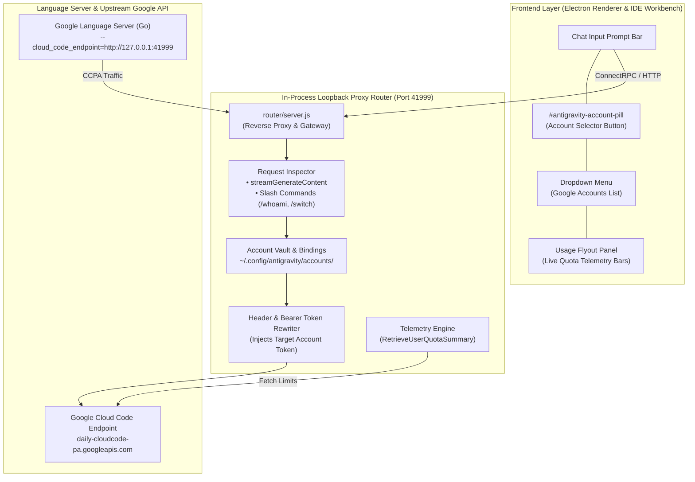

# Antigravity Suite Manager

[](LICENSE)
[](#platform-compatibility--requirements)
[](#platform-compatibility--requirements)
[](#-flagship-feature-per-chat-multi-account-selector-app--ide)
[](#-live-quota-telemetry--usage-flyout)
[](#shared-chat-history--profile-isolation)
[](#architecture--profile-isolation)

A comprehensive Linux automation suite and advanced runtime engine for **Google Antigravity** (Desktop App) and **Antigravity IDE** (VS Code edition).

Runs on Ubuntu and Debian-based Linux distributions across GNOME, KDE Plasma, XFCE, Cinnamon, and all standard X11/Wayland desktop environments.

---

> ### 🌟 What Makes This Suite Unique?
> 
> **Seamless Per-Chat Multi-Account Switching inside BOTH the Desktop App and the IDE!**
> 
> You no longer need to log out, switch profiles, or run multiple heavy application windows just to switch Google accounts when one account hits its quota limit. With our **In-App Account Selector**, each conversation can be pinned to a completely different Google account with independent Gemini & Claude quotas, full real-time telemetry, and instant `/switch` slash commands.

---

## ⚡ Quick Install

Install the complete Antigravity Suite (Multi-Account Selector, App, IDE, 3-Way Sync, RTL, and CLI tools) in one command:

```bash
curl -fsSL https://raw.githubusercontent.com/RezaRashidi/antigravity-suite-manager/main/install.sh | bash
```

To install non-interactively with default options:

```bash
curl -fsSL https://raw.githubusercontent.com/RezaRashidi/antigravity-suite-manager/main/install.sh | bash -s -- -y
```

Or clone and run locally:

```bash
git clone https://github.com/RezaRashidi/antigravity-suite-manager.git
cd antigravity-suite-manager
./install.sh
```

To update an existing installation anytime:

```bash
~/manage-antigravity.sh update
```

Launch the interactive Control Center dashboard:

```bash
~/manage-antigravity.sh center
```

---

## 🎯 Flagship Feature: Per-Chat Multi-Account Selector (App & IDE)

The **Multi-Account Selector subsystem** solves the #1 limitation of Google Antigravity: **strict single-account lock-in and quota exhaustion bottlenecks**.

```
+-----------------------------------------------------------------------------------+
|               Antigravity Desktop App / Antigravity IDE (VS Code)                 |
|                                                                                   |
|  +-----------------------------------------------------------------------------+  |
|  | Chat Input Prompt Bar                                                       |  |
|  | [Model: Gemini 1.5 Pro ▼]  [@ Account: user1@gmail.com ▼]  [ Send ➤ ]        |  |
|  +-------------------------------------------+---------------------------------+  |
|                                              | Click to switch account            |
|                                              v                                    |
|                       +-----------------------------------------------+           |
|                       |  Google Accounts (Per-Chat Binding)           |           |
|                       |  -------------------------------------------  |           |
|                       |  ● user1@gmail.com       [✓ Active]  [Usage ›]|           |
|                       |  ○ user2@work.com                    [Usage ›]|           |
|                       |  ○ user3@client.com                  [Usage ›]|           |
|                       |  -------------------------------------------  |           |
|                       |  [ + Add Account ]              [ Refresh ]   |           |
|                       +----------------------+------------------------+           |
|                                              | Hover "Usage ›"                    |
|                                              v                                    |
|                       +-----------------------------------------------+           |
|                       |  Usage Limits (Live Quota Telemetry)          |           |
|                       |  -------------------------------------------  |           |
|                       |  Gemini Models:                               |           |
|                       |  [████████████████░░░░] 78% (Resets in 2d 4h) |           |
|                       |  Claude & GPT Models:                         |           |
|                       |  [████████████████████] 100% (5h limit fresh) |           |
|                       |  -------------------------------------------  |           |
|                       |  [ Log Out ]                                  |           |
|                       +-----------------------------------------------+           |
+-----------------------------------------------------------------------------------+
```

### 1. 🔀 Granular Per-Conversation Account Binding
- **Per-Chat Independence**: Bind Conversation A to `user1@gmail.com`, Conversation B to `user2@gmail.com`, and Conversation C to `client@company.com`.
- **Zero Window Juggling**: Switch accounts in 1 click right next to the model selector trigger. No application reboots, no browser re-authentications.
- **Persistent State**: Conversation bindings (`cascadeId` -> `email`) are saved in `~/.config/antigravity/accounts/bindings.json` and persist across application restarts.

### 2. 📊 Live Quota Telemetry & Usage Flyout
- **Hover to Inspect**: Hover over **Usage ›** next to any account in the dropdown to instantly view real-time quota telemetry bars.
- **Dual SLA Monitoring**:
  - **Gemini Models**: Real-time remaining percentage and weekly/5-hour reset timers.
  - **Claude and GPT Models**: Independent quota percentages and proactive warning alerts when Claude 5-hour rate limits are reached.
- **Account Tier Badging**: Displays live badge status (`PRO`, `FREE`, `EXHAUSTED`, `NO LICENSE`).

### 3. 💬 In-Chat Slash Commands
Automate account management directly from your keyboard without touching the mouse:

| Slash Command | Purpose |
| :--- | :--- |
| `/whoami` | Displays the active Google account, conversation binding, and quota status for the current chat session. |
| `/accounts` | Lists all registered accounts in your vault, primary status, and real-time remaining quota percentages. |
| `/switch <id\|email>` | Immediately switches and binds the current conversation to another account (e.g., `/switch 2` or `/switch work@gmail.com`). |

> [!NOTE]
> The slash commands are automatically indexed by Antigravity's chat autocomplete system via skills installed in `~/.gemini/config/skills/` and `~/.gemide/config/skills/`.

### 4. ⚡ Seamless Loopback Proxy Router (`127.0.0.1:41999`)
- Transparent in-process loopback HTTP/SSE reverse proxy running between the client UI, Language Server, and Google's backend (`daily-cloudcode-pa.googleapis.com`).
- **Dynamic Token Rewriting**: Inspects every `streamGenerateContent` request, identifies the active conversation (`cascadeId`), and injects the corresponding account's Google Bearer token.
- **Official Consumer Scopes**: Uses official Antigravity consumer OAuth client credentials (`1071006060591-...`) to ensure full entitlement for personal Gmail and Google One AI Premium users.

### 5. 🔒 Singleton Background OAuth CLI Daemon
- **Unified Login Lock (`login.pid`)**: When initiating account login via the UI (`+ Add Account`) or CLI, the suite acquires a cross-process lock (`~/.config/antigravity/accounts/login.pid`).
- **Zero Collision Between App & IDE**: If login is triggered in the Desktop App while the IDE is running (or vice-versa), only a single background OAuth listener spins up, preventing duplicate processes and callback port conflicts.
- **180-Second Stale Lock Auto-Recovery**: If a previous login process was interrupted, abandoned, or killed abruptly, stale locks older than 180 seconds are automatically reclaimed without blocking new logins.

### 6. 🌐 Network Telemetry Isolation & Error Resilience
- **HostBridge Exclusion**: The in-process proxy router deliberately excludes internal Electron communication channels (specifically `HostBridgeServer` on port `39967`) and restricts port scans.
- **Zero `write EPIPE` Crashes**: Prevents unexpected socket resets or broken pipes when internal IPC servers drop unhandled probes, guaranteeing 100% stable background telemetry even across intermittent internet drops.

---

## 🚀 Key Features at a Glance

### 1. 🛡️ Per-Chat Multi-Account Selector (App & IDE)
- Integrated into both **Antigravity Desktop App** (`app.asar`) and **Antigravity IDE** (`workbench.desktop.main.js`).
- Dynamic viewport anchoring: dropdown and flyout menus automatically reposition during window resize and scroll.
- Decoupled from GNOME Keyring: stores tokens in a clean, headless-safe JSON vault with automated token rotation.

### 2. 🔄 3-Way Unified Chat History & Cross-Instance Brain Synchronization
- **Universal Conversation Continuity**: All chat history, active conversations, SQLite summaries, and brain artifacts are symlinked across App 1, App 2, custom instances, and Antigravity IDE.
- **SQLite WAL Safety**: Operates via SQLite Write-Ahead Logging (`.db-wal`), enabling concurrent multi-process access without database locks or corruption.

### 3. 🖥️ Taskbar De-Grouping & Multi-Instance Engine
- **Independent Window Identity**: Overrides Electron's default `WM_CLASS` to bind each instance to its own unique identifier (`antigravity-1`, `antigravity-2`, `antigravity-ide`).
- **Runtime X11 Window Injector**: Lightweight daemon (`antigravity-apply-icon.py`) dynamically synchronizes `_NET_WM_ICON` properties directly onto X11 window surfaces.

### 4. 🎨 C-Powered High-Resolution Icon Engine & Visual Theming
- **Catmull-Rom Bicubic Resampler**: Custom C scaler (`src/scale_icon.c`) with premultiplied alpha calculation, generating crisp icons from 16×16 tray up to 1024×1024 Retina/4K displays.
- **Theme Customization**: Black and White themes, plus hue-shift accent tinting (Violet glow) for secondary profiles.

### 5. 🔐 Dual-Mode Credential Decoupling (Keyring vs File Storage)
- **Freedom from GNOME Keyring**: Toggle between system GNOME Keyring (D-Bus Secret Service) and clean, headless-friendly Normal file storage (`--password-store=basic` + `jetski-standalone-oauth-token`).
- **Zero-Downtime Token Migration**: Automatically extracts active tokens when migrating from Keyring to Normal mode.

### 6. ✍️ First-Class Persian & Arabic RTL Typography
- **Automated RTL Integration**: Embedded patch from [antigravity-rtl](https://github.com/mmnaderi/antigravity-rtl) providing right-to-left layout and bidirectionality for Persian and Arabic text.
- **Vazirmatn Typography**: Injects premium Persian font rendering with a topbar toggle (`Alt+R` / `⌥R`).

### 7. 🔁 Manual F5 Backend Reload & Crash Resilience
- **Crash-Resilient F5 Reload**: Prevents jarring auto-restarts from breaking your active AI workflow. Hooks `F5` to trigger a clean webview reload on demand.

### 8. ⚙️ Universal Skills, Rules (`GEMINI.md`) & MCP Sync
- **Single Source of Truth**: Custom instructions (`GEMINI.md`), skills (`skills/`), agent rules, and MCP servers (`mcp_config.json`) are maintained in `~/.gemini` and unified across App and IDE.

### 9. 🌿 Experimental Conversation Forking (`conversationForking`)
- **Historical Branching**: Fork and branch conversations at any turn or step into the current workspace or an isolated Git worktree without affecting the original thread.
- **IDE Native Integration**: Automatically unlocks the `Fork Conversation` action button on assistant responses and the `Fork in current workspace` context menu option across `main.js`, `workbench.desktop.main.js`, and `jetskiAgent/main.js`.
- **Desktop App Enablement**: Activated via runtime experiment overrides (`enable-conversation-forking`, `enable-fork-in-new-worktree`, `enable-fork-at-historical-step`), backed directly by the Language Server's native `forkConversation` RPC engine.
- **Standalone Modular Patch**: Decoupled into its own independent CLI commands (`manage-antigravity.sh fork` / `unpatch-fork`) and Control Center option (`[J]`), with unwanted developer status bar footers cleanly eliminated.

---

## 📖 Multi-Account Selector Guide

### Applying the Selector Patch

The Account Selector patch is automatically applied during `./install.sh`. You can also manage or re-apply it manually at any time:

```bash
# Apply / Re-apply selector patch to both App and IDE
~/manage-antigravity.sh selector

# Re-apply with force overwrite (useful after Antigravity updates)
FORCE_INSTALL=true ~/manage-antigravity.sh selector

# Revert the selector patch (restores clean original files)
~/manage-antigravity.sh unpatch-selector
```

### Adding and Managing Accounts

#### Via the GUI (Recommended):
1. Open Antigravity App or Antigravity IDE.
2. In any chat window, locate the account pill button next to the model trigger (e.g. `user1 ▼`).
3. Click the pill button to open the dropdown menu.
4. Click **`+ Add Account`**.
5. Your default web browser will open to Google's sign-in page.
6. Sign in with your secondary Google account.
7. Upon successful login, you'll see a green **Connected!** page. The new account will immediately appear in your selector list with full quota telemetry!

#### Via CLI:
```bash
# Add a new Google account via CLI loopback
~/manage-antigravity.sh multi-account login

# List all registered vault accounts, primary status, and real-time quotas
~/manage-antigravity.sh multi-account list

# Remove an account from vault
~/manage-antigravity.sh multi-account logout user@gmail.com

# Bind a specific conversation to an account
~/manage-antigravity.sh multi-account bind <cascadeId> user@gmail.com

# Output complete multi-account state as JSON
~/manage-antigravity.sh multi-account json
```

### Live Traffic & Token Swapping Monitor

You can monitor real-time request routing, conversation detection, and Bearer token swapping as you chat:

```bash
~/manage-antigravity.sh trace
```

Sample live output:
```text
[2026-10-22T08:15:20Z] ChatGen: [bf1cc9dc-...] -> Account: [user1@gmail.com] | token: ...kQuA02 | Path: /v1internal:streamGenerateContent?alt=sse
[2026-10-22T08:15:21Z] ChatGen: [bf1cc9dc-...] <- Upstream Response: 200
[2026-10-22T08:15:45Z] [QUOTA] [user1@gmail.com] HTTP 200 | Buckets: 4
[2026-10-22T08:16:10Z] ChatGen: [e0e1533f-...] -> Account: [work@gmail.com]  | token: ...7hBGki | Path: /v1internal:streamGenerateContent?alt=sse
[2026-10-22T08:16:11Z] ChatGen: [e0e1533f-...] <- Upstream Response: 200
```

### 🌿 Experimental Conversation Forking Guide

With conversation forking enabled, you can branch an existing chat at any point in its history to explore alternate directions or test code changes without losing the original conversation.

```
                    ┌── Turn 1 ── Turn 2 ── Turn 3 (Original Conversation continues)
Main Conversation ──┤
                    └── [Fork Button] ── Turn 3b (Alternate Fork in Current Workspace)
```

#### Dedicated Standalone Patch Commands:
Forking is decoupled into its own independent, toggleable patch module:
```bash
# Apply conversation forking patch to both App & IDE
./bin/manage-antigravity.sh fork

# Apply selectively to App or IDE
./bin/manage-antigravity.sh fork app
./bin/manage-antigravity.sh fork ide

# Revert / Unpatch conversation forking
./bin/manage-antigravity.sh unpatch-fork
./bin/manage-antigravity.sh unpatch-fork app
./bin/manage-antigravity.sh unpatch-fork ide

# Or manage interactively via Control Center:
./bin/manage-antigravity.sh center    # Select [J] Conversation Forking
```

#### Where the Fork Controls Appear:
1. **Turn Response Action Bar**: Next to the standard *Copy* and *Thumbs Up/Down* feedback buttons on assistant responses, a **Fork Conversation** icon button (`aria-label: Fork Conversation`) will appear.
2. **Conversation Context Menu**: Right-clicking a conversation in the history or sidebar exposes **"Fork in current workspace"**.

#### Architecture & Activation Details:
- **Standalone Patcher**: Decoupled into `bin/lib/sh/patch_fork.sh`, `bin/antigravity-fork-patch.js`, and `bin/lib/patch/patch_conversation_forking.js`.
- **IDE Activation**: Unlocks the React gating conditions (`conversationForking.enabled`) in `main.js`, `vs/workbench/workbench.desktop.main.js`, and `jetskiAgent/main.js`, automatically maintaining `product.json` integrity and checksums.
- **Desktop App Activation**: Configures early main-world flags via Electron `webFrame` in `preload.js` and seeds `jetski.developer.customFlagOverrides` (`enable-conversation-forking`, `enable-fork-in-new-worktree`, `enable-fork-at-historical-step`).
- **Clean UI (No Developer Status Bar)**: Prevents and suppresses the unwanted bottom developer status bar ("Reset State") using multi-tier styling and DOM lifecycle guards (`preload.js` isolated style injection, `styles.css`, and `mount.js`).
- **Language Server Backend**: The underlying language server binary handles `forkConversation` natively, cloning the trajectory metadata, step sequence, and workspace context cleanly.

---

## 👥 Multi-Instance Cloning & Cross-Clone Synchronization

Beyond per-chat account switching, Antigravity Suite Manager features an **Unlimited Multi-Instance Cloning Engine** that lets you run multiple independent Antigravity App and IDE windows side-by-side with independent system tray icons, distinct taskbar entries, and automated real-time history synchronization.

```
+-----------------------------------------------------------------------------------+
|                        Multi-Instance & Clone Topology                            |
|                                                                                   |
|  +--------------------+   +--------------------+   +---------------------------+  |
|  | Antigravity App 1  |   | Antigravity App 2  |   | Antigravity IDE (VS Code) |  |
|  | (Primary Profile)  |   | (Custom Violet Glow)|   | (Code Edition)            |  |
|  | WM_CLASS:          |   | WM_CLASS:          |   | WM_CLASS:                 |  |
|  | antigravity-1      |   | antigravity-2      |   | antigravity-ide           |  |
|  +---------+----------+   +---------+----------+   +-------------+-------------+  |
|            |                        |                            |                |
|            |                        v                            |                |
|            |              +--------------------+                 |                |
|            |              | App Clone 3 / Work |                 |                |
|            |              | (Amber Orange Glow)|                 |                |
|            |              +---------+----------+                 |                |
|            |                        |                            |                |
|            +-------------------+----+----------------------------+                |
|                                |                                                  |
|                                v                                                  |
|  +-----------------------------------------------------------------------------+  |
|  | Real-Time Cross-Instance History Synchronization Engine                    |  |
|  | - SQLite WAL Mode (.db-wal) Multi-Process Concurrency                       |  |
|  | - Quad-Phase History Merger Daemon (antigravity-merge-history.py --watch)  |  |
|  | - Unified Conversation Summaries DB & Brain Artifacts Topology              |  |
|  | - Step 23 Checkpoint Synchronization & Fallback Title Guard                 |  |
|  +-----------------------------------------------------------------------------+  |
+-----------------------------------------------------------------------------------+
```

### 1. Creating and Cloning Instances

Clone any App or IDE instance with an interactive wizard or a single command:

```bash
# Launch the interactive instance creation wizard:
~/manage-antigravity.sh create-instance
# Alias: ~/manage-antigravity.sh add

# Or via the Control Center dashboard:
~/manage-antigravity.sh center    # Select [C] Clone / Add New Instance
```

#### What the Cloning Engine Configures:
1. **Target Type**: Choose between **Antigravity App** (Desktop Electron app) or **Antigravity IDE** (VS Code fork).
2. **Auto-Incrementing ID or Custom Name**: Automatically suggests the next numeric counter (e.g., `3`, `4`) or accepts custom named profiles (e.g., `work`, `client-a`).
3. **History Synchronization Mode**:
   - **Shared Mode (`--shared`, Default)**: Connects the clone to the universal conversation mesh. Any conversation created or updated in Clone 1, Clone 2, or IDE is instantly mirrored and queryable across all instances!
   - **Isolated Mode (`--isolated`)**: Gives the clone a private, quarantined conversation database and brain directory (ideal for confidential client work).
4. **Visual Accent Themes & Glows**: Choose custom Catmull-Rom resampled icon glows so you instantly identify running windows on your dock:
   - Violet / Magenta (0.52)
   - Emerald Green (0.33)
   - Amber Orange (0.12)
   - Royal Sapphire Blue (0.60)
   - Ruby Rose (0.85)
   - Cyan / Teal (0.45)
5. **Taskbar De-Grouping (`WM_CLASS`)**: Generates custom `.desktop` launchers and assigns unique window classes (`antigravity-app-<id>`, `antigravity-ide-<id>`) so GNOME and Ubuntu Dock never collapse distinct clones into one group.

### 2. Managing Clones and Profiles

```bash
# List all active App and IDE instances, history modes, and profiles:
~/manage-antigravity.sh list-instances

# Toggle an instance's history mode between shared and isolated:
~/manage-antigravity.sh set-history <instance-id> [shared|isolated]

# Delete an instance and cleanly archive its profile:
~/manage-antigravity.sh remove-instance <instance-id>
```

### 3. Background Synchronization Engine (`antigravity-merge-history.py`)

When running in **Shared Mode**, cross-instance synchronization is handled by the **Quad-Phase History Merger Daemon**:
- **SQLite WAL Concurrency**: All SQLite reads and writes use Write-Ahead Logging (`.db-wal`), completely eliminating locked database errors.
- **Background Daemon (`--watch`)**: Runs silently via systemd user service (`antigravity-history-sync.service`), monitoring changes across all instance roots.
- **Step 23 Checkpoint Sync**: Prevents authentic IDE chat titles from being polluted by generic fallback titles when switching between App and IDE.
- **Singleton Lock Protection**: Uses `/tmp/antigravity_history_merger.lock` to prevent CPU-intensive daemon races.

---

## 🔬 Diagnostics, Benchmarking & Disaster Recovery

### 1. AI Latency & Context Bloat Benchmark

Diagnose network latency, proxy overhead, and per-step response intervals across your Antigravity setup:

```bash
# Run standard latency benchmark:
~/manage-antigravity.sh benchmark

# View per-message step intervals and token throughput:
~/manage-antigravity.sh benchmark --all-steps

# Output benchmark results as structured JSON:
~/manage-antigravity.sh benchmark --json
```

Measures:
- IPv4/IPv6 and HTTP/HTTPS proxy latency against Google Cloud Code endpoints.
- Message input character volume vs output token generation throughput.
- Per-message turnaround speed and step latency breakdown.

### 2. Leaked Session Splicer & Conversation Restoration

In the rare event of a sudden machine crash or concurrent session leakage across conversation boundaries, use the **Leaked Session Splicer** to surgically rescue and transplant conversation steps:

```bash
# Dry-run inspection (simulates step migration without modifying files):
python3 scripts/splice_leaked_session.py

# Live execution with automated pre-flight snapshot backup:
python3 scripts/splice_leaked_session.py --execute
```

This tool:
- Surgically migrates SQLite rows from `<source_cid>.db` into `<target_cid>.db`.
- Re-indexes step ordering to guarantee contiguous `step_index` sequences.
- Transplants transcript logs (`transcript.jsonl` and `transcript_full.jsonl`) with proper offset shifting.
- Migrates associated background task logs (`.system_generated/tasks/`).
- Atomically updates master step counts in `conversation_summaries.db`.

### 3. Oversized Conversation Compactor

When deep conversations grow beyond tens of thousands of steps, UI rendering and model serialization can suffer latency. The **Conversation Compactor** (`scripts/compact_conversation.py`) archives older historical turns into timestamped safety backups while promoting an authentic compaction checkpoint into the active conversation base:

```bash
# Dry-run inspection of compaction boundaries:
python3 scripts/compact_conversation.py --cid <conversation-id> --base-step <start-step>

# Live execution with automated pre-compact backup:
python3 scripts/compact_conversation.py --cid <conversation-id> --base-step <start-step> --execute
```


---

## 🛠️ Suite Management CLI Reference

```bash
~/manage-antigravity.sh [command] [options]
```

| Command | Alias | Description |
| :--- | :--- | :--- |
| `center` | `menu`, `--menu` | Open the interactive Antigravity Control Center dashboard |
| `selector` | `patch-selector` | Apply the prompt-bar Account Selector patch to App & IDE |
| `unpatch-selector` | | Revert Account Selector patch |
| `multi-account` | `accounts` | Manage connected Google accounts, quotas & chat bindings |
| `trace` | `traffic` | Stream live multi-account request routing and token swaps |
| `detect` | `scan`, `find` | Scan filesystem and discover all installed Antigravity instances |
| `paths` | `engines` | Interactive installation path selector and engine target switcher |
| `install [all\|app\|ide]` | | Download and cleanly install Antigravity binaries |
| `update` | | Smart update all components (preserves user data & re-applies patches) |
| `merge-history` | `merge` | Sync & backfill conversation history across all profiles/IDEs |
| `keyring` | `creds` | Configure & switch credential storage (GNOME Keyring vs Normal File Storage) |
| `set-icons` | `icons` | Configure or re-apply icons (Black/White and Acc 2 Recolor) |
| `f5` | | Apply manual F5 reload sync patch |
| `rtl` | | Apply / re-apply Persian & Arabic RTL patch |
| `create-instance` | `add` | Create arbitrary App or IDE instances with shared/isolated history |
| `list-instances` | `list` | Show all created App and IDE instances and their status |
| `remove-instance` | `remove` | Delete an instance and cleanly archive its profile |
| `benchmark` | `bench` | Benchmark AI response latency, IPv6/proxy ping, and context bloat |
| `backups` | | Manage safety backups (list, create, restore) |

---

## 🏗️ Architecture & Data Flow



### Profile & History Storage Topology

| Storage Area | Antigravity App (Primary) | Antigravity App (Profile 2) | Antigravity IDE (VS Code) | Shared Strategy |
| :--- | :--- | :--- | :--- | :--- |
| **Conversations** | `~/.gemini/antigravity/conversations` | `~/.antigravity-profile2/.../conversations` | `~/.gemini/antigravity-ide/conversations` | Symlinked (Shared 3-Way) |
| **Summaries Index** | `~/.gemini/antigravity/conversation_summaries.db` | `~/.antigravity-profile2/.../conversation_summaries.db` | `~/.gemini/antigravity-ide/conversation_summaries.db` | Symlinked (Shared 3-Way) |
| **Brain Artifacts** | `~/.gemini/antigravity/brain` | `~/.antigravity-profile2/.../brain` | `~/.gemini/antigravity-ide/brain` | Symlinked (Shared 3-Way) |
| **Custom Skills** | `~/.gemini/config/skills` | `~/.antigravity-profile2/.../skills` | `~/.gemide/config/skills` | Unified Symlinks |
| **Account Vault** | `~/.config/antigravity/accounts` | `~/.config/antigravity/accounts` | `~/.config/antigravity/accounts` | Shared Vault Root |
| **Active Session** | `~/.config/Antigravity` | `~/.antigravity-profile2/.config/Antigravity` | `~/.config/Antigravity IDE` | Quarantined / Isolated |

---

## 📚 Technical Documentation Catalog

For deep engineering specifications, wire protocols, database schemas, and forensics investigations:

* **[Forensics & Debugging Guide](docs/forensics/README.md)** (`docs/forensics/`):
  26 detailed incident investigations covering Protobuf tag parsing, ConnectRPC loopbacks, 2027y timestamp fixes, OAuth client collision resolutions, cross-conversation session splicing, and Language Server checkpoint hooks.
* **[Storage Architecture & Specifications](docs/architecture/README.md)** (`docs/architecture/`):
  13 architectural specifications covering process mapping, directory taxonomies, SQLite wire protocols, Protobuf reflection, and multi-account selector internals ([Chapter 12](docs/architecture/12_multi_account_selector_architecture.md)).

---

## Platform Compatibility & Requirements

- **Supported OS**: Ubuntu Linux (strictly validated on **Ubuntu 24.04 LTS**, Debian 12+)
- **Desktop Environments**: GNOME Shell, KDE Plasma, XFCE, Cinnamon, MATE, Dash to Panel, etc.
- **Display Server**: X11 or Wayland (with XWayland)
- **Architecture**: `x86_64` (amd64)
- **Prerequisites**: `bash` (4.0+), `python3`, `node` (18+), `gcc`, `make`, `curl`

---

## License

This project is licensed under the **MIT License**. See the [LICENSE](LICENSE) file for details.
