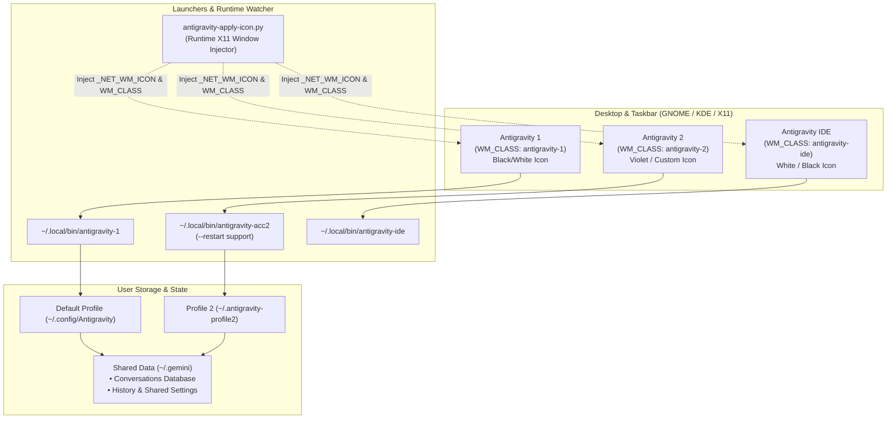

# Antigravity Suite Manager

[](LICENSE)
[](#platform-compatibility--requirements)
[](#platform-compatibility--requirements)
[](#shared-chat-history--profile-isolation)
[](#architecture--profile-isolation)

A comprehensive Linux automation suite for **Google Antigravity** and **Antigravity IDE**.

Provides seamless multi-instance profile isolation (Account 1, Account 2, & Antigravity IDE), taskbar de-grouping, high-resolution theme customization, dynamic release discovery, persistent archive caching, automated RTL (Right-to-Left) typography support, and manual F5 reload patching.

> [!IMPORTANT]
> **Platform Restriction**: This suite is built **exclusively for Ubuntu Linux** and has been **strictly tested on Ubuntu 24.04 LTS (Noble Numbat)**. Other distributions are not supported.

> [!NOTE]
> **Shared Chat History Across All 3 Instances**: While Account 1 (App), Account 2 (App), and Antigravity IDE use completely isolated authentication keyrings, cookies, and secret stores (allowing three distinct Google accounts to run concurrently without session conflicts), **all chat history, previous conversations, database logs, and workspace sessions are shared 3-way across all instances**. Any conversation created in App 1 or App 2 is immediately accessible in Antigravity IDE, and vice versa.

---

## Table of Contents

- [Overview](#overview)
- [Key Features](#key-features)
- [Platform Compatibility & Requirements](#platform-compatibility--requirements)
- [Architecture & Profile Isolation](#architecture--profile-isolation)
- [Shared Chat History & Profile Isolation](#shared-chat-history--profile-isolation)
- [Quick Start](#quick-start)
- [Usage & Commands](#usage--commands)
  - [Status Inspection](#status-inspection)
  - [Smart Updates & Caching](#smart-updates--caching)
  - [Customizing Icon Themes & Recolor](#customizing-icon-themes--recolor)
  - [Component-Level Commands](#component-level-commands)
- [Configuration](#configuration)
- [Taskbar De-Grouping & Window Management](#taskbar-de-grouping--window-management)
- [Patches Included](#patches-included)
  - [Persian / Arabic RTL Support](#persian--arabic-rtl-support)
  - [Manual F5 Reload Patch](#manual-f5-reload-patch)
- [Project Structure](#project-structure)
- [Contributing](#contributing)
- [License](#license)

---

## Overview

Running Google Antigravity on Linux in production workflows often encounters three major hurdles:

1. **Multi-Account Conflicts**: Running two simultaneous Antigravity instances (e.g. personal vs. work/client) causes single-instance Electron lockups and keyring authentication overwrites.
2. **Taskbar Grouping Collisions**: Desktop environments (GNOME Shell, Dash to Panel) group all instances under a single taskbar icon because they share the underlying binary executable.
3. **Typography & Auto-Reload Issues**: Lack of native RTL support for Persian/Arabic text and background auto-reload events interrupting active chat sessions.

**Antigravity Suite Manager** resolves these issues natively without container overhead.

---

## Key Features

- **Dual Isolated Accounts with Shared Chats**: Run Account 1 and Account 2 concurrently with distinct keyrings, isolated credentials, yet **100% shared chat history and conversation databases**.
- **Ubuntu 24.04 LTS Native**: Tailored specifically for Ubuntu 24.04 and GNOME Shell environment.
- **Side-by-Side Antigravity IDE**: Automated installation, configuration, and desktop integration for the VS Code-based Antigravity IDE.
- **Taskbar De-Grouping**: Enforces unique `WM_CLASS` identifiers (`antigravity-1`, `antigravity-2`, `antigravity-ide`) so docks and taskbars maintain separate entries.
- **High-Resolution Icon Engine**: High-performance Catmull-Rom bicubic resampler written in C with premultiplied alpha to produce razor-sharp icons (`16x16` up to `1024x1024`).
- **Configurable Themes**: Select White or Black base icons for any app, plus an optional Violet/Magenta recoloring glow for Account 2.
- **Dynamic Release Discovery**: Queries Google's official endpoints to detect the latest versions without hardcoding release URLs.
- **Zero-Waste Archive Cache**: Caches tarballs in `/tmp/antigravity-cache` to avoid repeated multi-hundred-megabyte downloads.
- **Automated RTL Patch**: Integrates [antigravity-rtl](https://github.com/mmnaderi/antigravity-rtl) for proper Persian and Arabic text rendering.
- **Manual F5 Reload**: Binds manual reload to F5 and disables intrusive background auto-restarts.

---

## Architecture & Profile Isolation



---

## Platform Compatibility & Requirements

> [!CAUTION]
> **Strict Platform Target**: This suite is built **exclusively for Ubuntu Linux** and is **only tested and verified on Ubuntu 24.04 LTS (Noble Numbat)** with X11 / GNOME Shell. Running on other distributions (Debian, Fedora, Arch) or pure Wayland without XWayland is untested and not supported.

- **Supported OS**: **Ubuntu Linux 24.04 LTS** (Noble Numbat)
- **Desktop Environment**: GNOME Shell / Dash to Panel / Ubuntu Desktop
- **Display Server**: X11 (Required for live `_NET_WM_ICON` injection and `WM_CLASS` runtime de-grouping)
- **Architecture**: `x86_64` (amd64)
- **Dependencies**:
  - `bash` (4.0+)
  - `python3`
  - `gcc` & `make` (to compile the C Catmull-Rom bicubic scaler)
  - `curl` or `wget`
  - `tar` & `gzip`
  - `x11-utils` (`xprop`, `xwininfo`)

---

## Shared Chat History & Profile Isolation

The suite solves the primary dilemma of multi-account AI pairing: **independent authentication without losing conversation context**.

### Why 3 Accounts Never Conflict:
1. **App 1 (Default Profile)**:
   - Electron stores cookies and OAuth refresh tokens in `~/.config/Antigravity`.
   - Credentials are encrypted via the host system's GNOME Keyring schema (`antigravity`).
2. **App 2 (Secondary Profile)**:
   - Runs with an isolated environment `HOME=~/.antigravity-profile2`.
   - Keyring fallback is triggered by `~/.antigravity-profile2/.gemini/cache/antigravity-keyring-unavailable`.
   - All session state and tokens are strictly stored inside `~/.antigravity-profile2/.config/Antigravity`.
3. **Antigravity IDE (VS Code Edition)**:
   - A distinct VS Code / Code OSS fork with configuration root at `~/.config/Antigravity IDE`.
   - Credentials and tokens are managed exclusively by VS Code's SecretStorage service (`Antigravity IDE`).
   - Completely independent from Electron App 1 & App 2 authentication storage.

### 3-Way Unified History Architecture:
While authentication tokens and keyring secrets are strictly siloed, all 3 applications share the same underlying conversation databases and brain artifacts:
- **Conversations Storage**:
  - App 1: `~/.gemini/antigravity/conversations/`
  - App 2: `~/.antigravity-profile2/.gemini/antigravity/conversations` (symlinked)
  - Antigravity IDE: `~/.gemini/antigravity-ide/conversations` (symlinked)
- **Brain & Artifacts**:
  - `~/.gemini/antigravity-ide/brain` -> `~/.gemini/antigravity/brain`
- **Summaries & Search Index**:
  - `~/.gemini/antigravity-ide/conversation_summaries.db` -> `~/.gemini/antigravity/conversation_summaries.db`

> [!TIP]
> **Zero Data Overwrite**: When configuring the 3-way symlinks, the manager non-destructively merges any pre-existing conversations and brain directories using non-overwriting copy operations (`cp -a --update=none`) and preserves safety backups (`.bak`).
> **Concurrent Safe**: All conversation stores operate via SQLite WAL mode (`.db-wal`), enabling App 1, App 2, and IDE to read and append history concurrently without database locks.

---

## Quick Start

### 1. Clone the Repository

```bash
git clone https://github.com/<your-username>/antigravity-suite-manager.git
cd antigravity-suite-manager
```

### 2. Install the Suite

Run the automated installer:

```bash
./install.sh
```

Or build with `make`:

```bash
make
make install
```

The installer:
- Compiles `src/scale_icon.c` into `~/.local/bin/scale_icon`.
- Installs the management scripts to `~/.local/bin/`.
- Deploys master icon assets to `~/.local/share/icons/`.
- Symlinks `~/manage-antigravity.sh` for convenient access.

---

## Usage & Commands

```bash
~/manage-antigravity.sh [command] [options]
```

### Status Inspection

Inspect installed versions, latest available releases, download cache status, patch verification, and active icon themes:

```bash
~/manage-antigravity.sh status
```

Example output:
```text
========================================================================================
                    Antigravity Suite Version & Patch Inspection                        
========================================================================================
Target                 Installed    Latest Available  Status          RTL Patch   F5 Patch
----------------------------------------------------------------------------------------
Antigravity (Acc 1&2)  2.23.1       2.23.1            Up-to-date    Applied   Applied
Antigravity IDE        2.5.5        2.5.5             Up-to-date    Applied   N/A
----------------------------------------------------------------------------------------
Package Cache Status in /tmp/antigravity-cache:
  • Antigravity App:        Cached (124.5 MB)
  • Antigravity IDE:        Cached (188.2 MB)
----------------------------------------------------------------------------------------
Icon & Appearance Themes:
  • Antigravity (Acc 1):    Black Icon Theme
  • Antigravity (Acc 2):    Black Icon Theme | Violet/Magenta Glow (Recolored)
  • Antigravity IDE:        White Icon Theme
----------------------------------------------------------------------------------------
Environment & Permissions:
  • Account 2 Status:       Configured (Isolated Keyring + Shared History)
  • App Dir Ownership:      Writable by reza (Ready)
  • IDE Dir Ownership:      Writable by reza (Ready)
========================================================================================
```

---

### Smart Updates & Caching

Update everything (Apps, IDE, RTL patch, F5 patch) with version protection:

```bash
~/manage-antigravity.sh update
```

- If you already have the latest version installed, the script **skips re-downloading**.
- If download is required, it caches the archive in `/tmp/antigravity-cache`.
- To force an unconditional re-download and re-install:
  ```bash
  ~/manage-antigravity.sh update --force
  ```

---

### Customizing Icon Themes & Recolor

Configure icons interactively or via command-line flags:

#### Interactive Mode:
```bash
~/manage-antigravity.sh set-icons
```

#### Command-Line Flags:
```bash
# Set IDE to White, App 1 to Black, and enable Violet recolor for Account 2:
~/manage-antigravity.sh set-icons --ide-icon white --acc1-icon black --acc2-icon black --acc2-recolor true

# Disable Account 2 recoloring (keep original colors):
~/manage-antigravity.sh set-icons --acc2-recolor false
```

| Flag | Values | Description |
|---|---|---|
| `--acc1-icon` | `black` \| `white` | Base theme for Account 1 |
| `--acc2-icon` | `black` \| `white` | Base theme for Account 2 |
| `--acc2-recolor` | `true` \| `false` | Apply distinct Violet/Magenta recolor to Account 2 |
| `--ide-icon` | `white` \| `black` | Base theme for Antigravity IDE |

---

### Component-Level Commands

| Command | Action |
|---|---|
| `all` | Install/update both Antigravity Apps, IDE, F5 patch, and RTL |
| `app` | Install/update Antigravity App binaries only |
| `ide` | Install/update Antigravity IDE binaries only |
| `app1` | Re-generate Account 1 launchers and `.desktop` shortcuts |
| `app2` | Re-generate Account 2 isolated profile and single-instance launcher |
| `ide-shortcuts` | Re-generate Antigravity IDE `.desktop` shortcuts |
| `rtl` | Apply / re-apply Right-to-Left (RTL) patch to App & IDE |
| `update-rtl` | Fetch latest RTL patch from GitHub and apply |
| `f5` | Apply manual F5 reload backend sync patch |
| `clean-cache` | Clear downloaded archives in `/tmp/antigravity-cache` |

---

## Configuration

Preferences are stored in `~/.config/antigravity/icons.conf`:

```bash
# Antigravity Suite Icon Configuration
ACC1_ICON_THEME="black"
ACC2_ICON_THEME="black"
ACC2_RECOLOR="true"
IDE_ICON_THEME="white"
```

You can edit this file directly or use `manage-antigravity.sh set-icons`.

---

## Taskbar De-Grouping & Window Management

Standard desktop environments group windows by matching `WM_CLASS` to desktop files. Antigravity Suite Manager configures mutually distinct window classes:

- **Account 1**: `WM_CLASS="antigravity-1"` -> `antigravity-1.desktop`
- **Account 2**: `WM_CLASS="antigravity-2"` -> `antigravity-2.desktop`
- **Antigravity IDE**: `WM_CLASS="antigravity-ide"` -> `antigravity-ide.desktop`

A background daemon (`antigravity-apply-icon.py`) dynamically synchronizes X11 `_NET_WM_ICON` properties using multi-resolution Catmull-Rom resampled buffers (`16px` to `256px`) so window titles, alt-tab switchers, and taskbars display crisp graphics.

### Single-Instance Raising for Account 2

Launching Account 2 when already running automatically brings the existing window to focus instead of launching duplicate instances. To restart Account 2 cleanly:

```bash
~/.local/bin/antigravity-acc2 --restart
```
*(Or right-click Account 2 in your dock and choose **Restart Account 2**).*

---

## Patches Included

### Persian / Arabic RTL Support
Integrated via [mmnaderi/antigravity-rtl](https://github.com/mmnaderi/antigravity-rtl). Patches `app.asar` and IDE `main.js` to ensure Persian and Arabic code comments, prompts, and documentation render correctly right-to-left.

### Manual F5 Reload Patch
Disables automated background application restarts during inactivity, allowing the user to refresh the session manually via the **F5** key without losing chat history or window context.

---

## Project Structure

```text
antigravity-suite-manager/
├── bin/
│   ├── manage-antigravity.sh        # Core CLI management tool
│   ├── antigravity-generate-icons.py # Multi-res icon generator & theme engine
│   └── antigravity-apply-icon.py    # Runtime X11 window class & icon synchronizer
├── src/
│   └── scale_icon.c                 # Catmull-Rom bicubic image resampler (C)
├── assets/
│   ├── antigravity-master-black.png # Official 1024x1024 Black icon asset
│   └── antigravity-master-white.png # Official 1024x1024 White tray asset
├── install.sh                       # One-click installation script
├── Makefile                         # GNU Make build file
├── LICENSE                          # MIT License
└── README.md                        # Project documentation
```

---

## Contributing

Pull requests, bug reports, and suggestions are welcome!

1. Fork the repository.
2. Create your feature branch (`git checkout -b feature/cool-feature`).
3. Commit your changes (`git commit -m 'feat: add cool feature'`).
4. Push to the branch (`git push origin feature/cool-feature`).
5. Open a Pull Request.

---

## License

This project is licensed under the **MIT License**. See the [LICENSE](LICENSE) file for details.
