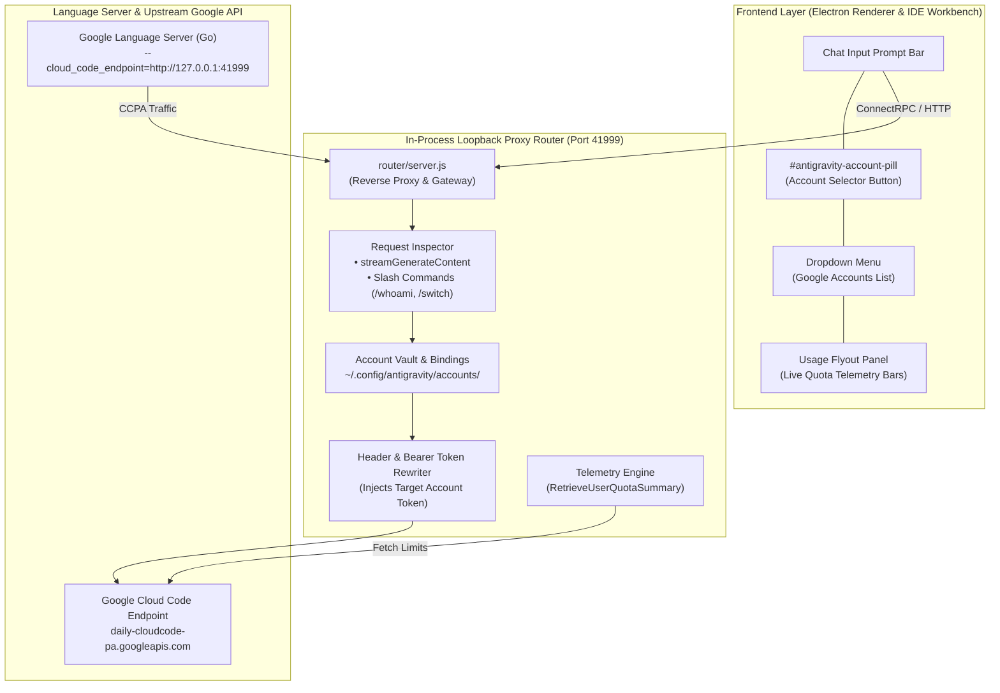

# Antigravity Suite Manager

[](LICENSE)
[](#platform-compatibility--requirements)
[](#platform-compatibility--requirements)
[](#-flagship-feature-per-chat-multi-account-selector-app--ide)
[](#-live-quota-telemetry--usage-flyout)
[](#shared-chat-history--profile-isolation)
[](#architecture--profile-isolation)

A comprehensive Linux automation suite and advanced runtime engine for **Google Antigravity** (Desktop App) and **Antigravity IDE** (VS Code edition).

Runs on Ubuntu and Debian-based Linux distributions across GNOME, KDE Plasma, XFCE, Cinnamon, and all standard X11/Wayland desktop environments.

---

> ### 🌟 What Makes This Suite Unique?
> 
> **Seamless Per-Chat Multi-Account Switching inside BOTH the Desktop App and the IDE!**
> 
> You no longer need to log out, switch profiles, or run multiple heavy application windows just to switch Google accounts when one account hits its quota limit. With our **In-App Account Selector**, each conversation can be pinned to a completely different Google account with independent Gemini & Claude quotas, full real-time telemetry, and instant `/switch` slash commands.

---

## ⚡ Quick Install

Install the complete Antigravity Suite (Multi-Account Selector, App, IDE, 3-Way Sync, RTL, and CLI tools) in one command:

```bash
curl -fsSL https://raw.githubusercontent.com/RezaRashidi/antigravity-suite-manager/main/install.sh | bash
```

To install non-interactively with default options:

```bash
curl -fsSL https://raw.githubusercontent.com/RezaRashidi/antigravity-suite-manager/main/install.sh | bash -s -- -y
```

Or clone and run locally:

```bash
git clone https://github.com/RezaRashidi/antigravity-suite-manager.git
cd antigravity-suite-manager
./install.sh
```

To update an existing installation anytime:

```bash
~/manage-antigravity.sh update
```

Launch the interactive Control Center dashboard:

```bash
~/manage-antigravity.sh center
```

---

## 🎯 Flagship Feature: Per-Chat Multi-Account Selector (App & IDE)

The **Multi-Account Selector subsystem** solves the #1 limitation of Google Antigravity: **strict single-account lock-in and quota exhaustion bottlenecks**.

```
+-----------------------------------------------------------------------------------+
|               Antigravity Desktop App / Antigravity IDE (VS Code)                 |
|                                                                                   |
|  +-----------------------------------------------------------------------------+  |
|  | Chat Input Prompt Bar                                                       |  |
|  | [Model: Gemini 1.5 Pro ▼]  [@ Account: user1@gmail.com ▼]  [ Send ➤ ]        |  |
|  +-------------------------------------------+---------------------------------+  |
|                                              | Click to switch account            |
|                                              v                                    |
|                       +-----------------------------------------------+           |
|                       |  Google Accounts (Per-Chat Binding)           |           |
|                       |  -------------------------------------------  |           |
|                       |  ● user1@gmail.com       [✓ Active]  [Usage ›]|           |
|                       |  ○ user2@work.com                    [Usage ›]|           |
|                       |  ○ user3@client.com                  [Usage ›]|           |
|                       |  -------------------------------------------  |           |
|                       |  [ + Add Account ]              [ Refresh ]   |           |
|                       +----------------------+------------------------+           |
|                                              | Hover "Usage ›"                    |
|                                              v                                    |
|                       +-----------------------------------------------+           |
|                       |  Usage Limits (Live Quota Telemetry)          |           |
|                       |  -------------------------------------------  |           |
|                       |  Gemini Models:                               |           |
|                       |  [████████████████░░░░] 78% (Resets in 2d 4h) |           |
|                       |  Claude & GPT Models:                         |           |
|                       |  [████████████████████] 100% (5h limit fresh) |           |
|                       |  -------------------------------------------  |           |
|                       |  [ Log Out ]                                  |           |
|                       +-----------------------------------------------+           |
+-----------------------------------------------------------------------------------+
```

### 1. 🔀 Granular Per-Conversation Account Binding
- **Per-Chat Independence**: Bind Conversation A to `user1@gmail.com`, Conversation B to `user2@gmail.com`, and Conversation C to `client@company.com`.
- **Zero Window Juggling**: Switch accounts in 1 click right next to the model selector trigger. No application reboots, no browser re-authentications.
- **Persistent State**: Conversation bindings (`cascadeId` -> `email`) are saved in `~/.config/antigravity/accounts/bindings.json` and persist across application restarts.

### 2. 📊 Live Quota Telemetry & Usage Flyout
- **Hover to Inspect**: Hover over **Usage ›** next to any account in the dropdown to instantly view real-time quota telemetry bars.
- **Dual SLA Monitoring**:
  - **Gemini Models**: Real-time remaining percentage and weekly/5-hour reset timers.
  - **Claude and GPT Models**: Independent quota percentages and proactive warning alerts when Claude 5-hour rate limits are reached.
- **Account Tier Badging**: Displays live badge status (`PRO`, `FREE`, `EXHAUSTED`, `NO LICENSE`).

### 3. 💬 In-Chat Slash Commands
Automate account management directly from your keyboard without touching the mouse:

| Slash Command | Purpose |
| :--- | :--- |
| `/whoami` | Displays the active Google account, conversation binding, and quota status for the current chat session. |
| `/accounts` | Lists all registered accounts in your vault, primary status, and real-time remaining quota percentages. |
| `/switch <id\|email>` | Immediately switches and binds the current conversation to another account (e.g., `/switch 2` or `/switch work@gmail.com`). |

> [!NOTE]
> The slash commands are automatically indexed by Antigravity's chat autocomplete system via skills installed in `~/.gemini/config/skills/` and `~/.gemide/config/skills/`.

### 4. ⚡ Seamless Loopback Proxy Router (`127.0.0.1:41999`)
- Transparent in-process loopback HTTP/SSE reverse proxy running between the client UI, Language Server, and Google's backend (`daily-cloudcode-pa.googleapis.com`).
- **Dynamic Token Rewriting**: Inspects every `streamGenerateContent` request, identifies the active conversation (`cascadeId`), and injects the corresponding account's Google Bearer token.
- **Official Consumer Scopes**: Uses official Antigravity consumer OAuth client credentials (`1071006060591-...`) to ensure full entitlement for personal Gmail and Google One AI Premium users.

---

## 🚀 Key Features at a Glance

### 1. 🛡️ Per-Chat Multi-Account Selector (App & IDE)
- Integrated into both **Antigravity Desktop App** (`app.asar`) and **Antigravity IDE** (`workbench.desktop.main.js`).
- Dynamic viewport anchoring: dropdown and flyout menus automatically reposition during window resize and scroll.
- Decoupled from GNOME Keyring: stores tokens in a clean, headless-safe JSON vault with automated token rotation.

### 2. 🔄 3-Way Unified Chat History & Cross-Instance Brain Synchronization
- **Universal Conversation Continuity**: All chat history, active conversations, SQLite summaries, and brain artifacts are symlinked across App 1, App 2, custom instances, and Antigravity IDE.
- **SQLite WAL Safety**: Operates via SQLite Write-Ahead Logging (`.db-wal`), enabling concurrent multi-process access without database locks or corruption.

### 3. 🖥️ Taskbar De-Grouping & Multi-Instance Engine
- **Independent Window Identity**: Overrides Electron's default `WM_CLASS` to bind each instance to its own unique identifier (`antigravity-1`, `antigravity-2`, `antigravity-ide`).
- **Runtime X11 Window Injector**: Lightweight daemon (`antigravity-apply-icon.py`) dynamically synchronizes `_NET_WM_ICON` properties directly onto X11 window surfaces.

### 4. 🎨 C-Powered High-Resolution Icon Engine & Visual Theming
- **Catmull-Rom Bicubic Resampler**: Custom C scaler (`src/scale_icon.c`) with premultiplied alpha calculation, generating crisp icons from 16×16 tray up to 1024×1024 Retina/4K displays.
- **Theme Customization**: Black and White themes, plus hue-shift accent tinting (Violet glow) for secondary profiles.

### 5. 🔐 Dual-Mode Credential Decoupling (Keyring vs File Storage)
- **Freedom from GNOME Keyring**: Toggle between system GNOME Keyring (D-Bus Secret Service) and clean, headless-friendly Normal file storage (`--password-store=basic` + `jetski-standalone-oauth-token`).
- **Zero-Downtime Token Migration**: Automatically extracts active tokens when migrating from Keyring to Normal mode.

### 6. ✍️ First-Class Persian & Arabic RTL Typography
- **Automated RTL Integration**: Embedded patch from [antigravity-rtl](https://github.com/mmnaderi/antigravity-rtl) providing right-to-left layout and bidirectionality for Persian and Arabic text.
- **Vazirmatn Typography**: Injects premium Persian font rendering with a topbar toggle (`Alt+R` / `⌥R`).

### 7. 🔁 Manual F5 Backend Reload & Crash Resilience
- **Crash-Resilient F5 Reload**: Prevents jarring auto-restarts from breaking your active AI workflow. Hooks `F5` to trigger a clean webview reload on demand.

### 8. ⚙️ Universal Skills, Rules (`GEMINI.md`) & MCP Sync
- **Single Source of Truth**: Custom instructions (`GEMINI.md`), skills (`skills/`), agent rules, and MCP servers (`mcp_config.json`) are maintained in `~/.gemini` and unified across App and IDE.

---

## 📖 Multi-Account Selector Guide

### Applying the Selector Patch

The Account Selector patch is automatically applied during `./install.sh`. You can also manage or re-apply it manually at any time:

```bash
# Apply / Re-apply selector patch to both App and IDE
~/manage-antigravity.sh selector

# Re-apply with force overwrite (useful after Antigravity updates)
FORCE_INSTALL=true ~/manage-antigravity.sh selector

# Revert the selector patch (restores clean original files)
~/manage-antigravity.sh unpatch-selector
```

### Adding and Managing Accounts

#### Via the GUI (Recommended):
1. Open Antigravity App or Antigravity IDE.
2. In any chat window, locate the account pill button next to the model trigger (e.g. `user1 ▼`).
3. Click the pill button to open the dropdown menu.
4. Click **`+ Add Account`**.
5. Your default web browser will open to Google's sign-in page.
6. Sign in with your secondary Google account.
7. Upon successful login, you'll see a green **Connected!** page. The new account will immediately appear in your selector list with full quota telemetry!

#### Via CLI:
```bash
# Add a new Google account via CLI loopback
~/manage-antigravity.sh multi-account login

# List all registered vault accounts, primary status, and real-time quotas
~/manage-antigravity.sh multi-account list

# Remove an account from vault
~/manage-antigravity.sh multi-account logout user@gmail.com

# Bind a specific conversation to an account
~/manage-antigravity.sh multi-account bind <cascadeId> user@gmail.com

# Output complete multi-account state as JSON
~/manage-antigravity.sh multi-account json
```

### Live Traffic & Token Swapping Monitor

You can monitor real-time request routing, conversation detection, and Bearer token swapping as you chat:

```bash
~/manage-antigravity.sh trace
```

Sample live output:
```text
[2026-10-22T08:15:20Z] ChatGen: [bf1cc9dc-...] -> Account: [user1@gmail.com] | token: ...kQuA02 | Path: /v1internal:streamGenerateContent?alt=sse
[2026-10-22T08:15:21Z] ChatGen: [bf1cc9dc-...] <- Upstream Response: 200
[2026-10-22T08:15:45Z] [QUOTA] [user1@gmail.com] HTTP 200 | Buckets: 4
[2026-10-22T08:16:10Z] ChatGen: [e0e1533f-...] -> Account: [work@gmail.com]  | token: ...7hBGki | Path: /v1internal:streamGenerateContent?alt=sse
[2026-10-22T08:16:11Z] ChatGen: [e0e1533f-...] <- Upstream Response: 200
```

---

## 🛠️ Suite Management CLI Reference

```bash
~/manage-antigravity.sh [command] [options]
```

| Command | Alias | Description |
| :--- | :--- | :--- |
| `center` | `menu`, `--menu` | Open the interactive Antigravity Control Center dashboard |
| `selector` | `patch-selector` | Apply the prompt-bar Account Selector patch to App & IDE |
| `unpatch-selector` | | Revert Account Selector patch |
| `multi-account` | `accounts` | Manage connected Google accounts, quotas & chat bindings |
| `trace` | `traffic` | Stream live multi-account request routing and token swaps |
| `detect` | `scan`, `find` | Scan filesystem and discover all installed Antigravity instances |
| `paths` | `engines` | Interactive installation path selector and engine target switcher |
| `install [all\|app\|ide]` | | Download and cleanly install Antigravity binaries |
| `update` | | Smart update all components (preserves user data & re-applies patches) |
| `merge-history` | `merge` | Sync & backfill conversation history across all profiles/IDEs |
| `keyring` | `creds` | Configure & switch credential storage (GNOME Keyring vs Normal File Storage) |
| `set-icons` | `icons` | Configure or re-apply icons (Black/White and Acc 2 Recolor) |
| `f5` | | Apply manual F5 reload sync patch |
| `rtl` | | Apply / re-apply Persian & Arabic RTL patch |
| `create-instance` | `add` | Create arbitrary App or IDE instances with shared/isolated history |
| `list-instances` | `list` | Show all created App and IDE instances and their status |
| `remove-instance` | `remove` | Delete an instance and cleanly archive its profile |
| `benchmark` | `bench` | Benchmark AI response latency, IPv6/proxy ping, and context bloat |
| `backups` | | Manage safety backups (list, create, restore) |

---

## 🏗️ Architecture & Data Flow



### Profile & History Storage Topology

| Storage Area | Antigravity App (Primary) | Antigravity App (Profile 2) | Antigravity IDE (VS Code) | Shared Strategy |
| :--- | :--- | :--- | :--- | :--- |
| **Conversations** | `~/.gemini/antigravity/conversations` | `~/.antigravity-profile2/.../conversations` | `~/.gemini/antigravity-ide/conversations` | Symlinked (Shared 3-Way) |
| **Summaries Index** | `~/.gemini/antigravity/conversation_summaries.db` | `~/.antigravity-profile2/.../conversation_summaries.db` | `~/.gemini/antigravity-ide/conversation_summaries.db` | Symlinked (Shared 3-Way) |
| **Brain Artifacts** | `~/.gemini/antigravity/brain` | `~/.antigravity-profile2/.../brain` | `~/.gemini/antigravity-ide/brain` | Symlinked (Shared 3-Way) |
| **Custom Skills** | `~/.gemini/config/skills` | `~/.antigravity-profile2/.../skills` | `~/.gemide/config/skills` | Unified Symlinks |
| **Account Vault** | `~/.config/antigravity/accounts` | `~/.config/antigravity/accounts` | `~/.config/antigravity/accounts` | Shared Vault Root |
| **Active Session** | `~/.config/Antigravity` | `~/.antigravity-profile2/.config/Antigravity` | `~/.config/Antigravity IDE` | Quarantined / Isolated |

---

## 📚 Technical Documentation Catalog

For deep engineering specifications, wire protocols, database schemas, and forensics investigations:

* **[Forensics & Debugging Guide](docs/forensics/README.md)** (`docs/forensics/`):
  25 detailed incident investigations covering Protobuf tag parsing, ConnectRPC loopbacks, 2027y timestamp fixes, OAuth client collision resolutions, and Language Server checkpoint hooks.
* **[Storage Architecture & Specifications](docs/architecture/README.md)** (`docs/architecture/`):
  13 architectural specifications covering process mapping, directory taxonomies, SQLite wire protocols, Protobuf reflection, and multi-account selector internals ([Chapter 12](docs/architecture/12_multi_account_selector_architecture.md)).

---

## Platform Compatibility & Requirements

- **Supported OS**: Ubuntu Linux (strictly validated on **Ubuntu 24.04 LTS**, Debian 12+)
- **Desktop Environments**: GNOME Shell, KDE Plasma, XFCE, Cinnamon, MATE, Dash to Panel, etc.
- **Display Server**: X11 or Wayland (with XWayland)
- **Architecture**: `x86_64` (amd64)
- **Prerequisites**: `bash` (4.0+), `python3`, `node` (18+), `gcc`, `make`, `curl`

---

## License

This project is licensed under the **MIT License**. See the [LICENSE](LICENSE) file for details.
