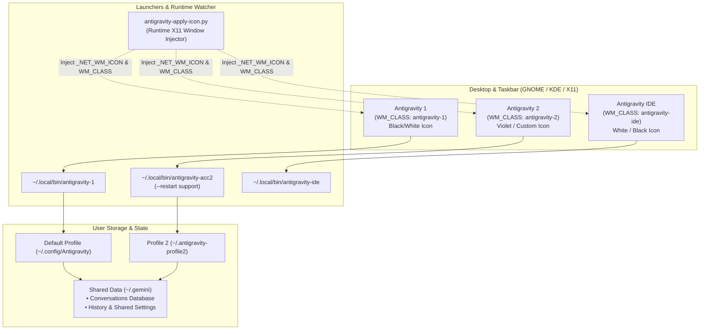

# Antigravity Suite Manager

[](LICENSE)
[](#platform-compatibility--requirements)
[](#platform-compatibility--requirements)
[](#shared-chat-history--profile-isolation)
[](#taskbar-de-grouping--window-management)
[](#architecture--profile-isolation)

A comprehensive Linux automation suite for **Google Antigravity** and **Antigravity IDE**.

Runs on any Debian-based Linux distribution (Ubuntu, Debian, Pop!_OS, Linux Mint, etc.) and any desktop environment that supports standard `.desktop` application launchers (GNOME, KDE Plasma, XFCE, Cinnamon, MATE, etc.).

Provides seamless multi-instance profile isolation (Account 1, Account 2, & Antigravity IDE), taskbar de-grouping, high-resolution theme customization, dynamic release discovery, persistent archive caching, automated RTL (Right-to-Left) typography support, and manual F5 reload patching.

> [!NOTE]
> **Shared Chat History Across All 3 Instances**: While Account 1 (App), Account 2 (App), and Antigravity IDE use completely isolated authentication keyrings, cookies, and secret stores (allowing three distinct Google accounts to run concurrently without session conflicts), **all chat history, previous conversations, database logs, and workspace sessions are shared 3-way across all instances**. Any conversation created in App 1 or App 2 is immediately accessible in Antigravity IDE, and vice versa.

---

## ⚡ Quick Install

Install the complete Antigravity Suite (App, IDE, 3-way sync, RTL, and management tools) in one command:

```bash
curl -fsSL https://raw.githubusercontent.com/RezaRashidi/antigravity-suite-manager/main/install.sh | bash
```

To install non-interactively with default options:

```bash
curl -fsSL https://raw.githubusercontent.com/RezaRashidi/antigravity-suite-manager/main/install.sh | bash -s -- -y
```

Or clone and run locally:

```bash
git clone https://github.com/RezaRashidi/antigravity-suite-manager.git
cd antigravity-suite-manager
./install.sh
```

To update an existing installation anytime:

```bash
./install.sh -u
# or via management tool:
~/manage-antigravity.sh update
```

Launch the interactive Control Center dashboard anytime:

```bash
~/manage-antigravity.sh center
```

---

## 🚀 Key Features at a Glance

Antigravity Suite Manager is engineered to make Google Antigravity and Antigravity IDE feel like first-class, production-ready desktop citizens on Linux:

### 1. 🛡️ Unlimited Multi-Account & Multi-Instance Engine (With Auto-Counter)
- **Concurrent Independent Execution**: Run personal, work, and client Google accounts simultaneously side-by-side without Electron single-instance locks or account eviction.
- **Dynamic Auto-Incrementing Counter**: `~/manage-antigravity.sh create-instance` automatically detects existing accounts and suggests the next numeric counter (e.g. `[default: 3]`). Arbitrary named profiles (`work`, `client-a`) are also supported.
- **Siloed Keyrings & Secret Stores**: App 1 binds to system GNOME Keyring, App 2 runs in an isolated profile directory (`~/.antigravity-profile2`), custom instances use `~/.antigravity-profile-app-<id>`, and Antigravity IDE leverages VS Code's internal `SecretStorage`.
- **Zero Cross-Contamination**: Cookies, OAuth refresh tokens, and active sessions are strictly quarantined per profile.

### 2. 🔄 3-Way Unified Chat History & Brain Artifacts
- **Universal Conversation Sync**: All chat history, active threads, conversation summaries, and brain artifacts are symlinked across App 1, App 2, custom accounts, and Antigravity IDE.
- **Seamless Context Continuity**: Initiate an AI pair programming session in App 1, continue discussing in App 2, or review generated code artifacts directly in Antigravity IDE.
- **Concurrent SQLite WAL Safety**: Operates via SQLite Write-Ahead Logging (`.db-wal`), allowing concurrent reads/writes without database locks or corruption.
- **Configurable Isolation vs Sharing**: New instances can be spawned in either `--shared` mode (participates in 3-way history) or `--isolated` mode (private isolated database).

### 3. 🖥️ Taskbar De-Grouping & Window Independence
- **Dedicated Window Classes**: Overrides Electron's default `WM_CLASS` to bind each instance to its own unique identifier (`antigravity-1`, `antigravity-2`, `antigravity-app-<id>`, `antigravity-ide`).
- **No More Collapsed Icons**: Ubuntu Dock, GNOME Dash to Panel, and taskbars will never stack your distinct accounts under a single generic window group.
- **Live X11 Window Injector**: Lightweight daemon (`antigravity-apply-icon.py`) monitors window creation and dynamically applies `_NET_WM_ICON` directly onto the X11 surface.

### 4. 🎨 C-Powered High-Resolution Icon Engine & Visual Theming
- **Catmull-Rom Bicubic Scaler in Pure C**: Custom C resampler (`src/scale_icon.c`) with premultiplied alpha calculation, generating razor-sharp icons from 16×16 system trays up to 1024×1024 Retina/4K displays without blurring or dark fringes.
- **Distinct Icon Schemes**: Choose between official Black and White themes for each application.
- **Accent Glow for Secondary Instances**: Supports custom hue-shift tinting (e.g. Violet/Magenta glow) so you instantly recognize which account is active on your dock.

### 5. 🔍 Decoupled Dynamic Installation Paths (Zero Hardcoded Assumptions)
- **Portable & Extensible**: Fully supports non-standard installations (`~/.local/share/`, `/usr/local/`, `/var/lib/`, custom mounts).
- **Environment Variable Overrides**: Prioritizes `ANTIGRAVITY_APP_DIR`, `ANTIGRAVITY_IDE_DIR`, and `ANTIGRAVITY_PROFILE2_DIR` over static defaults, followed by `paths.conf` and the automated filesystem scanner.

### 6. 🔄 Multi-Directory Chromium Status Tray Sync
- **Dynamic Tray Cache Matching**: `tray_sync.py` resolves active temp storage across `tempfile.gettempdir()`, `$TMPDIR`, `$XDG_RUNTIME_DIR`, `/run/user/<uid>`, `/tmp`, and `/var/tmp`.
- **Arbitrary Account Mapping**: Automatically correlates running App instances (Account 1, 2, 3, ...) with their respective recolored status tray icon files.

### 7. 🔐 Dual-Mode Credential Storage (GNOME Keyring vs Normal File Storage)
- **Freedom from GNOME Keyring**: Easily switch Antigravity and Antigravity IDE between GNOME Keyring (D-Bus Secret Service) and clean, headless-friendly Normal file storage (`--password-store=basic` + `jetski-standalone-oauth-token`).
- **Zero-Downtime Token Migration**: When switching from GNOME Keyring to Normal mode, active OAuth tokens are automatically extracted from GNOME Keyring into local standalone token files, preventing any re-login prompts.
- **GNOME Keyring Purging**: Cleanly purge all Antigravity secret items, tokens, and encryption keys from GNOME Keyring with a single command.

### 8. ✍️ First-Class Persian & Arabic RTL Typography
- **Automated RTL Integration**: Embedded patch from [antigravity-rtl](https://github.com/mmnaderi/antigravity-rtl) providing correct right-to-left layout and bidirectionality for Persian and Arabic text.
- **Vazirmatn Typography**: Injects premium Persian font rendering and provides an intuitive topbar toggle (`Alt+R` / `⌥R`).

### 9. 🔁 Manual F5 Refresh & Crash Resilience
- **No More Jarring Auto-Reloads**: Prevents intrusive background auto-restarts from breaking your active AI workflow.
- **Native Keyboard Hook**: Hooks `F5` to trigger a clean webview reload on demand.

### 10. ⚙️ Universal Config, Skills, Rules & MCP Synchronization
- **Single Source of Truth**: All custom instructions (`GEMINI.md`), skills (`skills/`), agent rules, plugins, and MCP servers (`mcp_config.json`) are maintained in `~/.gemini` and cleanly unified across App 1, App 2, and Antigravity IDE.
- **Dedicated Quota Preservation**: While configurations are shared, OAuth credentials and tokens remain strictly isolated (`~/.gemide` wrapper) so each account retains its dedicated Google One AI Pro quota.
- **Automatic Rule Deduplication**: Clean symlink topology prevents duplicate `user_global` rule registration in language server ConnectRPC engines.

### 11. 🌐 Dynamic Upstream Discovery & Zero-Waste Smart Caching
- **Live Endpoint Scraping**: Automatically queries Google's official auto-updater and release endpoints on-the-fly, downloading the freshest release without hardcoded URLs.
- **Persistent Tarball Cache**: Stores downloads in `/tmp/antigravity-cache`. Re-running installations, repairing shortcuts, or adding instances never re-downloads hundreds of megabytes.

---

## Table of Contents

- [⚡ Quick Install](#-quick-install)
- [🚀 Key Features at a Glance](#-key-features-at-a-glance)
- [🛠️ Advanced Installation & Wizard Options](#️-advanced-installation--wizard-options)
- [Overview](#overview)
- [Usage & Commands](#usage--commands)
  - [System Detection & Scanner](#system-detection--scanner)
  - [Installation Paths & Target Switching](#installation-paths--instance-configuration-selection-first)
  - [Automated Antigravity Installation](#automated-antigravity-installation)
  - [Status Inspection](#status-inspection)
  - [Multi-Instance Creation & Management](#multi-instance-creation--management)
  - [Keyring & Credential Storage Switching](#keyring--credential-storage-switching)
  - [Conversation History Merging & Sync](#conversation-history-merging--sync)
  - [Smart Updates & Caching](#smart-updates--caching)
  - [Customizing Icon Themes & Recolor](#customizing-icon-themes--recolor)
  - [Component-Level Commands](#component-level-commands)
- [Configuration](#configuration)
- [Taskbar De-Grouping & Window Management](#taskbar-de-grouping--window-management)
- [Patches Included](#patches-included)
  - [Persian / Arabic RTL Support](#persian--arabic-rtl-support)
  - [Manual F5 Reload Patch](#manual-f5-reload-patch)
- [Architecture & Profile Isolation](#architecture--profile-isolation)
- [Shared Chat History & Profile Isolation](#shared-chat-history--profile-isolation)
- [📚 Technical Documentation Catalog](#-technical-documentation-catalog)
  - [Forensics & Debugging Guide (`docs/forensics/`)](docs/forensics/README.md)
  - [Storage Architecture & Reverse Engineering (`docs/architecture/`)](docs/architecture/README.md)
- [Platform Compatibility & Requirements](#platform-compatibility--requirements)
- [Project Structure](#project-structure)
- [Contributing](#contributing)
- [License](#license)

---

## 🛠️ Advanced Installation & Wizard Options

### Step Execution Options & Step Aliases:
```bash
# Execute ONLY a single step by number or descriptive name:
./install.sh --only-step paths      # Or: -o 2
./install.sh --only-step icons      # Or: -o 5
./install.sh --only-step keyring    # Or: -o 6

# Start execution from a specific step and proceed sequentially:
./install.sh --step paths           # Or: -s 2

# Guided step-by-step confirmation mode (prompts after each step):
./install.sh --wizard               # Or: -w

# Specify custom installation paths directly on the command line:
./install.sh --app-dir "/opt/my-antigravity" --ide-dir "/opt/my-ide"

# Non-interactive automated install with defaults:
./install.sh -y
```

### Wizard Steps Overview:
1. **Check Dependencies & Prerequisites** (`prereqs`, `dep`): Validates system and core build tools (`python3`, `gcc`, `tar`, `curl`).
2. **Configure Installation Paths & Engines** (`paths`, `engines`, `detect`): Scans for installed Antigravity instances, lets you select from detected installations or specify custom directories for App and IDE.
3. **Compile Catmull-Rom Bicubic Resampler** (`resampler`, `scale`): Builds `scale_icon` from pure C with Catmull-Rom filtering and alpha premultiplication.
4. **Deploy Management Tools & Master Icons** (`deploy`, `tools`, `bin`): Installs suite binaries to `~/.local/bin/` and symlinks `~/manage-antigravity.sh`.
5. **Configure Visual Icon Themes & Recolor** (`icons`, `themes`, `recolor`): Sets up Black/White themes, Account 2 glow recolor, and initializes icon cache.
6. **Configure Credential Storage Mode** (`keyring`, `creds`): Sets up Normal local file storage (recommended, bypassing GNOME Keyring) or GNOME Keyring.
7. **Download & Install Google Antigravity Binaries** (`install`, `download`, `binary`): Automatically fetches latest releases and installs them into your configured directories.
8. **Setup Multi-Account Launchers & 3-Way Chat Sync** (`sync`, `launchers`, `chat`): Deploys `antigravity-1`, `antigravity-acc2`, `antigravity-ide`, verifies 3-way history sync, and outputs the status report.

### GNU Make Alternative:
```bash
make
make install
```

---

## Overview

Running Google Antigravity on Linux in production workflows often encounters three major hurdles:

1. **Multi-Account Conflicts**: Running two simultaneous Antigravity instances (e.g. personal vs. work/client) causes single-instance Electron lockups and keyring authentication overwrites.
2. **Taskbar Grouping Collisions**: Desktop environments (GNOME Shell, Dash to Panel) group all instances under a single taskbar icon because they share the underlying binary executable.
3. **Typography & Auto-Reload Issues**: Lack of native RTL support for Persian/Arabic text and background auto-reload events interrupting active chat sessions.

**Antigravity Suite Manager** resolves these issues natively without container overhead.

---

## Usage & Commands

```bash
~/manage-antigravity.sh [command] [options]
```

### System Detection & Scanner

Scan your entire Linux filesystem, PATH binaries, `.desktop` launchers, and running processes to discover all installed Antigravity App, IDE, and Manager instances:

```bash
~/manage-antigravity.sh detect
# Aliases: scan, find, find-installations
```

Example output:
```text
========================================================================================
                    Detected Antigravity Installations on System                       
========================================================================================
Type                 Version     Writable    Executable                  Path
----------------------------------------------------------------------------------------
Antigravity IDE      v2.5.5      Yes         antigravity-ide             /opt/antigravity
Antigravity App      v2.23.1     Yes         antigravity                 /opt/antigravity2
Antigravity Manager  v0.25.1     No (Root)   antigravity-manager         /usr/lib/antigravity-manager
========================================================================================
```

---

### Installation Paths & Instance Configuration (Selection-First)

Manage and customize any detected Antigravity installation on your system. The selection-first configuration flow first discovers all installed Antigravity instances (App, IDE, Manager, or custom paths) and asks which instance you wish to configure.

#### 1. Interactive Installation Selector & Configuration
```bash
~/manage-antigravity.sh paths
```
*(Or select **Option 16: Configure / Switch Antigravity Installation Paths & Targets** in `~/manage-antigravity.sh`)*

Workflow:
1. **Choose Installation**: Select any detected Antigravity instance (`[1-N]`), register a custom directory (`[C]`), or reset defaults (`[R]`).
2. **Dedicated Instance Submenu**:
   - `[1] Change / Relocate Directory Path`: Change installation path with optional automated file migration.
   - `[2] Set as Suite Target`: Assign as Primary App Target (`antigravity-1`/`antigravity-acc2`) or Primary IDE Target (`antigravity-ide`).
   - `[3] Re-generate Desktop Launcher & Shortcut`: Generate tailored standalone `.desktop` and CLI launcher.
   - `[4] Toggle Credential Storage Mode`: Switch between Normal File Storage (bypasses GNOME Keyring) and GNOME Keyring.

#### 2. Command-Line Path Configuration
```bash
# Set custom install directories directly:
~/manage-antigravity.sh paths --set-app-dir "/opt/my-antigravity2" --set-ide-dir "/opt/my-ide"

# Show currently active configured paths and registered custom instances:
~/manage-antigravity.sh paths --show-paths
```

Configuration is persisted across runs in `~/.config/antigravity/paths.conf`.

---

### Step-by-Step Setup Wizard

Launch the full interactive setup wizard at any time to reconfigure, repair, or inspect any step:

```bash
# Launch interactive step-by-step setup wizard:
~/manage-antigravity.sh wizard

# Start execution from a specific step (e.g. Step 2 for paths, Step 5 for icons):
~/manage-antigravity.sh wizard --step 2

# Execute ONLY a single step and exit:
~/manage-antigravity.sh wizard --only-step 2
```

---

### Automated Antigravity Installation

If Google Antigravity is not yet installed on your system, or if you wish to do a clean install:

```bash
# Install both Antigravity App (Accounts 1 & 2) and Antigravity IDE
~/manage-antigravity.sh install all

# Install only Antigravity App
~/manage-antigravity.sh install app

# Install only Antigravity IDE
~/manage-antigravity.sh install ide
```

This automatically:
1. Queries upstream Google release endpoints to discover latest release versions.
2. Downloads official tarballs into `/tmp/antigravity-cache` (reused across runs).
3. Extracts binaries into target locations (`/opt/antigravity2` and `/opt/antigravity`).
4. Hardens file permissions (`chown` and `chrome-sandbox` 4755).
5. Configures desktop shortcuts, multi-account launchers, and MIME handlers.
6. Applies RTL typography and manual F5 reload patches.

---

### Status Inspection

Inspect installed versions, latest available releases, download cache status, patch verification, and active icon themes:

```bash
~/manage-antigravity.sh status
```

Example output:
```text
========================================================================================
                    Antigravity Suite Version & Patch Inspection                        
========================================================================================
Target                 Installed    Latest Available  Status          RTL Patch   F5 Patch
----------------------------------------------------------------------------------------
Antigravity (Acc 1&2)  2.23.1       2.23.1            Up-to-date    Applied   Applied
Antigravity IDE        2.5.5        2.5.5             Up-to-date    Applied   N/A
----------------------------------------------------------------------------------------
Detected System Installations:
  • Antigravity IDE      v2.5.5      in /opt/antigravity [Primary IDE]
  • Antigravity App      v2.23.1     in /opt/antigravity2 [Primary App]
----------------------------------------------------------------------------------------
Package Cache Status in /tmp/antigravity-cache:
  • Antigravity App:        Cached (124.5 MB)
  • Antigravity IDE:        Cached (188.2 MB)
----------------------------------------------------------------------------------------
Icon & Appearance Themes:
  • Antigravity (Acc 1):    Black Icon Theme
  • Antigravity (Acc 2):    Black Icon Theme | Violet/Magenta Glow (Recolored)
  • Antigravity IDE:        White Icon Theme
----------------------------------------------------------------------------------------
Environment & Permissions:
  • Account 2 Status:       Configured (Isolated Keyring + Shared History)
  • Keyring Storage Mode:   Normal File Storage (Decoupled from GNOME Keyring)
  • History Sharing:        3-Way Unified (App 1, App 2, IDE)
  • Customizations Sharing: Unified (Rules, Skills, MCP across all instances)
  • App Dir Ownership:      Writable by <user> (Ready)
  • IDE Dir Ownership:      Writable by <user> (Ready)
========================================================================================
```

---

### Multi-Instance Creation & Management

You can create an arbitrary number of distinct Antigravity App profiles and Antigravity IDE instances (e.g. Account 3, Account 4, client-specific profiles, or isolated workspaces).

#### 1. List All Active Instances
```bash
~/manage-antigravity.sh list-instances
```
Displays an inventory table with type, instance identifier, history mode (`Shared` vs `Isolated`), `WM_CLASS`, status, and launcher path.

#### 2. Create a New Instance
```bash
~/manage-antigravity.sh create-instance [app|ide] [instance_id] [shared|isolated] [black|white] [hue_shift]
```
- **Interactive Mode**: Simply run `~/manage-antigravity.sh create-instance` to be prompted interactively through type, name, history mode, theme, and color tint options.
- **Examples**:
  ```bash
  # Create a 3rd App profile with shared history and violet glow:
  ~/manage-antigravity.sh create-instance app 3 shared black 0.52

  # Create an isolated IDE instance for a private client with emerald green accent:
  ~/manage-antigravity.sh create-instance ide client-a isolated white 0.33
  ```

Every created instance receives:
- Dedicated profile directory (`~/.antigravity-profile-app-<id>` or `~/.antigravity-ide-profile-<id>`).
- Completely isolated credentials, browser cookies, and keyring storage.
- Custom recolored high-resolution icons across all resolutions (`16x16` to `512x512`).
- Dedicated launcher script (`antigravity-app-<id>` or `antigravity-ide-<id>`) with single-instance raising and `--restart` support.
- Unique `WM_CLASS` and `.desktop` entry to prevent taskbar grouping collisions.

#### 3. Toggle History Mode (`Shared` vs `Isolated`)
Switch any instance between shared and isolated on the fly:
```bash
# Switch an instance to shared (automatically merges any private chats into the pool first):
~/manage-antigravity.sh set-history app 3 shared

# Switch an instance to isolated (makes future chats private to this profile):
~/manage-antigravity.sh set-history app 3 isolated
```

#### 4. Remove an Instance
Safely delete an instance, removing its desktop entries and launchers while archiving the profile directory:
```bash
~/manage-antigravity.sh remove-instance app 3
```

---

### Keyring & Credential Storage Switching

Manage whether Antigravity instances store credentials in **GNOME Keyring (Secret Service)** or in **Normal (local file storage)**.

Normal file storage decouples Antigravity from GNOME Keyring, using:
- Chromium basic password store: `--password-store=basic`
- Language Server file store: `~/.gemini/jetski-standalone-oauth-token`
- Keyring fallback marker: `~/.gemini/cache/antigravity-keyring-unavailable`

#### 1. Interactive Keyring Menu
```bash
~/manage-antigravity.sh keyring
```
*(Or select **Option 15: Configure Keyring / Credential Storage Mode** in `~/manage-antigravity.sh`)*

#### 2. Keyring & Secret Service Status
Inspect the active storage mode for all instances and list all items currently residing inside GNOME Keyring:
```bash
~/manage-antigravity.sh keyring status
```

#### 3. Switch Storage Mode (with Zero-Downtime Migration)
Switch an instance to `normal` or `gnome` storage. When switching to `normal`, existing login tokens are automatically extracted from GNOME Keyring into the local token file so you do not need to re-authenticate:
```bash
# Switch Account 1 to Normal file storage:
~/manage-antigravity.sh keyring set app1 normal

# Switch Account 1 to GNOME Keyring:
~/manage-antigravity.sh keyring set app1 gnome

# Switch all instances (Account 1, Account 2, IDE) to Normal file storage:
~/manage-antigravity.sh keyring set all normal

# Switch to Normal file storage and immediately purge from GNOME Keyring:
~/manage-antigravity.sh keyring set all normal --purge
```

| Target | Values | Description |
|---|---|---|
| `app1` | `normal` \| `gnome` | Account 1 primary profile (`~/.gemini`) |
| `app2` | `normal` \| `gnome` | Account 2 secondary profile (`~/.antigravity-profile2`) |
| `ide` | `normal` \| `gnome` | Antigravity IDE launcher |
| `all` | `normal` \| `gnome` | All detected instances simultaneously |

#### 4. Purge Antigravity from GNOME Keyring
Permanently remove all Antigravity tokens, session secrets, and encryption keys from GNOME Keyring via D-Bus:
```bash
~/manage-antigravity.sh keyring purge
```

---

### Conversation History Merging & Sync

Synchronize, merge, and backfill conversation history across all profiles and IDEs into the unified SQLite database and search index:

```bash
~/manage-antigravity.sh merge-history
```
*(Alias: `~/manage-antigravity.sh merge`)*

- Discovers all `.db` databases across App and IDE profiles.
- Performs non-destructive imports of missing conversations and project `brain/` folders.
- Backfills missing rows into `conversation_summaries.db` by extracting prompt previews from `transcript.jsonl`.
- Updates the FTS search index and verifies symlinks.

---

### Smart Updates & Caching

Update everything (Apps, IDE, RTL patch, F5 patch) with version protection:

```bash
~/manage-antigravity.sh update
```

- If you already have the latest version installed, the script **skips re-downloading**.
- If download is required, it caches the archive in `/tmp/antigravity-cache`.
- To force an unconditional re-download and re-install:
  ```bash
  ~/manage-antigravity.sh update --force
  ```

---

### Customizing Icon Themes & Recolor

Configure icons interactively or via command-line flags:

#### Interactive Mode:
```bash
~/manage-antigravity.sh set-icons
```

#### Command-Line Flags:
```bash
# Set IDE to White, App 1 to Black, and enable Violet recolor for Account 2:
~/manage-antigravity.sh set-icons --ide-icon white --acc1-icon black --acc2-icon black --acc2-recolor true

# Disable Account 2 recoloring (keep original colors):
~/manage-antigravity.sh set-icons --acc2-recolor false
```

| Flag | Values | Description |
|---|---|---|
| `--acc1-icon` | `black` \| `white` | Base theme for Account 1 |
| `--acc2-icon` | `black` \| `white` | Base theme for Account 2 |
| `--acc2-recolor` | `true` \| `false` | Apply distinct Violet/Magenta recolor to Account 2 |
| `--ide-icon` | `white` \| `black` | Base theme for Antigravity IDE |

---

### Component-Level Commands

| Command | Action |
|---|---|
| `all` | Install/update both Antigravity Apps, IDE, F5 patch, and RTL |
| `app` | Install/update Antigravity App binaries only |
| `ide` | Install/update Antigravity IDE binaries only |
| `app1` | Re-generate Account 1 launchers and `.desktop` shortcuts |
| `app2` | Re-generate Account 2 isolated profile and single-instance launcher |
| `ide-shortcuts` | Re-generate Antigravity IDE `.desktop` shortcuts |
| `rtl` | Apply / re-apply Right-to-Left (RTL) patch to App & IDE |
| `update-rtl` | Fetch latest RTL patch from GitHub and apply |
| `f5` | Apply manual F5 reload backend sync patch |
| `update-f5` | Force re-apply manual F5 reload backend sync patch |
| `checksums` | Verify and synchronize VS Code bundle checksums in `product.json` |
| `update` | Smart update components: `update [all|app|ide|rtl|f5|checksums]` |
| `clean-cache` | Clear downloaded archives in `/tmp/antigravity-cache` |
| `keyring` | Manage credential storage mode (status, set, purge, or interactive) |

---

## Configuration

Preferences are stored in `~/.config/antigravity/`:

### 1. Icon Themes (`~/.config/antigravity/icons.conf`)
```bash
# Antigravity Suite Icon Configuration
ACC1_ICON_THEME="black"
ACC2_ICON_THEME="black"
ACC2_RECOLOR="true"
IDE_ICON_THEME="white"
```
You can edit this file directly or use `manage-antigravity.sh set-icons`.

### 2. Keyring Storage Modes (`~/.config/antigravity/keyring.conf`)
```bash
# Antigravity Keyring Storage Configuration
# Values: 'normal' (Basic file storage, no GNOME Keyring) or 'gnome' (GNOME Keyring)
KEYRING_MODE_APP1="normal"
KEYRING_MODE_APP2="normal"
KEYRING_MODE_IDE="normal"
```
You can edit this file directly or use `manage-antigravity.sh keyring set <target> <mode>`.

### 3. Installation Paths (`~/.config/antigravity/paths.conf`)
```bash
# Antigravity Suite Installation Paths Configuration
APP_INSTALL_DIR="/opt/antigravity2"
IDE_INSTALL_DIR="/opt/antigravity"
```
You can edit this file directly or use `manage-antigravity.sh paths`.

---

## Taskbar De-Grouping & Window Management

Standard desktop environments group windows by matching `WM_CLASS` to desktop files. Antigravity Suite Manager configures mutually distinct window classes:

- **Account 1**: `WM_CLASS="antigravity-1"` -> `antigravity-1.desktop`
- **Account 2**: `WM_CLASS="antigravity-2"` -> `antigravity-2.desktop`
- **Antigravity IDE**: `WM_CLASS="antigravity-ide"` -> `antigravity-ide.desktop`

A background daemon (`antigravity-apply-icon.py`) dynamically synchronizes X11 `_NET_WM_ICON` properties using multi-resolution Catmull-Rom resampled buffers (`16px` to `256px`) so window titles, alt-tab switchers, and taskbars display crisp graphics.

### Single-Instance Raising for Account 2

Launching Account 2 when already running automatically brings the existing window to focus instead of launching duplicate instances. To restart Account 2 cleanly:

```bash
~/.local/bin/antigravity-acc2 --restart
```
*(Or right-click Account 2 in your dock and choose **Restart Account 2**).*

---

## Patches Included

### Persian / Arabic RTL Support
Integrated via [mmnaderi/antigravity-rtl](https://github.com/mmnaderi/antigravity-rtl). Patches `app.asar` and IDE `main.js` to ensure Persian and Arabic code comments, prompts, and documentation render correctly right-to-left.

### Manual F5 Reload Patch
Disables automated background application restarts during inactivity, allowing the user to refresh the session manually via the **F5** key without losing chat history or window context.

### Antigravity IDE Bundle Checksum Integrity & Corruption Fix
Antigravity IDE runs VS Code's internal `IntegrityService` on startup to verify 11 core bundle files against `product.json["checksums"]`. Applying external patches (such as `antigravity-rtl` font CSP tweaks or custom UI buttons) alters files on disk, triggering the dialog `"Your Antigravity IDE installation appears to be corrupt. Please reinstall."`.

The suite manager incorporates an automated unpadded SHA-256 base64 hasher (`src/antigravity_suite/patch/ide_checksums.py`) that syncs live checksums whenever patches are applied or updated. You can also verify or re-synchronize manually at any time:

```bash
# Verify checksum status
antigravity-checksums /opt/antigravity --verify

# Re-synchronize checksums in product.json
~/manage-antigravity.sh checksums
```

### Automated Full Patch Re-Application on Updates
When running a suite update (`./install.sh -u`, `~/manage-antigravity.sh update`, or Control Center `[U]`), the manager forces clean re-application of all patches:
1. **RTL Typography**: Restores clean backups and applies fresh upstream RTL patches to App and IDE.
2. **F5 Backend Reload**: Unpacks `app.asar`, re-applies all IPC and language server restart hooks, and repacks.
3. **Checksums Integrity**: Recomputes live SHA-256 base64 digests and updates `product.json`.
4. **Desktop Launchers**: Re-verifies single-instance flags and X11 icon mappings.


---

## Architecture & Profile Isolation



---

## Shared Chat History & Profile Isolation

The suite solves the primary dilemma of multi-account AI pairing: **independent authentication without losing conversation context**.

### Why 3 Accounts Never Conflict:
1. **App 1 (Default Profile)**:
   - Electron stores cookies and OAuth refresh tokens in `~/.config/Antigravity`.
   - Credentials are encrypted via the host system's GNOME Keyring schema (`antigravity`).
2. **App 2 (Secondary Profile)**:
   - Runs with an isolated environment `HOME=~/.antigravity-profile2`.
   - Keyring fallback is triggered by `~/.antigravity-profile2/.gemini/cache/antigravity-keyring-unavailable`.
   - All session state and tokens are strictly stored inside `~/.antigravity-profile2/.config/Antigravity`.
3. **Antigravity IDE (VS Code Edition)**:
   - A distinct VS Code / Code OSS fork with configuration root at `~/.config/Antigravity IDE`.
   - Credentials and tokens are managed exclusively by VS Code's SecretStorage service (`Antigravity IDE`).
   - Completely independent from Electron App 1 & App 2 authentication storage.

### 3-Way Unified History Architecture:
While authentication tokens and keyring secrets are strictly siloed, all 3 applications share the same underlying conversation databases and brain artifacts:
- **Conversations Storage**:
  - App 1: `~/.gemini/antigravity/conversations/`
  - App 2: `~/.antigravity-profile2/.gemini/antigravity/conversations` (symlinked)
  - Antigravity IDE: `~/.gemini/antigravity-ide/conversations` (symlinked)
- **Brain & Artifacts**:
  - `~/.gemini/antigravity-ide/brain` -> `~/.gemini/antigravity/brain`
- **Summaries & Search Index**:
  - `~/.gemini/antigravity-ide/conversation_summaries.db` -> `~/.gemini/antigravity/conversation_summaries.db`

> [!TIP]
> **Zero Data Overwrite**: When configuring the 3-way symlinks, the manager non-destructively merges any pre-existing conversations and brain directories using non-overwriting copy operations (`cp -a --update=none`) and preserves safety backups (`.bak`).
> **Concurrent Safe**: All conversation stores operate via SQLite WAL mode (`.db-wal`), enabling App 1, App 2, and IDE to read and append history concurrently without database locks.

---

## 📚 Technical Documentation Catalog

For deep engineering details, wire specifications, database schemas, and reverse-engineered diagnostics:

* **[Forensics & Debugging Guide](docs/forensics/README.md)** (`docs/forensics/`):
  17 chapter modules documenting the end-to-end investigation, Protobuf wire formats, Language Server checkpoint extraction, epoch-0 timestamp bug fix, dynamic workspace learning, and system path decoupling.
* **[Storage Architecture & Code Catalog](docs/architecture/README.md)** (`docs/architecture/`):
  11 chapter modules detailing the dual-layer SQLite schema, Protobuf wire reflection, React Webview Redux reducer gates, ConnectRPC loopback protocol, and F5 auto-reload suppression.

---

## Platform Compatibility & Requirements

This suite is engineered for Linux desktops and runs on Debian-based distributions and desktop environments adhering to standard XDG specifications:

- **Supported Distributions**: Debian, Ubuntu, Linux Mint, Pop!_OS, Elementary OS, and other Debian derivatives.
- **Desktop Environments**: Any environment that supports standard `.desktop` application launchers (GNOME Shell, Dash to Panel, KDE Plasma, XFCE, Cinnamon, MATE, LXQt, etc.).
- **Display Server**: X11 or Wayland (with XWayland support for runtime window class de-grouping and `_NET_WM_ICON` injection).
- **Architecture**: `x86_64` (amd64)
- **Dependencies**:
  - `bash` (4.0+)
  - `python3`
  - `gcc` & `make` (to compile the C Catmull-Rom bicubic scaler)
  - `curl` or `wget`
  - `tar` & `gzip`
  - `x11-utils` (`xprop`, `xwininfo`)

> [!IMPORTANT]
> **Platform Restriction**: This suite is built exclusively for Ubuntu Linux and has been strictly tested on Ubuntu 24.04 LTS (Noble Numbat). Other distributions are not supported.

---

## Project Structure

```text
antigravity-suite-manager/
├── bin/
│   ├── manage-antigravity.sh        # Core CLI management tool
│   ├── antigravity-detect.py        # System installation scanner & version detector
│   ├── antigravity-generate-icons.py # Multi-res icon generator & theme engine
│   ├── antigravity-apply-icon.py    # Runtime X11 window class & icon synchronizer
│   ├── antigravity-merge-history.py # 3-way conversation history & SQLite sync
│   └── antigravity-keyring.py       # GNOME Keyring & file storage switcher & migrator
├── src/
│   └── scale_icon.c                 # Catmull-Rom bicubic image resampler (C)
├── docs/
│   ├── forensics/                                   # Decomposed diagnostic & forensics chapters (17 files)
│   ├── architecture/                                # Decomposed storage architecture specifications (11 files)
│   ├── DEBUGGING_FORENSICS.md                       # Master index & monolithic diagnostics guide
│   └── STORAGE_ARCHITECTURE_AND_CODE_EXAMPLES.md   # Master index & monolithic architecture catalog
├── assets/
│   ├── antigravity-master-black.png # Official 1024x1024 Black icon asset
│   └── antigravity-master-white.png # Official 1024x1024 White tray asset
├── install.sh                       # One-click installation script
├── Makefile                         # GNU Make build file
├── LICENSE                          # MIT License
└── README.md                        # Project documentation
```

---

## Contributing

Pull requests, bug reports, and suggestions are welcome!

1. Fork the repository.
2. Create your feature branch (`git checkout -b feature/cool-feature`).
3. Commit your changes (`git commit -m 'feat: add cool feature'`).
4. Push to the branch (`git push origin feature/cool-feature`).
5. Open a Pull Request.

---

## License

This project is licensed under the **MIT License**. See the [LICENSE](LICENSE) file for details.
