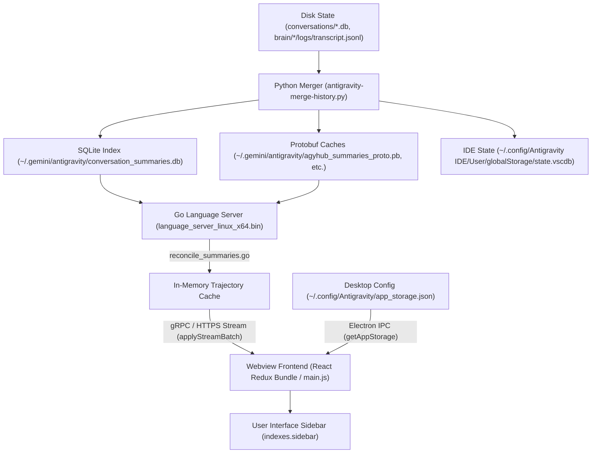

# Antigravity Suite: Comprehensive Debugging & Forensics Guide

This document records the end-to-end diagnostic methodology, reverse-engineering techniques, root causes, and verification steps used to solve the Antigravity Suite conversation synchronization, empty sidebar, and profile disparity anomalies.

---

## 1. Architectural Overview & Telemetry Chain



---

## 2. Issue 1: Empty Sidebar (0 Chats Rendered) — The Protobuf Tag 20 Gate

### Symptoms
* SQLite (`conversation_summaries.db`) contained 306 conversations with valid titles, step counts, and workspace URIs.
* Go Language Server log ([language_server.log](file:///home/reza/.config/Antigravity/logs/language_server.log)) reported:
  ```
  [Summaries] reconcile checked 322 conversations, restored 0, cached 321, skipped 1, dropped 0, cancelled false in 71ms (resident: 0 -> 0)
  ```
* Yet, the Desktop App and IDE sidebar displayed **0 conversations** (completely blank project list).

### Diagnostic Methodology & Execution
1. **Backend vs. Frontend Isolation**:
   Because `reconcile_summaries.go` confirmed `cached 321, dropped 0`, the backend Go language server had successfully parsed and held all summaries in memory. The elimination was occurring in the frontend Webview bundle.

2. **Extracting Live Webview Frontend**:
   The Antigravity UI is rendered via an internal Webview loaded from the Language Server's local HTTPS port.
   * Extracted CSRF token and HTTPS port from process arguments:
     ```bash
     ps aux | grep language_server
     # Found: --extension_server_port 41693 --csrf_token dafc01cf-728b-473c-b172-6ef68a5a6f77
     ```
   * Downloaded `main.js` (the minified React frontend bundle) using loopback HTTPS with `x-codeium-csrf-token`.

3. **Tracing the Redux Ingestion Reducer**:
   Searched for trajectory batch updates in `main.js`:
   ```javascript
   const una = Ul({
     name: "trajectorySummaries",
     initialState: lna,
     reducers: {
       applyStreamBatch(a, b) {
         a.hasLoadedInitialSummaries = !0;
         for (let [e, f] of b.payload.updates) {
           let g = e, h = f;
           ...
           mna(h.source) ? (
             // Normal sidebar branch
             a.summaries[g] = ...;
             a.indexes.sidebar.add(g);
           ) : (
             // External conversation branch
             a.externalSummaries[g] = ...;
           )
         }
       }
     }
   });
   ```

4. **Inspecting the `mna(source)` Gate**:
   Extracted the implementation of `mna`:
   ```javascript
   function mna(a) {
     return a === T.CortexTrajectorySource.UNSPECIFIED || // 0
            a === T.CortexTrajectorySource.JETBOX ||      // 18
            a === T.CortexTrajectorySource.CIDER;         // 20
   }
   ```
   * Enum values: `UNSPECIFIED = 0`, `CASCADE_CLIENT = 1`, `JETBOX = 18`, `CIDER = 20`.
   * For local conversations, Google Antigravity omits Tag 20 on the wire (`source == 0`), so `mna(0)` evaluates to `true`.

5. **Root Cause Identification**:
   * Git history revealed commit [`6e08074`](https://github.com/RezaRashidi/antigravity-suite-manager/commit/6e08074) added:
     ```python
     # Tag 20: source (1)
     out += encode_tag_uint(20, 1)
     ```
   * Because Tag 20 was hardcoded to `1` (`CASCADE_CLIENT`), `mna(1)` returned `false`.
   * **Result**: Every incoming conversation summary was diverted to `externalSummaries`, completely bypassing `indexes.sidebar`.

### Solution Applied
* In [src/antigravity_suite/proto/cascade.py](file:///home/reza/PhpstormProjects/antigravity-suite-manager/src/antigravity_suite/proto/cascade.py), omit Tag 20 when `source == 0`:
  ```python
  if source != 0:
      out += encode_tag_uint(20, source)
  ```
* In [src/antigravity_suite/history/merger.py](file:///home/reza/PhpstormProjects/antigravity-suite-manager/src/antigravity_suite/history/merger.py), detect existing stored summaries with `source == 1` or `tag 20 == 1` and force a clean rebuild.
* In [src/antigravity_suite/history/sqlite_store.py](file:///home/reza/PhpstormProjects/antigravity-suite-manager/src/antigravity_suite/history/sqlite_store.py), strip `'CORTEX_TRAJECTORY_SOURCE_CASCADE_CLIENT'` from SQLite store.

---

## 3. Issue 2: Account 1 "Flash & Collapse" (Visible for 2s, Then Only Old Chats)

### Symptoms
* Launching Account 2 displayed all 306 chats continuously in a flat chronological list.
* Launching Account 1 displayed all 306 chats for the first 2 seconds; then the list disappeared, leaving only ~17 old chats from months ago.

### Diagnostic Methodology & Execution
1. **Comparing Instance Configurations**:
   Inspected differences between Account 1 ([~/.config/Antigravity/app_storage.json](file:///home/reza/.config/Antigravity/app_storage.json)) and Account 2 ([~/.antigravity-profile2/.config/Antigravity/app_storage.json](file:///home/reza/.antigravity-profile2/.config/Antigravity/app_storage.json)):
   ```python
   # Account 1:
   "projectsGroupBy": "project",
   "sidebar_section_display": "{\"onlyShowFirstFewConvos\":{\"all\":false,\"d21f8bda-a6ca-434d-a243-ee89f4924363\":false}}",
   "projectsOrder": ["d21f8bda-a6ca-434d-a243-ee89f4924363", ...]

   # Account 2:
   "projectsGroupBy": "none",
   "sidebar_collapsed_section_headers": []
   ```

2. **Querying Database for Project `d21f8bda...`**:
   Queried SQLite for conversations belonging to `project_id = 'd21f8bda-a6ca-434d-a243-ee89f4924363'`:
   * Exactly 17 conversations returned, with dates spanning June, July, August, and October 12 (the exact "old chats" seen by the user).

3. **Frontend Lifecycle Mechanics**:
   * **0 - 2 seconds**: React mounts with initial Redux state (`projectsGroupBy = "none"`). All 306 conversations render in a flat list.
   * **2 seconds**: Electron IPC returns stored preferences from `app_storage.json`.
   * **State update**: `projectsGroupBy` updates to `"project"`. React switches to the Project Accordion view.
   * Because `onlyShowFirstFewConvos` had all projects collapsed except `d21f8bda...` (CRM), the sidebar hid all recent chats and isolated only the 17 old CRM conversations.

### Solution Applied
* In [~/.config/Antigravity/app_storage.json](file:///home/reza/.config/Antigravity/app_storage.json):
  ```json
  {
    "projectsGroupBy": "none",
    "projectsSortBy": null,
    "sidebar_collapsed_section_headers": [],
    "sidebar_section_display": "{\"onlyShowFirstFewConvos\":{\"all\":false}}"
  }
  ```
* Both accounts now share identical `"projectsGroupBy": "none"` configurations, rendering all 306 conversations continuously without layout collapse.

---

## 4. Issue 3: Rogue Symlink Causing Schema Version Crash

### Symptoms
* Go Language Server log contained recurring warnings:
  ```
  Skipping conversation conversation_summaries while listing: open backend /home/reza/.gemini/antigravity/conversations/conversation_summaries.db: db version too new: got 3, want 1
  [Summaries] failed to generate summary for conversation_summaries while reconciling: conversation conversation_summaries not found
  ```

### Diagnostic Methodology & Execution
* Checked directory contents of `/home/reza/.gemini/antigravity/conversations/`.
* Discovered a rogue symlink:
  ```bash
  /home/reza/.gemini/antigravity/conversations/conversation_summaries.db -> ../conversation_summaries.db
  ```
* **Root Cause**: The Go Language Server enumerates all `*.db` files in `conversations/` assuming they are individual conversation trajectory databases (`user_version = 1`). It attempted to open the master summary database (`user_version = 3`) as a conversation, threw a schema incompatibility error, and aborted reconciliation for that thread.

### Solution Applied
* Removed the rogue symlink:
  ```bash
  rm -f /home/reza/.gemini/antigravity/conversations/conversation_summaries.db
  ```
* Removed empty 0-byte collision artifact `/home/reza/.config/antigravity/conversation_summaries.db`.

---

## 5. Issue 4: Metadata Inode Stagnation in Fast-Path Caching

### Symptoms
* Updates made to `transcript.jsonl` in pool profiles were silently ignored during merge sweeps.

### Diagnostic Methodology & Execution
* Inspected [src/antigravity_suite/history/pool_merger.py](file:///home/reza/PhpstormProjects/antigravity-suite-manager/src/antigravity_suite/history/pool_merger.py):
  ```python
  src_logs = os.path.join(b_item, ".system_generated", "logs")
  tgt_logs = target_brain_item / ".system_generated" / "logs"
  if tgt_logs.is_dir() and os.path.isdir(src_logs):
      if os.path.getmtime(src_logs) <= tgt_logs.stat().st_mtime:
          continue
  ```
* **Root Cause**: On POSIX filesystems, appending data to an existing file (`transcript.jsonl`) modifies only the file's inode `mtime`, NOT the containing directory's `mtime`. Once the target directory existed, `tgt_logs.stat().st_mtime >= src_logs.stat().st_mtime` remained permanently `True`, skipping updated conversation logs.

### Solution Applied
* Replaced directory `mtime` comparisons with direct verification of `transcript.jsonl` and `transcript_full.jsonl` file modification timestamps.

---

## 6. Summary Checklist for Future Diagnostics

| Checkpoint | Target Path / Command | Expected Healthy State |
| :--- | :--- | :--- |
| **Protobuf Tag 20** | `src/antigravity_suite/proto/cascade.py` | Must NOT emit Tag 20 when `source == 0` |
| **Sidebar Grouping** | `~/.config/Antigravity/app_storage.json` | `"projectsGroupBy": "none"` |
| **Conversations Folder** | `~/.gemini/antigravity/conversations/` | Contains ONLY `<UUID>.db` files (no `conversation_summaries.db`) |
| **Language Server Health** | `~/.config/Antigravity/logs/language_server.log` | `reconcile checked N, restored 0, cached N, dropped 0` |
| **SQLite User Version** | `PRAGMA user_version` on `conversations/*.db` | Must be `1` |
| **Unit Test Suite** | `python3 -m unittest discover tests` | All 87 tests passing |
