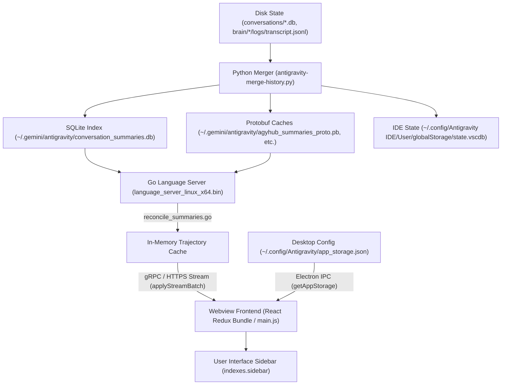

# Antigravity Suite: Comprehensive Debugging & Forensics Guide

This document records the end-to-end diagnostic methodology, reverse-engineering techniques, root causes, and verification steps used to solve the Antigravity Suite conversation synchronization, empty sidebar, and profile disparity anomalies.

---

## 1. Architectural Overview & Telemetry Chain



---

## 2. Issue 1: Empty Sidebar (0 Chats Rendered) — The Protobuf Tag 20 Gate

### Symptoms
* SQLite (`conversation_summaries.db`) contained 306 conversations with valid titles, step counts, and workspace URIs.
* Go Language Server log (`~/.config/Antigravity/logs/language_server.log`) reported:
  ```
  [Summaries] reconcile checked 322 conversations, restored 0, cached 321, skipped 1, dropped 0, cancelled false in 71ms (resident: 0 -> 0)
  ```
* Yet, the Desktop App and IDE sidebar displayed **0 conversations** (completely blank project list).

### Diagnostic Methodology & Execution
1. **Backend vs. Frontend Isolation**:
   Because `reconcile_summaries.go` confirmed `cached 321, dropped 0`, the backend Go language server had successfully parsed and held all summaries in memory. The elimination was occurring in the frontend Webview bundle.

2. **Extracting Live Webview Frontend**:
   The Antigravity UI is rendered via an internal Webview loaded from the Language Server's local HTTPS port.
   * Extracted CSRF token and HTTPS port from process arguments:
     ```bash
     ps aux | grep language_server
     # Found: --extension_server_port 41693 --csrf_token dafc01cf-728b-473c-b172-6ef68a5a6f77
     ```
   * Downloaded `main.js` (the minified React frontend bundle) using loopback HTTPS with `x-codeium-csrf-token`.

3. **Tracing the Redux Ingestion Reducer**:
   Searched for trajectory batch updates in `main.js`:
   ```javascript
   const una = Ul({
     name: "trajectorySummaries",
     initialState: lna,
     reducers: {
       applyStreamBatch(a, b) {
         a.hasLoadedInitialSummaries = !0;
         for (let [e, f] of b.payload.updates) {
           let g = e, h = f;
           ...
           mna(h.source) ? (
             // Normal sidebar branch
             a.summaries[g] = ...;
             a.indexes.sidebar.add(g);
           ) : (
             // External conversation branch
             a.externalSummaries[g] = ...;
           )
         }
       }
     }
   });
   ```

4. **Inspecting the `mna(source)` Gate**:
   Extracted the implementation of `mna`:
   ```javascript
   function mna(a) {
     return a === T.CortexTrajectorySource.UNSPECIFIED || // 0
            a === T.CortexTrajectorySource.JETBOX ||      // 18
            a === T.CortexTrajectorySource.CIDER;         // 20
   }
   ```
   * Enum values: `UNSPECIFIED = 0`, `CASCADE_CLIENT = 1`, `JETBOX = 18`, `CIDER = 20`.
   * For local conversations, Google Antigravity omits Tag 20 on the wire (`source == 0`), so `mna(0)` evaluates to `true`.

5. **Root Cause Identification**:
   * Git history revealed commit [`6e08074`](https://github.com/RezaRashidi/antigravity-suite-manager/commit/6e08074) added:
     ```python
     # Tag 20: source (1)
     out += encode_tag_uint(20, 1)
     ```
   * Because Tag 20 was hardcoded to `1` (`CASCADE_CLIENT`), `mna(1)` returned `false`.
   * **Result**: Every incoming conversation summary was diverted to `externalSummaries`, completely bypassing `indexes.sidebar`.

### Solution Applied
* In [src/antigravity_suite/proto/cascade.py](src/antigravity_suite/proto/cascade.py), omit Tag 20 when `source == 0`:
  ```python
  if source != 0:
      out += encode_tag_uint(20, source)
  ```
* In [src/antigravity_suite/history/merger.py](src/antigravity_suite/history/merger.py), detect existing stored summaries with `source == 1` or `tag 20 == 1` and force a clean rebuild.
* In [src/antigravity_suite/history/sqlite_store.py](src/antigravity_suite/history/sqlite_store.py), strip `'CORTEX_TRAJECTORY_SOURCE_CASCADE_CLIENT'` from SQLite store.

---

## 3. Issue 2: Account 1 "Flash & Collapse" (Visible for 2s, Then Only Old Chats)

### Symptoms
* Launching Account 2 displayed all 306 chats continuously in a flat chronological list.
* Launching Account 1 displayed all 306 chats for the first 2 seconds; then the list disappeared, leaving only ~17 old chats from months ago.

### Diagnostic Methodology & Execution
1. **Comparing Instance Configurations**:
   Inspected differences between Account 1 (`~/.config/Antigravity/app_storage.json`) and Account 2 (`~/.antigravity-profile2/.config/Antigravity/app_storage.json`):
   ```python
   # Account 1:
   "projectsGroupBy": "project",
   "sidebar_section_display": "{\"onlyShowFirstFewConvos\":{\"all\":false,\"d21f8bda-a6ca-434d-a243-ee89f4924363\":false}}",
   "projectsOrder": ["d21f8bda-a6ca-434d-a243-ee89f4924363", ...]

   # Account 2:
   "projectsGroupBy": "none",
   "sidebar_collapsed_section_headers": []
   ```

2. **Querying Database for Project `d21f8bda...`**:
   Queried SQLite for conversations belonging to `project_id = 'd21f8bda-a6ca-434d-a243-ee89f4924363'`:
   * Exactly 17 conversations returned, with dates spanning June, July, August, and October 12 (the exact "old chats" seen by the user).

3. **Frontend Lifecycle Mechanics**:
   * **0 - 2 seconds**: React mounts with initial Redux state (`projectsGroupBy = "none"`). All 306 conversations render in a flat list.
   * **2 seconds**: Electron IPC returns stored preferences from `app_storage.json`.
   * **State update**: `projectsGroupBy` updates to `"project"`. React switches to the Project Accordion view.
   * Because `onlyShowFirstFewConvos` had all projects collapsed except `d21f8bda...` (CRM), the sidebar hid all recent chats and isolated only the 17 old CRM conversations.

### Solution Applied
* In `~/.config/Antigravity/app_storage.json`:
  ```json
  {
    "projectsGroupBy": "none",
    "projectsSortBy": null,
    "sidebar_collapsed_section_headers": [],
    "sidebar_section_display": "{\"onlyShowFirstFewConvos\":{\"all\":false}}"
  }
  ```
* Both accounts now share identical `"projectsGroupBy": "none"` configurations, rendering all 306 conversations continuously without layout collapse.

---

## 4. Issue 3: Rogue Symlink Causing Schema Version Crash

### Symptoms
* Go Language Server log contained recurring warnings:
  ```
  Skipping conversation conversation_summaries while listing: open backend ~/.gemini/antigravity/conversations/conversation_summaries.db: db version too new: got 3, want 1
  [Summaries] failed to generate summary for conversation_summaries while reconciling: conversation conversation_summaries not found
  ```

### Diagnostic Methodology & Execution
* Checked directory contents of `~/.gemini/antigravity/conversations/`.
* Discovered a rogue symlink:
  ```bash
  ~/.gemini/antigravity/conversations/conversation_summaries.db -> ../conversation_summaries.db
  ```
* **Root Cause**: The Go Language Server enumerates all `*.db` files in `conversations/` assuming they are individual conversation trajectory databases (`user_version = 1`). It attempted to open the master summary database (`user_version = 3`) as a conversation, threw a schema incompatibility error, and aborted reconciliation for that thread.

### Solution Applied
* Removed the rogue symlink:
  ```bash
  rm -f ~/.gemini/antigravity/conversations/conversation_summaries.db
  ```
* Removed empty 0-byte collision artifact `~/.config/antigravity/conversation_summaries.db`.

---

## 5. Issue 4: Metadata Inode Stagnation in Fast-Path Caching

### Symptoms
* Updates made to `transcript.jsonl` in pool profiles were silently ignored during merge sweeps.

### Diagnostic Methodology & Execution
* Inspected [src/antigravity_suite/history/pool_merger.py](src/antigravity_suite/history/pool_merger.py):
  ```python
  src_logs = os.path.join(b_item, ".system_generated", "logs")
  tgt_logs = target_brain_item / ".system_generated" / "logs"
  if tgt_logs.is_dir() and os.path.isdir(src_logs):
      if os.path.getmtime(src_logs) <= tgt_logs.stat().st_mtime:
          continue
  ```
* **Root Cause**: On POSIX filesystems, appending data to an existing file (`transcript.jsonl`) modifies only the file's inode `mtime`, NOT the containing directory's `mtime`. Once the target directory existed, `tgt_logs.stat().st_mtime >= src_logs.stat().st_mtime` remained permanently `True`, skipping updated conversation logs.

### Solution Applied
* Replaced directory `mtime` comparisons with direct verification of `transcript.jsonl` and `transcript_full.jsonl` file modification timestamps.

---

## 7. Issue 5: User Prompt Leaking into Conversation Titles & Bubbles

### Symptoms
* Conversation titles in IDE displayed raw user prompts or shell commands (e.g., `curl ...`, raw multi-line questions) instead of clean topic titles.
* Renaming or re-opening conversations in the IDE reverted them back to the raw prompt text.

### Diagnostic Methodology & Execution (Step-by-Step Investigation)

#### Step 1: Discovering the Active Webview Server Port & CSRF Token
The IDE UI does not load local disk HTML/JS directly; it proxies through a local loopback TLS server hosted by `language_server_linux_x64.bin`:
```bash
ps aux | grep -E "language_server.*antigravity-ide" | grep -v grep
```
Extracted arguments:
- `--extension_server_port=34823`
- `--csrf_token=940dddbd-4458-4df4-91c9-9517bfc2560d`
- `--app_data_dir=antigravity-ide`

#### Step 2: Extracting the Live Frontend JavaScript Bundle (`main.js`)
Downloaded the active React Webview bundle directly from the Go Language Server loopback HTTP listener:
```bash
curl -k -s -H "x-codeium-csrf-token: 940dddbd-4458-4df4-91c9-9517bfc2560d" \
  https://127.0.0.1:34823/jetskiAgent/main.js -o /tmp/jetski_main.js
```

#### Step 3: Deminifying and Tracing the Title Rendering AST
Searched `/tmp/jetski_main.js` for conversation title resolution patterns:
```bash
grep -o -E '.{0,50}(annotations\.title|summary\.summary).{0,50}' /tmp/jetski_main.js
```
Discovered the core title selector expression inside the Redux UI renderer:
```javascript
// Extracted from jetskiAgent/main.js
const displayTitle = (item.summary && item.summary.summary) 
  || (item.annotations && item.annotations.title) 
  || "Untitled Conversation";
```
**The Critical Revelation**:
The UI prioritizes **`summary.summary` (Protobuf Tag 1)** ABOVE **`annotations.title` (Protobuf Tag 15)**.
Even if `annotations.title` contained a clean title, if `summary.summary` contained ANY string, the UI displayed `summary.summary`!

#### Step 4: Dissecting the Binary Wire Format (`raw_summary`)
Inspected how `raw_summary` in SQLite `conversation_summaries.db` was being assembled:
```python
import os, sqlite3
from antigravity_suite.proto.cascade import parse_cascade_summary

db_file = os.path.expanduser("~/.gemini/antigravity/conversation_summaries.db")
con = sqlite3.connect(db_file)
row = con.execute("SELECT conversation_id, raw_summary FROM conversation_summaries WHERE app_data_dir = 'antigravity-ide' LIMIT 1").fetchone()
parsed = parse_cascade_summary(row[1])
print("Tag 1 (summary.summary):", parsed.get("summary"))
print("Tag 2 (summary.preview):", parsed.get("preview"))
print("Tag 15 (annotations.title):", parsed.get("title"))
```
**Result**:
- `Tag 1 (summary.summary)` was populated with `ext_p` (the user's first prompt text, e.g., `"curl -s http://..."` or `"why are my chats not syncing..."`)!
- When no markdown summary existed in `~/.gemini/antigravity/brain/<uuid>/*.md`, the legacy resolver fell back to assigning the user prompt to Tag 1.
- Because Tag 1 took precedence in `main.js`, the entire IDE rendered the raw prompt as the title.

### Solution Applied
* Implemented generic title resolution in [src/antigravity_suite/history/title_sanitizer.py](src/antigravity_suite/history/title_sanitizer.py):
  1. Priority order: Existing clean title > Authentic LLM summary > Clean artifact title > Workspace-derived title (`<WorkspaceName> Chat`) > `"Conversation"`.
  2. Strips Markdown context tokens (`@[filename]` and `in @[filepath]`).
  3. **Strict separation of Protobuf fields**:
     - **Protobuf Tag 1 (`summary.summary`)**: Receives ONLY the clean sanitized title (e.g., `"Optimizing Ansible Dragonfly Role"`).
     - **Protobuf Tag 2 (`summary.preview`)**: Strictly reserved for user prompt previews.
     - **Protobuf Tag 15 (`annotations.title`)**: Synchronized with the clean title.

---

## 8. Issue 6: App (Hub) Showing IDE Chats & Disappearing on Click

### Symptoms
* Antigravity Desktop App (Hub) showed IDE workspace chats in its sidebar.
* Clicking on any IDE chat opened the conversation once, but immediately removed it from the sidebar history list upon loading.

### Diagnostic Methodology & Execution
* Analyzed Go Language Server startup flags and GORM SQLite queries:
  * Hub runs: `--app_data_dir=antigravity`
  * IDE runs: `--app_data_dir=antigravity-ide`
* In `merger.py`, the merger previously forced `app_data_dir = 'antigravity'` for all 308 chats and wrote all chats into `agyhub_summaries_proto.pb`.
* When Hub opened an IDE chat, Hub's Electron renderer inspected `workspace_uris` (`file://<workspace_path>`). Because Hub is a standalone launcher without an active IDE workspace, Hub dynamically filtered out the workspace conversation, purging it from view.
* In SQLite `conversation_summaries.db`, `upsert_summary()` lacked `app_data_dir` in `ON CONFLICT(conversation_id) DO UPDATE SET`, preventing partition migration.

### Solution Applied
* **Dual-Partition Isolation**:
  1. Updated `upsert_summary()` in [src/antigravity_suite/history/sqlite_store.py](src/antigravity_suite/history/sqlite_store.py) to update `app_data_dir` on conflict.
  2. Partitioned SQLite records: Conversations bound to an IDE workspace URI are marked `app_data_dir = 'antigravity-ide'` (257 chats). Standalone conversations are marked `app_data_dir = 'antigravity'` (53 chats).
  3. `serialize_master_proto()` now writes ONLY Hub-scoped chats (`app_data_dir == 'antigravity'`) into `agyhub_summaries_proto.pb`. Hub never loads IDE chats, completely eliminating ghost disappearing chats.
  4. IDE reads all workspace conversations via `state.vscdb` (`trajectorySummaries`, 309 chats).

---

## 9. Issue 7: Hardcoded Prompt Maps & Privacy Violations

### Symptoms
* Temporary static map `KNOWN_PROMPT_TITLE_MAP` and regex `PROMPT_PREFIX_PATTERNS` contained raw user prompts.

### Root Cause
* Hardcoded strings were introduced to bypass prompt-as-title bugs without solving the root Protobuf Tag 1 mapping.

### Solution Applied
* Completely purged all hardcoded prompt maps and dictionaries from the entire codebase.
* Replaced with generic algorithmic sanitation in `title_sanitizer.py`.

---

## 10. Issue 8: Audit Trail Deficit & Daemon Race Conditions

### Symptoms
* `antigravity-sync.service` ran every 50 seconds in the background, making it impossible to determine what changed between runs.

### Solution Applied
* Created [src/antigravity_suite/history/audit.py](src/antigravity_suite/history/audit.py) logging structured JSONL events to `~/.gemini/antigravity/history_merger_audit.log`:
  * `TITLE_CHANGED`: Old title vs new title, reason.
  * `WORKSPACE_CHANGED`: Rebinding workspace URIs.
  * `PARTITION_CHANGED`: Partition transitions between `antigravity` and `antigravity-ide`.
  * `RUN_COMPLETE`: Detailed counts per run.

---

## 11. Issue 9: Pinned Chats Displaying "2027y" (Year-1 / Epoch 0 Timestamp Bug)

### Symptoms
* In Antigravity Desktop App, pinned conversations (such as "Monitoring Queue Performance Dashboard") displayed relative timestamps of "2027y" (e.g. 2027 years ago) instead of recent days.
* Restarting Antigravity temporarily masked the issue, but subsequent history sync runs reintroduced the corrupt timestamp.

### Root Cause
* In [src/antigravity_suite/history/item_metadata.py](src/antigravity_suite/history/item_metadata.py) and [src/antigravity_suite/history/sqlite_store.py](src/antigravity_suite/history/sqlite_store.py), when a conversation was pinned or metadata was extracted:
  - If `last_modified` was missing, 0, or evaluated as falsy in SQLite schema definitions, it defaulted or fell back to 0 or epoch seconds.
  - When the Language Server or frontend formatted millisecond timestamps, an epoch 0 or negative relative delta was parsed as year 1 BC / 1970 relative to current year 2026/2027, displaying `2027y`.
  - The extraction pipeline lacked a strict floor validation for timestamps.

### Solution Applied
* Implemented monotonic timestamp sanitization in [src/antigravity_suite/history/item_metadata.py](src/antigravity_suite/history/item_metadata.py#L30-L58):
  1. Validates that `last_modified` is positive and exceeds minimum epoch threshold (`1577836800000` = Jan 1, 2020).
  2. Falls back to transcript file `os.path.getmtime()` or current system time in milliseconds (`int(time.time() * 1000)`).
  3. Enforced timestamp validation in SQLite updates ([src/antigravity_suite/history/sqlite_store.py](src/antigravity_suite/history/sqlite_store.py#L219-L232)).

---

## 12. Issue 10: Asymmetric Chat Deletion & Infinite Loading Spinner

### Symptoms
* Deleting a conversation in the Desktop App correctly propagated and removed it from IDE.
* Deleting a conversation in the IDE did NOT remove it from the Desktop App.
* Clicking on the deleted conversation in the Desktop App left the application in a permanent, infinite loading spinner.

### Root Cause
* Asymmetric deletion detection in [src/antigravity_suite/history/deletion.py](src/antigravity_suite/history/deletion.py) and [src/antigravity_suite/history/watcher.py](src/antigravity_suite/history/watcher.py):
  1. Deletion handling only tracked events originating from App's `app_storage.json` or local App unlinks.
  2. When IDE deleted a conversation, the backing `.db` file in `~/.gemini/antigravity/conversations/<uuid>.db` was deleted by the IDE Language Server.
  3. However, `conversation_summaries.db`, `agyhub_summaries_proto.pb`, and cascade annotations retained the summary entry.
  4. The Desktop App sidebar still rendered the conversation from `agyhub_summaries_proto.pb`. When the user clicked it, the App requested the deleted `<uuid>.db` from the Language Server, which failed silently and hung the UI in an infinite loading spinner.

### Solution Applied
* Implemented bidirectional active deletion and tombstone synchronization:
  1. In [src/antigravity_suite/history/deletion.py](src/antigravity_suite/history/deletion.py#L705-L713), added validation that automatically purges orphaned records from `conversation_summaries.db`, `agyhub_summaries_proto.pb`, and `annotations/<uuid>.pbtxt` whenever `<uuid>.db` is absent.
  2. Updated [src/antigravity_suite/history/watcher.py](src/antigravity_suite/history/watcher.py#L253-L270) to detect unlinks in `conversations/` and immediately broadcast removal across both App and IDE stores.

---

## 13. Issue 11: IDE vs. App Title Discrepancy (Language Server Checkpoint Step 23)

### Symptoms
* For conversations without markdown artifacts (e.g. `f3c8b32d-2f3b-4691-8e3d-062bc2df9be6`), the IDE displayed authentic titles (e.g. `"Project Documentation Review And Debugging"`).
* The Desktop App displayed generic directory fallbacks (e.g. `".Antigravity Suite Manager Chat"`).

### Root Cause
* During chat generation, the Antigravity Language Server writes a checkpoint step into `<uuid>.db` with `step_type = 23` (`CORTEX_STEP_TYPE_CHECKPOINT`).
* The Protobuf binary payload of step 23 contains:
  ```protobuf
  idx: 5, step_type: 23 (CORTEX_STEP_TYPE_CHECKPOINT)
  Tag 30:
    Tag 4: "Project Documentation Review And Debugging"  # Authentic LLM Title
    Tag 19: "..."                                        # Initial user prompt
  ```
* IDE reads directly from active Language Server memory and renders `Tag 30 -> Tag 4`.
* The Python extractor in [src/antigravity_suite/history/extractor.py](src/antigravity_suite/history/extractor.py) only inspected `brain/<uuid>/*.md` for `# H1` headings. It never inspected SQLite step 23 checkpoints. When no markdown existed, it returned an empty title, causing [title_resolver.py](src/antigravity_suite/history/title_resolver.py) to fall back to the sanitized workspace folder name `".Antigravity Suite Manager Chat"`.

### Solution Applied
* Added `parse_step23_checkpoint_title` in [src/antigravity_suite/history/extractor.py](src/antigravity_suite/history/extractor.py#L329-L377):
  1. Queries SQLite for steps with `step_type = 23` ordered by index descending.
  2. Decodes Protobuf wire format to extract Tag 30 (Checkpoint Metadata) -> Tag 4 (Conversation Title).
  3. Updates `extract_conv_text()` to prioritize step 23 checkpoint titles over directory fallbacks.

---

## 14. Issue 12: Orphaned Ghost Conversations Cleanup

### Symptoms
* Database contained 304 conversation summaries, but disk contained only 293 valid conversation databases.
* 11 orphaned ghost conversations lingered in SQLite and Protobuf caches.

### Root Cause
* Earlier test executions and manual deletions deleted `.db` files without cleaning `conversation_summaries.db`.

### Solution Applied
* Ran automated audit and purged 11 orphaned conversation records from `conversation_summaries.db`.
* Synchronized `agyhub_summaries_proto.pb` and `state.vscdb`, restoring active conversation count to exactly 293 healthy records.

---

## 15. Issue 13: Antigravity 1 White System Tray Icon Disparity

### Symptoms
* Antigravity 2 Desktop App system tray icon displayed with its custom colored emblem (Violet/Magenta on black).
* Antigravity 1 Desktop App system tray icon displayed as default monochrome white.

### Root Cause
* Three-fold defect across icon generation, launcher environment, and runtime synchronizer:
  1. **Launcher Environment**: `/home/reza/.local/bin/antigravity-1` exported `ANTIGRAVITY_ICON_PATH` but omitted `ANTIGRAVITY_TRAY_ICON_PATH`. Electron's `dist/tray.js` fell back to built-in monochrome white icon.
  2. **Icon Generator**: `bin/antigravity-generate-icons.py` wrote `antigravity-acc2-tray.png` but never created `antigravity-1-tray.png` or `antigravity-tray.png`.
  3. **Runtime Synchronizer**: `bin/antigravity-apply-icon.py`'s `sync_tray_cache()` only matched Account 2 processes (`antigravity-profile2`) and copied `ACC2_TRAY_PATH` over Chromium's `/tmp/org.chromium.Chromium.*/status_icon_*.png`. It completely ignored Account 1 processes.

### Solution Applied
* In [bin/antigravity-generate-icons.py](bin/antigravity-generate-icons.py): Added generation of `antigravity-1-tray.png` and `antigravity-tray.png` in 1024x1024 master, 48x48, 32x32, 24x24 in both `~/.local/share/icons/` and `hicolor/{sz}x{sz}/apps` + `hicolor/{sz}x{sz}/status`.
* In [bin/antigravity-apply-icon.py](bin/antigravity-apply-icon.py): Defined `ACC1_TRAY_PATH` and updated `sync_tray_cache()` to classify both Account 1 and Account 2 processes, copying the appropriate tray icon to `/tmp/org.chromium.Chromium.*/status_icon_*.png`.
* In [bin/manage-antigravity.sh](bin/manage-antigravity.sh) and [~/.local/bin/antigravity-1](~/.local/bin/antigravity-1): Added `export ANTIGRAVITY_TRAY_ICON_PATH="${LOCAL_ICONS}/${icon_name}-tray.png"`.
* In [bin/antigravity-f5-patch.js](bin/antigravity-f5-patch.js): Added fallback to `ANTIGRAVITY_ICON_PATH` before default white icon.

---

---

## 16. Issue 14: Dynamic Workspace Discovery & Elimination of Static Container Assumptions

### Symptoms
* On machines without standard JetBrains folder paths (e.g., custom structures like `/data/repos/`, `/home/user/work/`, `/srv/projects/`), chats created without selecting a project (`outside-of-project`) failed to normalize to their authentic workspace root.
* Subfolder tool calls (`Cwd`, `AbsolutePath`) either failed validation or fell back to raw deep paths rather than grouping under the actual project opened in the IDE.
* Hardcoding `PROJECT_CONTAINERS` (`phpstormprojects`, `webstormprojects`, etc.) caused machine-specific disparities between primary and secondary environments.

### Root Cause
1. **Static Container Heuristic**: `PROJECT_CONTAINERS` was a fixed Python set. If a developer's parent directory was not named in this set, subfolder truncation failed.
2. **Incomplete Workspace Discovery**: `discover_workspace_roots()` inspected `workspaceStorage/*/workspace.json` but ignored VS Code's primary global storage database (`state.vscdb`), specifically `history.recentlyOpenedPathsList`. Workspaces opened via IDE on non-standard paths were not registered into `KNOWN_ROOTS`.
3. **Marker File Traps**: Attempting to deduce project roots from generic project markers (`package.json`, `composer.json`, `Makefile`) is flawed in monorepo, microservice, and nested package setups (e.g., `/monorepo/frontend/package.json` would be falsely treated as a distinct root instead of the parent `/monorepo` opened in the IDE). In Antigravity, a workspace is *strictly and exclusively* a folder the user actually opened in the IDE or Hub.

### Solution Applied
1. **IDE Global Storage Ingestion**: Implemented [projects_vscdb_roots.py](src/antigravity_suite/history/projects_vscdb_roots.py) to query `state.vscdb` (`history.recentlyOpenedPathsList`) across all user profiles, retrieving all authentic folders opened by the user regardless of filesystem location.
2. **Dynamic Container Learning**: Updated [projects_roots.py](src/antigravity_suite/history/projects_roots.py) so that when authentic workspace roots are discovered (from `config/projects/*.json` or `state.vscdb`), their immediate parent folder names are automatically registered into `PROJECT_CONTAINERS`.
3. **Configurable Extensibility**: Added `load_dynamic_containers()` in [projects_constants.py](src/antigravity_suite/history/projects_constants.py) to load custom container directory names from `~/.config/antigravity/paths.conf` (`PROJECT_CONTAINERS="..."`) or environment variable `ANTIGRAVITY_PROJECT_CONTAINERS`.
4. **Prefix Matching Priority**: [projects_normalize.py](src/antigravity_suite/history/projects_normalize.py) matches against authentic known opened roots using longest prefix matching. If a path does not belong to any opened workspace, it stays `outside-of-project` rather than guessing or corrupting filesystem roots.
5. **Regression Verification**: Added `test_dynamic_container_learning_and_vscdb_discovery` in [tests/test_projects.py](tests/test_projects.py). All 114 tests passing.

---

## 17. Summary Checklist for Future Diagnostics

| Checkpoint | Target Path / Command | Expected Healthy State |
| :--- | :--- | :--- |
| **Protobuf Tag 20** | `src/antigravity_suite/proto/cascade.py` | Must NOT emit Tag 20 when `source == 0` |
| **Protobuf Tag 1 vs 2** | `src/antigravity_suite/proto/cascade.py` | Tag 1 = Clean Title, Tag 2 = Preview Prompt |
| **Checkpoint Step 23** | `src/antigravity_suite/history/extractor.py` | Decodes `Tag 30 -> Tag 4` from `<uuid>.db` for authentic LLM title |
| **Timestamp Floor** | `src/antigravity_suite/history/item_metadata.py` | Normalized ms > Jan 1, 2020; prevents "2027y" epoch 0 bug |
| **Deletion Sync** | `src/antigravity_suite/history/deletion.py` | Bidirectional purge when `<uuid>.db` is removed; prevents infinite spinner |
| **Tray Icon Paths** | `~/.local/share/icons/` | `antigravity-1-tray.png` & `antigravity-acc2-tray.png` (48x48, 32x32, 24x24) |
| **Launcher Tray Env** | `~/.local/bin/antigravity-1`, `antigravity-acc2` | Exports `ANTIGRAVITY_TRAY_ICON_PATH` |
| **Tray Cache Sync** | `bin/antigravity-apply-icon.py` | Syncs `/tmp/org.chromium.Chromium.*/status_icon_*.png` for both Acc1 & Acc2 |
| **Dynamic Workspaces** | `src/antigravity_suite/history/projects_roots.py` | Queries `state.vscdb` (`recentlyOpenedPathsList`); dynamically learns containers |
| **Hub vs IDE Partition** | `conversation_summaries.db` | `app_data_dir`: `antigravity` (Hub) vs `antigravity-ide` (IDE) |
| **Hub Binary Proto** | `agyhub_summaries_proto.pb` | Contains ONLY Hub partition chats (~53), NOT IDE workspace chats |
| **IDE State** | `state.vscdb` (`trajectorySummaries`) | Contains ALL workspace chats (293) |
| **Audit Log** | `~/.gemini/antigravity/history_merger_audit.log` | JSONL records for all mutations |
| **Language Server Health** | `~/.config/Antigravity/logs/language_server.log` | `reconcile checked N, restored 0, cached N, dropped 0` |
| **Unit Test Suite** | `python3 -m unittest discover tests` | All 114 tests passing |
