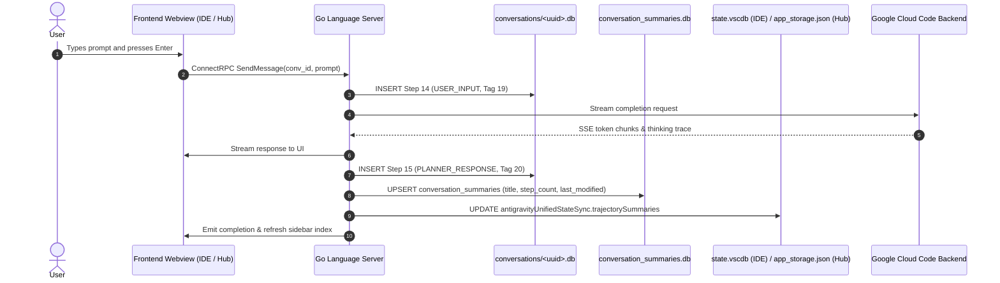

# Antigravity Hub & IDE: Storage Architecture & Reverse-Engineered Code Catalog

This technical specification and engineering reference documents the complete data storage mechanisms, file hierarchies, database schemas, Protobuf wire formats, reverse-engineered source components, and synchronization pipelines for **Google Antigravity Hub** (Desktop App) and **Antigravity IDE** (VS Code edition).

---

## Table of Contents
1. [High-Level Architecture & Process Mapping](#1-high-level-architecture--process-mapping)
2. [Directory Hierarchy & Storage Taxonomy](#2-directory-hierarchy--storage-taxonomy)
3. [Individual Conversation Storage (`<uuid>.db`)](#3-individual-conversation-storage-uuiddb)
   - [3.1 SQLite Schema](#31-sqlite-schema)
   - [3.2 Protobuf `step_payload` Wire Architecture](#32-protobuf-step_payload-wire-architecture)
   - [3.3 Raw Wire Hex & Decoded Payloads](#33-raw-wire-hex--decoded-payloads)
4. [Master Relational Index (`conversation_summaries.db`)](#4-master-relational-index-conversation_summariesdb)
   - [4.1 Database Schema & Indices](#41-database-schema--indices)
   - [4.2 Unread / "New" ("تازه") Badge Mechanics](#42-unread--new-تازه-badge-mechanics)
5. [Protobuf Wire Specifications & Go Struct Reflection](#5-protobuf-wire-specifications--go-struct-reflection)
   - [5.1 `CascadeTrajectorySummary` Go Reflection](#51-cascadetrajectorysummary-go-reflection)
   - [5.2 `ConversationAnnotations` Go Reflection](#52-conversationannotations-go-reflection)
6. [IDE VS Code Storage Engine (`state.vscdb`)](#6-ide-vs-code-storage-engine-statevscdb)
   - [6.1 `ItemTable` SQLite Schema & Keys](#61-itemtable-sqlite-schema--keys)
   - [6.2 Extension Host Topic Synchronization (`extension.js`)](#62-extension-host-topic-synchronization-extensionjs)
7. [Desktop App Storage & React UI Filtering (`app_storage.json`)](#7-desktop-app-storage--react-ui-filtering-app_storagejson)
   - [7.1 The React Double-Elimination Filter (`w.has(ta)`)](#71-the-react-double-elimination-filter-whasta)
   - [7.2 Pinned and Archived Membership Predicates](#72-pinned-and-archived-membership-predicates)
8. [Desktop App Electron Supervisor (`dist/languageServer.js`)](#8-desktop-app-electron-supervisor-distlanguageserverjs)
   - [8.1 Process Lifecycle & Auto-Restart Mechanics](#81-process-lifecycle--auto-restart-mechanics)
9. [Live ConnectRPC Loopback Protocol](#9-live-connectrpc-loopback-protocol)
   - [9.1 Zero-Restart Live Annotation Script](#91-zero-restart-live-annotation-script)
10. [Data Flow Lifecycle: Message Creation to Storage](#10-data-flow-lifecycle-message-creation-to-storage)
11. [Two-Way Synchronization Engine (`antigravity-suite-manager`)](#11-two-way-synchronization-engine-antigravity-suite-manager)

---

## 1. High-Level Architecture & Process Mapping

Antigravity runs as two distinct Electron applications backed by a compiled Go language server runtime:

```mermaid
graph TD
    subgraph Antigravity Hub (Desktop App)
        HubUI["Electron Webview & React UI (/opt/antigravity2)"]
        HubStore["app_storage.json (~/.config/Antigravity)"]
        HubLS["Go Language Server (/opt/antigravity2/resources/bin/language_server)"]
        HubUI <--> HubStore
        HubUI <-->|"Loopback HTTPS ConnectRPC"| HubLS
    end

    subgraph Antigravity IDE (VS Code Fork)
        IDEUI["Monaco Editor & Workbench (/opt/antigravity/antigravity-ide)"]
        IDEvscdb["state.vscdb (~/.config/Antigravity IDE/.../globalStorage)"]
        IDEExt["VS Code Extension Host (resources/app/extensions/antigravity)"]
        IDELS["Go Language Server (bin/language_server_linux_x64.bin)"]
        IDEUI <--> IDEvscdb
        IDEUI <--> IDEExt
        IDEExt <-->|"Loopback HTTPS ConnectRPC"| IDELS
    end

    subgraph "Persistent Storage Engine (~/.gemini or ~/.gemide)"
        CS_DB[("conversation_summaries.db (Master Index)")]
        ConvDBs[("conversations/<uuid>.db (Granular Trajectory Steps)")]
        Brain[("brain/<uuid>/ (Transcripts & Markdown Artifacts)")]
        ProtoFast["agyhub_summaries_proto.pb (Fast Binary Cache)"]
        Projects["config/projects/<id>.json (Project & Workspace Configs)"]
    end

    HubLS <--> CS_DB
    HubLS <--> ConvDBs
    HubLS <--> Brain
    HubLS <--> ProtoFast
    HubLS <--> Projects

    IDELS <--> CS_DB
    IDELS <--> ConvDBs
    IDELS <--> Brain
    IDELS <--> IDEvscdb
    IDELS <--> Projects
```

### Process & Path Inventory

| Component | Antigravity Hub (Desktop App) | Antigravity IDE (VS Code Fork) |
| :--- | :--- | :--- |
| **Main Binary** | `/opt/antigravity2/antigravity` | `/opt/antigravity/antigravity-ide` |
| **Language Server** | `/opt/antigravity2/resources/bin/language_server` | `/opt/antigravity/resources/app/extensions/antigravity/bin/language_server_linux_x64.bin` |
| **User Data Dir** | `~/.config/Antigravity/` | `~/.config/Antigravity IDE/` |
| **UI State File** | `~/.config/Antigravity/app_storage.json` | `~/.config/Antigravity IDE/User/globalStorage/state.vscdb` |
| **Default Root Dir**| `~/.gemini/antigravity/` | `~/.gemide/antigravity-ide/` (or `~/.gemini/antigravity/`) |

---

## 2. Directory Hierarchy & Storage Taxonomy

All conversational state, session histories, code reasoning logs, and authentication tokens reside inside the target Gemini configuration directory:

```
~/.gemini/ (or ~/.gemide/)
├── jetski-standalone-oauth-token          # Primary Google OAuth2 credential cache
├── oauth_credentials.json                 # Google OAuth client ID and secrets
├── google_accounts.json                   # Account profiles metadata
├── config/
│   └── projects/                          # Workspace & Project mappings
│       └── <project-uuid>.json            # Maps workspace folderUri -> project UUID
├── cache/
│   └── antigravity-keyring-unavailable   # Sentinel forcing file-based credentials
└── antigravity/ (or antigravity-ide/)
    ├── conversation_summaries.db          # Master SQLite relational index
    ├── conversation_summaries.db-wal      # SQLite Write-Ahead Log
    ├── conversation_summaries.db-shm      # SQLite Shared Memory index
    ├── agyhub_summaries_proto.pb          # Protobuf binary conversation cache
    ├── jetbox_summaries.pb                # Secondary Protobuf binary index
    ├── conversations/                     # Granular trajectory SQLite databases
    │   ├── <conv-uuid-1>.db
    │   └── <conv-uuid-2>.db
    ├── brain/                             # Conversation artifacts, transcripts, scratchpads
    │   └── <conv-uuid>/
    │       ├── *.md                       # Markdown artifacts generated during chat
    │       ├── scratch/                   # Scratch scripts and temporary files
    │       └── .system_generated/
    │           ├── logs/
    │           │   ├── transcript.jsonl      # Compact conversation transcript
    │           │   └── transcript_full.jsonl # Complete un-truncated conversation log
    │           └── tasks/                 # Background task execution logs
    └── annotations/                       # Human-edited titles and flags
        └── <conv-uuid>.pbtxt              # Protobuf text format annotations
```

---

## 3. Individual Conversation Storage (`<uuid>.db`)

Every conversation trajectory is persisted as a dedicated, standalone SQLite database located in `conversations/<uuid>.db`. This compartmentalization guarantees ACID isolation so that a crash in one chat cannot corrupt other conversations.

### 3.1 SQLite Schema

```sql
-- Trajectory high-level identity and source
CREATE TABLE `trajectory_meta` (
    `trajectory_id`   TEXT PRIMARY KEY,  -- Conversation UUID
    `cascade_id`      TEXT,              -- Cascade engine session ID
    `trajectory_type` INTEGER,           -- 4 = CHAT
    `source`          INTEGER            -- 1 = USER, 2 = IDE
);

-- Granular step-by-step chat history
CREATE TABLE `steps` (
    `idx`               INTEGER PRIMARY KEY,         -- Step index (0, 1, 2, ...)
    `step_type`         INTEGER NOT NULL DEFAULT 0,  -- 14=User, 15=Assistant, 28=RunCommand, 47=MCP, 140=Tool
    `status`            INTEGER NOT NULL DEFAULT 0,  -- 1=UNSPECIFIED, 2=RUNNING, 3=DONE, 4=ERROR
    `has_subtrajectory` NUMERIC NOT NULL DEFAULT 0,  -- Boolean: Has subagent or child trajectory
    `metadata`          BLOB,                        -- Protobuf Tag 5 TrajectoryMetadata
    `error_details`     BLOB,                        -- Error stack trace protobuf
    `permissions`       BLOB,                        -- Sandbox/approval permissions
    `task_details`      BLOB,                        -- Task boundary metadata
    `render_info`       BLOB,                        -- Visual layout directives
    `step_payload`      BLOB,                        -- Core Protobuf message payload (see Section 3.2)
    `step_format`       INTEGER NOT NULL DEFAULT 0   -- Encoding version
);

-- Project binding and Git metadata
CREATE TABLE `trajectory_metadata_blob` (
    `id`   TEXT PRIMARY KEY DEFAULT "main",
    `data` BLOB                                      -- Protobuf CortexTrajectoryMetadata
);

-- Generation telemetry and agent hierarchy
CREATE TABLE `gen_metadata` (
    `idx`  INTEGER PRIMARY KEY,
    `data` BLOB,
    `size` INTEGER NOT NULL DEFAULT 0
);
CREATE TABLE `executor_metadata` (`idx` INTEGER PRIMARY KEY, `data` BLOB);
CREATE TABLE `parent_references` (`idx` INTEGER PRIMARY KEY, `data` BLOB);
CREATE TABLE `battle_mode_infos` (`idx` INTEGER PRIMARY KEY, `data` BLOB);
```

---

### 3.2 Protobuf `step_payload` Wire Architecture

Both the Electron webview and the Go Language Server serialize and deserialize message bubbles directly from the binary Protobuf blob stored in `steps.step_payload`:

```mermaid
graph TD
    Payload["step_payload (Outer Protobuf Container)"]
    Payload --> Tag1["Tag 1 (Varint): step_type"]
    Payload --> Tag4["Tag 4 (Varint): status (1=UNSPECIFIED, 2=RUNNING, 3=DONE, 4=ERROR)"]
    Payload --> Tag5["Tag 5 (Bytes): TrajectoryMetadata (conv_id, cascade_id)"]
    Payload --> Body{"Step Body Branch by step_type"}

    Body -->|"step_type == 14 (User Prompt)"| Tag19["Tag 19 (CortexStepUserInput)"]
    Tag19 --> T19_1["Subfield 1: query (string)"]
    Tag19 --> T19_2["Subfield 2: Raw User Prompt Text (string)"]
    Tag19 --> T19_3["Subfield 3: UserInputChunk (Subfield 1 = Clean Bubble Title)"]
    Tag19 --> T19_5["Subfield 5: images (repeated ImageData)"]
    Tag19 --> T19_9["Subfield 9: media (repeated MediaItem: mime_type, uri)"]

    Body -->|"step_type == 15 (Assistant Response)"| Tag20["Tag 20 (CortexStepPlannerResponse)"]
    Tag20 --> T20_1["Subfield 1: Primary Markdown Text (string)"]
    Tag20 --> T20_3["Subfield 3: Thinking / CoT Reasoning (string)"]
    Tag20 --> T20_6["Subfield 6: Agent ID ('antigravity-agent')"]
    Tag20 --> T20_7["Subfield 7: ToolCall Proto (call_id, function, args JSON)"]
    Tag20 --> T20_8["Subfield 8: Fallback Markdown Text (string)"]
    Tag20 --> T20_16["Subfield 16: raw_thinking (string)"]

    Body -->|"step_type == 28 (Command Execution)"| Tag28["Tag 28 (CortexStepRunCommand)"]
    Tag28 --> T28_1["Subfield 1: command_line (string)"]
    Tag28 --> T28_2["Subfield 2: cwd (string)"]
    Tag28 --> T28_3["Subfield 3: is_daemon (bool)"]

    Body -->|"step_type == 47 (MCP Tool)"| Tag47["Tag 47 (CortexStepMcpTool)"]
    Tag47 --> T47_1["Subfield 1: server_name (string)"]
    Tag47 --> T47_2["Subfield 2: tool_name (string)"]
    Tag47 --> T47_3["Subfield 3: arguments_json (string)"]

    Body -->|"step_type == 132/140 (Tool Output)"| Tag140["Tag 140 (CortexStepGeneric)"]
    Tag140 --> T140_1["Subfield 1: Parameters key-value pairs"]
    Tag140 --> T140_2["Subfield 2: Command stdout / Result Content (string)"]
```



#### Step Type & Wire Tag Reference Table

| Step Type ID | Name | Payload Tag | Protobuf Message | Critical Subfields | UI Render Behavior |
| :---: | :--- | :---: | :--- | :--- | :--- |
| **14** | `USER_INPUT` | **19** | `CortexStepUserInput` | Subfield 2 = Raw prompt<br>Subfield 3 (Sub 1) = Bubble title | If Subfield 3 is missing, user chat bubble displays empty title. |
| **15** | `PLANNER_RESPONSE` | **20** | `CortexStepPlannerResponse` | Subfield 1 = Markdown output<br>Subfield 3 = Thinking trace<br>Subfield 7 = Tool calls | If Tag 20 is absent or stored under Tag 19, UI renders blank assistant bubble. |
| **28** | `RUN_COMMAND` | **28** | `CortexStepRunCommand` | Subfield 1 = Shell command<br>Subfield 2 = Working directory | Renders shell terminal execution box in UI. |
| **42** | `SEARCH_WEB` | **42** | `CortexStepSearchWeb` | Subfield 1 = Query<br>Subfield 2 = Citations | Renders web search pill and preview snippet. |
| **47** | `MCP_TOOL` | **47** | `CortexStepMcpTool` | Subfield 1 = Server name<br>Subfield 2 = Tool name<br>Subfield 3 = Arguments JSON | Renders MCP tool call badge with parameters. |
| **132** / **140** | `TOOL_EXECUTION`| **140**| `CortexStepGeneric` | Subfield 2 = stdout / text | Displays tool execution output and exit code. |
| **143** | `INVOKE_SUBAGENT`| **143**| `CortexStepInvokeSubagent` | Subfield 1 = Role<br>Subfield 2 = Prompt | Spawns child agent conversation. |
| **154** | `ASK_QUESTION` | **154**| `CortexStepAskQuestion` | Subfield 1 = Questions<br>Subfield 2 = Options | Renders interactive multiple-choice question modal. |

---

### 3.3 Raw Wire Hex & Decoded Payloads

#### Step 14 (`USER_INPUT`): Raw Wire Hex
```
08 0e                               // Tag 1 (varint): step_type = 14 (USER_INPUT)
20 03                               // Tag 4 (varint): status = 3 (DONE)
9a 01 45                            // Tag 19 (length-delimited, 69 bytes): CortexStepUserInput
  12 21 48 6f 77 20 64 6f 20...     //   Subfield 2 (string, 33 bytes): "How do I configure Redis cluster?"
  1a 20                             //   Subfield 3 (UserInputChunk):
    0a 1e 52 65 64 69 73 20...      //     Subfield 1 (string, 30 bytes): "Configure Redis Cluster Setup" (Clean Title)
```
> **UI Impact**: If Tag 19 -> Subfield 3 -> Subfield 1 is missing, the conversation renders in the UI with a blank/missing user message title bubble.

#### Step 15 (`PLANNER_RESPONSE`): Raw Wire Hex
```
08 0f                               // Tag 1 (varint): step_type = 15 (PLANNER_RESPONSE)
20 03                               // Tag 4 (varint): status = 3 (DONE)
a2 01 8c 02                         // Tag 20 (length-delimited, 268 bytes): CortexStepPlannerResponse
  0a 82 01 23 23 20 52 65...        //   Subfield 1 (string): "## Redis Cluster Architecture\n..."
  1a 3b 54 68 69 6e 6b 69...        //   Subfield 3 (string): "Thinking: evaluate master-replica topologies..."
  32 11 61 6e 74 69 67 72...        //   Subfield 6 (string): "antigravity-agent"
  3a 42                             //   Subfield 7 (CortexToolCall):
    0a 0b 72 75 6e 5f 63 6f...      //     Subfield 1: "run_command"
    12 33 7b 22 43 6f 6d 6d...      //     Subfield 2: '{"CommandLine": "redis-cli cluster nodes"}'
```
> **UI Impact**: The UI parses markdown exclusively from Tag 20 Subfield 1. If an assistant step is encoded under Tag 19 or generic tags, the webview displays a completely blank message card.

---

## 4. Master Relational Index (`conversation_summaries.db`)

The master SQLite database at `~/.gemini/antigravity/conversation_summaries.db` serves as the primary catalog indexed by the Language Server for both Desktop App and IDE.

### 4.1 Database Schema & Indices

```sql
CREATE TABLE `conversation_summaries` (
    `conversation_id`            TEXT PRIMARY KEY,
    `title`                      TEXT NOT NULL DEFAULT "",
    `preview`                    TEXT NOT NULL DEFAULT "",
    `step_count`                 INTEGER NOT NULL DEFAULT 0,
    `last_modified_time`         DATETIME NOT NULL,
    `workspace_uris`             TEXT NOT NULL DEFAULT "",               -- JSON array e.g. ["file:///path/to/project"]
    `status`                     TEXT NOT NULL DEFAULT "CASCADE_RUN_STATUS_IDLE",
    `source`                     TEXT NOT NULL DEFAULT "",
    `project_id`                 TEXT NOT NULL DEFAULT "outside-of-project", -- Project UUID or "outside-of-project"
    `agent_name`                 TEXT NOT NULL DEFAULT "antigravity-agent",
    `parent_conversation_id`     TEXT NOT NULL DEFAULT "",               -- Parent UUID if spawned by subagent
    `nesting_depth`              INTEGER NOT NULL DEFAULT 0,              -- Subagent recursion depth
    `battle_id`                  TEXT NOT NULL DEFAULT "",
    `winning_conversation_id`    TEXT NOT NULL DEFAULT "",
    `not_fully_idle`             NUMERIC NOT NULL DEFAULT 0,
    `killed`                     NUMERIC NOT NULL DEFAULT 0,
    `last_user_input_time`       DATETIME NOT NULL,
    `last_user_input_step_index` INTEGER NOT NULL DEFAULT -1,             -- Read/Unread flag (see Section 4.2)
    `app_data_dir`               TEXT NOT NULL DEFAULT "antigravity",     -- Instance partition key
    `raw_summary`                BLOB,                                    -- Complete CascadeTrajectorySummary protobuf
    `group_id`                   TEXT NOT NULL DEFAULT ""
);

CREATE INDEX `idx_conversation_summaries_last_user_input_time`
    ON `conversation_summaries` (`last_user_input_time`);
CREATE INDEX `idx_conversation_summaries_last_modified_time`
    ON `conversation_summaries` (`last_modified_time`);

-- Full-Text Search Virtual Table
CREATE VIRTUAL TABLE `conversations_fts` USING fts5(
    conversation_id UNINDEXED, chunk_index UNINDEXED, chunk_first_step UNINDEXED, chunk_last_step UNINDEXED,
    last_modified_time UNINDEXED, step_count UNINDEXED, last_step_created_at UNINDEXED, archived UNINDEXED,
    user_step_byte_offsets UNINDEXED, agent_step_byte_offsets UNINDEXED,
    title, workspace, project, user_body, agent_body,
    tokenize = 'unicode61 remove_diacritics 2', prefix = '1 2 3'
);
```

### 4.2 Unread / "New" ("تازه") Badge Mechanics
The UI sidebar marks a conversation as unread / "New" when:
1. `last_user_input_step_index == -1` while `step_count > 0`, OR
2. Protobuf Field 16 (`last_user_input_step_index`) in `CascadeTrajectorySummary` is omitted.

To mark a conversation as read and prevent spurious "New" badges, `last_user_input_step_index` must be set to the index of the last user step (`SELECT idx FROM steps WHERE step_type = 14 ORDER BY idx DESC LIMIT 1`).

---

## 5. Protobuf Wire Specifications & Go Struct Reflection

Extracted from compiled Go ELF binary `/opt/antigravity2/resources/bin/language_server` (string tables and type descriptors).

### 5.1 `CascadeTrajectorySummary` Go Reflection

```go
// Extracted from Go runtime type reflection: package exa.language_server_pb
type CascadeTrajectorySummary struct {
    Summary                 string                     `protobuf:"bytes,1,opt,name=summary,proto3"`
    StepCount               uint32                     `protobuf:"varint,2,opt,name=step_count,json=stepCount,proto3"`
    LastModifiedTime        *timestamppb.Timestamp     `protobuf:"bytes,3,opt,name=last_modified_time,json=lastModifiedTime,proto3"`
    TrajectoryId            string                     `protobuf:"bytes,4,opt,name=trajectory_id,json=trajectoryId,proto3"`
    Status                  CascadeRunStatus           `protobuf:"varint,5,opt,name=status,proto3"`
    CreatedTime             *timestamppb.Timestamp     `protobuf:"bytes,7,opt,name=created_time,json=createdTime,proto3"`
    Workspaces              []*CortexWorkspaceMetadata `protobuf:"bytes,9,rep,name=workspaces,proto3"`
    LastUserInputTime       *timestamppb.Timestamp     `protobuf:"bytes,10,opt,name=last_user_input_time,json=lastUserInputTime,proto3"`
    Annotations             *ConversationAnnotations   `protobuf:"bytes,15,opt,name=annotations,proto3"`
    LastUserInputStepIndex  uint32                     `protobuf:"varint,16,opt,name=last_user_input_step_index,json=lastUserInputStepIndex,proto3"`
    TrajectoryMetadata      *CortexTrajectoryMetadata  `protobuf:"bytes,17,opt,name=trajectory_metadata,json=trajectoryMetadata,proto3"`
    Source                  CortexTrajectorySource     `protobuf:"varint,20,opt,name=source,proto3"`
    Killed                  bool                       `protobuf:"varint,23,opt,name=killed,proto3"`
}
```

### 5.2 `ConversationAnnotations` Go Reflection

```go
// Extracted from Go runtime type reflection: package exa.language_server_pb
type ConversationAnnotations struct {
    Title                   string                     `protobuf:"bytes,1,opt,name=title,proto3"`
    Archived                bool                       `protobuf:"varint,4,opt,name=archived,proto3"`
    Starred                 bool                       `protobuf:"varint,6,opt,name=starred,proto3"`
    Pinned                  bool                       `protobuf:"varint,12,opt,name=pinned,proto3"`
}
```

---

## 6. IDE VS Code Storage Engine (`state.vscdb`)

Antigravity IDE stores state inside SQLite LevelDB replacements (`state.vscdb`) at:
- **Global Storage**: `~/.config/Antigravity IDE/User/globalStorage/state.vscdb`
- **Workspace Storage**: `~/.config/Antigravity IDE/User/workspaceStorage/<workspace-hash>/state.vscdb`

### 6.1 `ItemTable` SQLite Schema & Keys

```sql
CREATE TABLE `ItemTable` (
    `key`   TEXT PRIMARY KEY,
    `value` TEXT -- Base64 encoded protobuf or JSON string
);
```

#### Critical Keys in `ItemTable`
1. **`antigravityUnifiedStateSync.trajectorySummaries`**:
   - Contains a Base64-encoded Protobuf `Topic` message:
     ```
     Topic (Message)
       Tag 1: repeated DataEntry data = 1
         Tag 1: key (string = conversation_uuid)
         Tag 2: value (Row message)
           Tag 1: value (string = base64-encoded CascadeTrajectorySummary bytes)
           Tag 2: e_tag (int64 = 0 or timestamp)
     ```
   - Antigravity IDE parses this key directly upon launch to populate the chat sidebar.
2. **`antigravityUnifiedStateSync`**:
   - Contains `UssState` message grouping topics (`trajectorySummaries`, `userStatus`, `models`).
3. **`antigravityUnifiedStateSync.sidebarWorkspaces`**:
   - JSON array associating project UUIDs with recent workspace paths.

---

### 6.2 Extension Host Topic Synchronization (`extension.js`)

Extracted from `/opt/antigravity/resources/app/extensions/antigravity/dist/extension.js`. The Antigravity extension binds directly to Electron's IPC bus to stream state topics into `state.vscdb`:

```javascript
// Source: extensions/antigravity/dist/extension.js (Topic Synchronization Engine)
async function syncTopic(topicContainer, cancellationToken) {
    const topicName = topicContainer.topic; // e.g. "trajectorySummaries", "userStatus"
    
    // 1. Initialize IPC subscription to native Go LS service
    const sub = await vscode.antigravityUnifiedStateSync.initIPCSubscription(topicName);
    let currentValue = (0, decodeProto.P2)(sub.initialValue);
    
    // 2. Listen to async state update stream
    for await (const updateEvent of (0, asyncIter.V)(
        vscode.antigravityUnifiedStateSync.onDidUpdateTopicIPC, 
        cancellationToken.signal
    )) {
        if (updateEvent.topic === topicName) {
            // 3. Serialize and push updated Protobuf blob into VS Code ItemTable in state.vscdb
            await vscode.antigravityUnifiedStateSync.pushSerializedUpdateIPC(
                (0, encodeProto.q9)(ProtobufSchema.Topic, updateEvent.payload)
            );
        }
    }
}
```

---

## 7. Desktop App Storage & React UI Filtering (`app_storage.json`)

Antigravity Hub Desktop App stores UI interaction state inside `~/.config/Antigravity/app_storage.json`:

```json
{
  "projectsOrder": "[\"a9b5a9cf-cfda-543d-9a7e-6cf8a15a7005\", \"f71fd387-c848-4215-bc99-44a007d79163\"]",
  "pinnedConversations": "[\"c99bd561-1ff5-4e7a-9774-60193bb967b5\"]",
  "archivedConversations": "[]",
  "conversationTitles": {
    "c99bd561-1ff5-4e7a-9774-60193bb967b5": "Performance Engineering Strategy: Load Test Catalog"
  }
}
```

> [!IMPORTANT]
> The Desktop App writes `projectsOrder`, `pinnedConversations`, and `archivedConversations` as **JSON-stringified strings** (`"[\"uuid\"]"`), not native arrays. Parsers must support string-encoded JSON decoding.

---

### 7.1 The React Double-Elimination Filter (`w.has(ta)`)

Extracted from `/opt/antigravity2/resources/app.asar` (Webview bundle `/tmp/hub_ui_main.js`, lines 8030–8040):

```javascript
// Source: resources/app.asar (decompiled main.js - Component Asb)
var Asb = a => {
  var b = a?.headless ?? !1,
      c = cS(),                                      // Active sidebar project sections
      e = bk(),
      f = Lj();
  var g = f.get("projectManagementFeature");
  var t = Pj(a?.projectsStateProvider),             // Project state provider
      u = (0, A.useMemo)(() => t ?? [], [t]),
      v = fsb(),
      
      // w: Set of all registered project IDs across sidebar sections and projectsStateProvider
      w = (0, A.useMemo)(() => {
        var na = new Set(c.map(uh));
        u.forEach(Aa => { na.add(Aa.project.id); });
        return na;
      }, [c, u]),
      
      x = (0, A.useMemo)(() => new Set(u.map(na => na.project.id)), [u]),
      
      // y: The conversation filter callback
      y = (0, A.useCallback)(na => {
        var Aa = w.size === 0;
        return na.filter(Ca => {
          var ta = Ca.summary.trajectoryMetadata?.projectId;
          // CRITICAL BUG LOCATION:
          // If conversation has a projectId (ta) != "outside-of-project",
          // it MUST be in `w` (projectsOrder). Otherwise, it is silently dropped!
          return Ca.summary.cloud 
            ? !!ta && x.has(ta) 
            : Aa || !ta || ta === "outside-of-project" ? !0 : w.has(ta);
        });
      }, [w, x]),
      
      B = (0, A.useMemo)(() => y(r), [y, r]),
      C = (0, A.useMemo)(() => (m ? y(q) : B).filter(na => {
        na = na.summary.trajectoryMetadata?.projectId;
        return !na || !v.has(na);
      }), [m, y, q, B, v]);
      
  // Reads projectsOrder directly from ~/.config/Antigravity/app_storage.json
  var [N, O] = zN("projectsOrder", cZ, Frb, []);
  ...
};
```

#### Diagnostic Breakdown:
- When a user opens projects in IDE or another profile, new `projectId` UUIDs (e.g. `k6` `a9b5a9cf...`) get stamped into `<uuid>.db`.
- When Desktop App Profile 2 loads, `projectsOrder` in `~/.antigravity-profile2/.config/Antigravity/app_storage.json` only contained 14 projects.
- `w.has(ta)` returned `false` for `k6` and other non-listed projects, immediately discarding 162 conversations from the UI.

---

### 7.2 Pinned and Archived Membership Predicates

Extracted from `main.js` (lines 8035–8045):

```javascript
// Source: resources/app.asar (decompiled main.js - Conversation Set Evaluators)
{
  kind: "set",
  name: "pinned",
  // A conversation is ONLY pinned if Protobuf Tag 15 -> Tag 12 (pinned) is true AND not archived
  isMember: a => !!a.annotations?.pinned && !a.annotations?.archived
},
{
  kind: "set",
  name: "sidebar",
  isMember: a => !a.annotations?.archived && !a.annotations?.pinned
},
{
  kind: "set",
  name: "archived",
  isMember: a => !!a.annotations?.archived
}
```

```javascript
// Source: resources/app.asar (decompiled main.js - Storage Binding)
function dZ() {
  // Reads pinned order from app_storage.json
  return zN("pinned_conversations_order", cZ, Crb, []);
}
```

---

## 8. Desktop App Electron Supervisor (`dist/languageServer.js`)

Extracted from `/opt/antigravity2/resources/app.asar/dist/languageServer.js`.

### 8.1 Process Lifecycle & Auto-Restart Mechanics

The Electron main process manages the Go Language Server binary as a child process:

```javascript
// Source: resources/app.asar/dist/languageServer.js
async function startAndMonitorLanguageServer(port, csrf, options) {
    const lsBinaryPath = getLanguageServerPath(); // /opt/antigravity2/resources/bin/language_server
    const lsArgs = [
        "--standalone",
        "--override_ide_name", "antigravity",
        "--subclient_type", "hub",
        "--override_ide_version", "2.23.1",
        "--override_user_agent_name", "antigravity",
        "--https_server_port", "0",              // 0 forces OS to assign dynamic ephemeral port
        "--csrf_token", csrf,
        "--app_data_dir", "antigravity",
        "--api_server_url", "https://generativelanguage.googleapis.com",
        "--cloud_code_endpoint", "https://daily-cloudcode-pa.googleapis.com",
        "--enable_sidecars"
    ];

    const child = child_process.spawn(lsBinaryPath, lsArgs, {
        stdio: ["ignore", "pipe", "pipe"],
        env: process.env
    });

    // Parses dynamically bound loopback port from stdout
    const boundPort = await readPortFromStdout(child.stdout);
    
    // Automatically restarts Language Server if killed or crashed
    monitorLsCrashInternal(child, boundPort, csrf, options);
    return { child, port: boundPort };
}

function monitorLsCrashInternal(handle, port, csrf, options) {
    handle.on("exit", (code, signal) => {
        console.warn(`[LS] Language Server exited with code ${code}, signal ${signal}. Restarting...`);
        if (!global.__is_quitting__) {
            setTimeout(() => {
                startAndMonitorLanguageServer(port, csrf, options);
            }, 1000);
        }
    });
}
```

---

## 9. Live ConnectRPC Loopback Protocol

The Desktop App and IDE communicate with the Language Server via ConnectRPC (gRPC-Web over loopback TLS).

### 9.1 Zero-Restart Live Annotation Script

```python
#!/usr/bin/env python3
"""
Pushes real-time conversation title, pinned status, and archival state
directly into the running Go Language Server's in-memory index without restarting.
"""
import json
import ssl
import urllib.request

# 1. Discover loopback port dynamically: ss -tulpn | grep language_server
LS_PORT = 44711

# 2. Parse active CSRF token from command line arguments: ps aux | grep -- --csrf_token
CSRF_TOKEN = "b131a5c6-e151-430d-a7a2-05847ee8f030"

url = f"https://127.0.0.1:{LS_PORT}/exa.language_server_pb.LanguageServerService/UpdateConversationAnnotations"

payload = {
    "cascadeIds": ["7b382c83-e685-4637-84bc-4520cdfcb94c"],
    "annotations": {
        "title": "Performance Engineering Strategy: Load Test Scenario Design Catalog",
        "pinned": False,
        "archived": False
    }
}

ctx = ssl._create_unverified_context()
req = urllib.request.Request(
    url,
    data=json.dumps(payload).encode("utf-8"),
    headers={
        "Content-Type": "application/json",
        "x-codeium-csrf-token": CSRF_TOKEN
    }
)

with urllib.request.urlopen(req, context=ctx) as response:
    result = json.loads(response.read().decode("utf-8"))
    print("Response from Go Language Server:", result)
```

---

## 10. Data Flow Lifecycle: Message Creation to Storage



---

## 11. Two-Way Synchronization Engine (`antigravity-suite-manager`)

To ensure bidirectional consistency between Desktop App and IDE without data loss:

1. **Ingest Phase (`vscdb_sync.py`)**:
   - Scans all discovered `state.vscdb` files across IDE profiles.
   - Extracts binary `CascadeTrajectorySummary` records from `ItemTable`.
   - Ingests new conversations (`u_id not in all_summaries`) into master `conversation_summaries.db`.
   - Refreshes authentic LLM-generated titles (Tag 1 `summary`) over user prompt fallbacks.
2. **Reconciliation Phase (`replicate_projects_order`)**:
   - Collects project UUIDs from all `app_storage.json` profiles and `config/projects/*.json`.
   - Propagates merged `projectsOrder` to every `app_storage.json` profile, neutralizing the `w.has(ta)` double-elimination filter.
3. **Distribution Phase (`distribution_pipeline.py`)**:
   - Writes consolidated summaries to `conversation_summaries.db`.
   - Generates and writes `agyhub_summaries_proto.pb`.
   - Encodes and writes unified state into all IDE `state.vscdb` databases.
   - Replicates atomic symlinks to all secondary instance profiles.
