# Individual Conversation Storage (`<uuid>.db`)

Every conversation trajectory is persisted as a dedicated, standalone SQLite database located in `conversations/<uuid>.db`. This compartmentalization guarantees ACID isolation so that a crash in one chat cannot corrupt other conversations.

### 3.1 SQLite Schema

```sql
-- Trajectory high-level identity and source
CREATE TABLE `trajectory_meta` (
    `trajectory_id`   TEXT PRIMARY KEY,  -- Conversation UUID
    `cascade_id`      TEXT,              -- Cascade engine session ID
    `trajectory_type` INTEGER,           -- 4 = CHAT
    `source`          INTEGER            -- 1 = USER, 2 = IDE
);

-- Granular step-by-step chat history
CREATE TABLE `steps` (
    `idx`               INTEGER PRIMARY KEY,         -- Step index (0, 1, 2, ...)
    `step_type`         INTEGER NOT NULL DEFAULT 0,  -- 14=User, 15=Assistant, 28=RunCommand, 47=MCP, 140=Tool
    `status`            INTEGER NOT NULL DEFAULT 0,  -- 1=UNSPECIFIED, 2=RUNNING, 3=DONE, 4=ERROR
    `has_subtrajectory` NUMERIC NOT NULL DEFAULT 0,  -- Boolean: Has subagent or child trajectory
    `metadata`          BLOB,                        -- Protobuf Tag 5 TrajectoryMetadata
    `error_details`     BLOB,                        -- Error stack trace protobuf
    `permissions`       BLOB,                        -- Sandbox/approval permissions
    `task_details`      BLOB,                        -- Task boundary metadata
    `render_info`       BLOB,                        -- Visual layout directives
    `step_payload`      BLOB,                        -- Core Protobuf message payload (see Section 3.2)
    `step_format`       INTEGER NOT NULL DEFAULT 0   -- Encoding version
);

-- Project binding and Git metadata
CREATE TABLE `trajectory_metadata_blob` (
    `id`   TEXT PRIMARY KEY DEFAULT "main",
    `data` BLOB                                      -- Protobuf CortexTrajectoryMetadata
);

-- Generation telemetry and agent hierarchy
CREATE TABLE `gen_metadata` (
    `idx`  INTEGER PRIMARY KEY,
    `data` BLOB,
    `size` INTEGER NOT NULL DEFAULT 0
);
CREATE TABLE `executor_metadata` (`idx` INTEGER PRIMARY KEY, `data` BLOB);
CREATE TABLE `parent_references` (`idx` INTEGER PRIMARY KEY, `data` BLOB);
CREATE TABLE `battle_mode_infos` (`idx` INTEGER PRIMARY KEY, `data` BLOB);
```

---

### 3.2 Protobuf `step_payload` Wire Architecture

Both the Electron webview and the Go Language Server serialize and deserialize message bubbles directly from the binary Protobuf blob stored in `steps.step_payload`:

```mermaid
graph TD
    Payload["step_payload (Outer Protobuf Container)"]
    Payload --> Tag1["Tag 1 (Varint): step_type"]
    Payload --> Tag4["Tag 4 (Varint): status (1=UNSPECIFIED, 2=RUNNING, 3=DONE, 4=ERROR)"]
    Payload --> Tag5["Tag 5 (Bytes): TrajectoryMetadata (conv_id, cascade_id)"]
    Payload --> Body{"Step Body Branch by step_type"}

    Body -->|"step_type == 14 (User Prompt)"| Tag19["Tag 19 (CortexStepUserInput)"]
    Tag19 --> T19_1["Subfield 1: query (string)"]
    Tag19 --> T19_2["Subfield 2: Raw User Prompt Text (string)"]
    Tag19 --> T19_3["Subfield 3: UserInputChunk (Subfield 1 = Clean Bubble Title)"]
    Tag19 --> T19_5["Subfield 5: images (repeated ImageData)"]
    Tag19 --> T19_9["Subfield 9: media (repeated MediaItem: mime_type, uri)"]

    Body -->|"step_type == 15 (Assistant Response)"| Tag20["Tag 20 (CortexStepPlannerResponse)"]
    Tag20 --> T20_1["Subfield 1: Primary Markdown Text (string)"]
    Tag20 --> T20_3["Subfield 3: Thinking / CoT Reasoning (string)"]
    Tag20 --> T20_6["Subfield 6: Agent ID ('antigravity-agent')"]
    Tag20 --> T20_7["Subfield 7: ToolCall Proto (call_id, function, args JSON)"]
    Tag20 --> T20_8["Subfield 8: Fallback Markdown Text (string)"]
    Tag20 --> T20_16["Subfield 16: raw_thinking (string)"]

    Body -->|"step_type == 28 (Command Execution)"| Tag28["Tag 28 (CortexStepRunCommand)"]
    Tag28 --> T28_1["Subfield 1: command_line (string)"]
    Tag28 --> T28_2["Subfield 2: cwd (string)"]
    Tag28 --> T28_3["Subfield 3: is_daemon (bool)"]

    Body -->|"step_type == 47 (MCP Tool)"| Tag47["Tag 47 (CortexStepMcpTool)"]
    Tag47 --> T47_1["Subfield 1: server_name (string)"]
    Tag47 --> T47_2["Subfield 2: tool_name (string)"]
    Tag47 --> T47_3["Subfield 3: arguments_json (string)"]

    Body -->|"step_type == 132/140 (Tool Output)"| Tag140["Tag 140 (CortexStepGeneric)"]
    Tag140 --> T140_1["Subfield 1: Parameters key-value pairs"]
    Tag140 --> T140_2["Subfield 2: Command stdout / Result Content (string)"]
```



#### Step Type & Wire Tag Reference Table

| Step Type ID | Name | Payload Tag | Protobuf Message | Critical Subfields | UI Render Behavior |
| :---: | :--- | :---: | :--- | :--- | :--- |
| **14** | `USER_INPUT` | **19** | `CortexStepUserInput` | Subfield 2 = Raw prompt<br>Subfield 3 (Sub 1) = Bubble title | If Subfield 3 is missing, user chat bubble displays empty title. |
| **15** | `PLANNER_RESPONSE` | **20** | `CortexStepPlannerResponse` | Subfield 1 = Markdown output<br>Subfield 3 = Thinking trace<br>Subfield 7 = Tool calls | If Tag 20 is absent or stored under Tag 19, UI renders blank assistant bubble. |
| **28** | `RUN_COMMAND` | **28** | `CortexStepRunCommand` | Subfield 1 = Shell command<br>Subfield 2 = Working directory | Renders shell terminal execution box in UI. |
| **42** | `SEARCH_WEB` | **42** | `CortexStepSearchWeb` | Subfield 1 = Query<br>Subfield 2 = Citations | Renders web search pill and preview snippet. |
| **47** | `MCP_TOOL` | **47** | `CortexStepMcpTool` | Subfield 1 = Server name<br>Subfield 2 = Tool name<br>Subfield 3 = Arguments JSON | Renders MCP tool call badge with parameters. |
| **132** / **140** | `TOOL_EXECUTION`| **140**| `CortexStepGeneric` | Subfield 2 = stdout / text | Displays tool execution output and exit code. |
| **143** | `INVOKE_SUBAGENT`| **143**| `CortexStepInvokeSubagent` | Subfield 1 = Role<br>Subfield 2 = Prompt | Spawns child agent conversation. |
| **154** | `ASK_QUESTION` | **154**| `CortexStepAskQuestion` | Subfield 1 = Questions<br>Subfield 2 = Options | Renders interactive multiple-choice question modal. |

---

### 3.3 Raw Wire Hex & Decoded Payloads

#### Step 14 (`USER_INPUT`): Raw Wire Hex
```
08 0e                               // Tag 1 (varint): step_type = 14 (USER_INPUT)
20 03                               // Tag 4 (varint): status = 3 (DONE)
9a 01 45                            // Tag 19 (length-delimited, 69 bytes): CortexStepUserInput
  12 21 48 6f 77 20 64 6f 20...     //   Subfield 2 (string, 33 bytes): "How do I configure Redis cluster?"
  1a 20                             //   Subfield 3 (UserInputChunk):
    0a 1e 52 65 64 69 73 20...      //     Subfield 1 (string, 30 bytes): "Configure Redis Cluster Setup" (Clean Title)
```
> **UI Impact**: If Tag 19 -> Subfield 3 -> Subfield 1 is missing, the conversation renders in the UI with a blank/missing user message title bubble.

#### Step 15 (`PLANNER_RESPONSE`): Raw Wire Hex
```
08 0f                               // Tag 1 (varint): step_type = 15 (PLANNER_RESPONSE)
20 03                               // Tag 4 (varint): status = 3 (DONE)
a2 01 8c 02                         // Tag 20 (length-delimited, 268 bytes): CortexStepPlannerResponse
  0a 82 01 23 23 20 52 65...        //   Subfield 1 (string): "## Redis Cluster Architecture\n..."
  1a 3b 54 68 69 6e 6b 69...        //   Subfield 3 (string): "Thinking: evaluate master-replica topologies..."
  32 11 61 6e 74 69 67 72...        //   Subfield 6 (string): "antigravity-agent"
  3a 42                             //   Subfield 7 (CortexToolCall):
    0a 0b 72 75 6e 5f 63 6f...      //     Subfield 1: "run_command"
    12 33 7b 22 43 6f 6d 6d...      //     Subfield 2: '{"CommandLine": "redis-cli cluster nodes"}'
```
> **UI Impact**: The UI parses markdown exclusively from Tag 20 Subfield 1. If an assistant step is encoded under Tag 19 or generic tags, the webview displays a completely blank message card.

---
