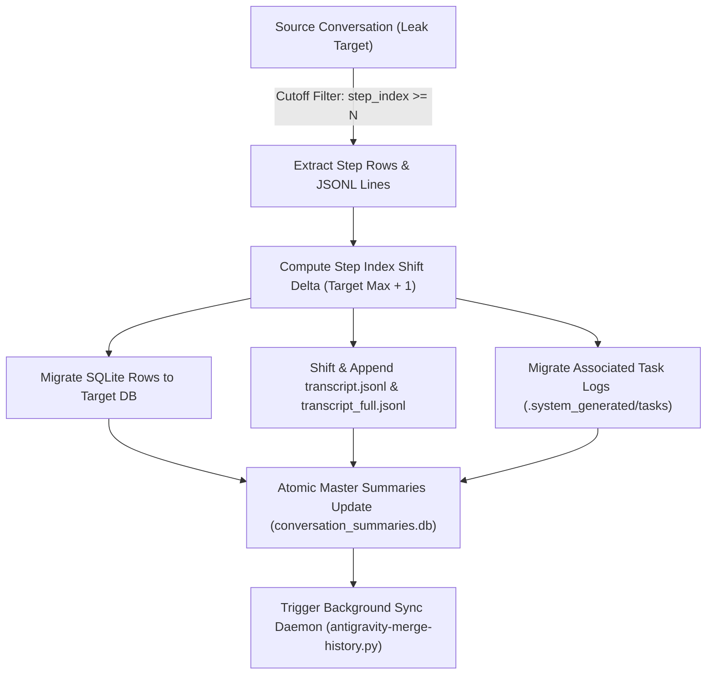

# Forensic Case 26: Cross-Conversation Session Splicing and Transcript Reconstitution

## 1. Incident Overview

During high-concurrency multi-account operations or abnormal workspace restarts, steps and conversation turns generated in one conversation context may become orphaned or mistakenly appended to an adjacent conversation thread (or split across session boundaries).

This causes:
1. **Broken Thread Continuity**: Responses refer to instructions executed in another chat window.
2. **Step Index Gaps / Discontinuities**: The UI displays incorrect step counts or stalls while reconstituting transcript logs.
3. **Master Index Desynchronization**: `conversation_summaries.db` records inconsistent `step_count` values compared to the actual rows inside `<conversation_id>.db`.

---

## 2. Technical Architecture & Forensic Findings

### 2.1 Multi-Tier Conversation Storage Engine
Antigravity stores chat state across three coupled layers:

1. **Relational Index** (`~/.gemini/antigravity/conversation_summaries.db`):
   - Table `conversation_summaries`: Contains `conversation_id`, `step_count`, `last_modified_time`, and metadata.
2. **Step State Database** (`~/.gemini/antigravity/conversations/<uuid>.db`):
   - Tables: `steps`, `step_payload`, `step_metadata`, and `artifacts`.
   - Primary key: `step_index` (monotonically increasing integer).
3. **Transcript Event Logs & Task Output** (`~/.gemini/antigravity/brain/<uuid>/`):
   - `.system_generated/logs/transcript.jsonl` (compact JSON lines)
   - `.system_generated/logs/transcript_full.jsonl` (full wire payloads)
   - `.system_generated/tasks/task-<N>.log` (background task execution logs)

### 2.2 Splicing Mechanics
The session splicer (`scripts/splice_leaked_session.py` and `src/antigravity_suite/history/splice_*.py`) executes surgical extraction and transplanting:



---

## 3. Tool Implementation & Operational Usage

### 3.1 Live Splicer Tool
The tool supports dry-run simulation and automated safety backup creation:

```bash
# Dry-run validation (inspects shift delta and planned step migrations)
python3 scripts/splice_leaked_session.py

# Live execution with automated pre-flight snapshot backup
python3 scripts/splice_leaked_session.py --execute
```

### 3.2 Safety Guarantees
- **Automated Pre-Flight Snapshot**: Backs up all source and target SQLite databases, transcripts, and summaries to timestamped `.bak` archives before modifying a single byte.
- **Foreign Key & Step Gap Validation**: Re-indexes transplanted steps to ensure contiguous `step_index` ordering without gaps.
- **WAL Flush**: Forces a SQLite checkpoint (`PRAGMA wal_checkpoint(FULL);`) to persist changes across active language server processes.
