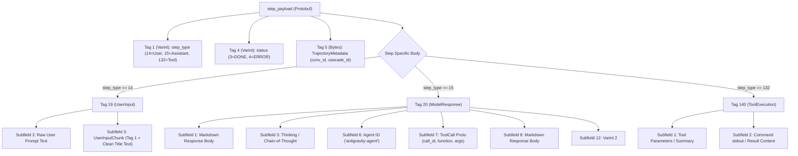

# Antigravity Suite Architecture, Internals & Isolation Guide

This skill documents the complete technical architecture, reverse-engineered runtime mechanics, storage schemas, and operational procedures for **Google Antigravity Hub** (Desktop App) and **Antigravity IDE** (VS Code edition).

---

## 1. Dual-Product Hierarchy & Binary Layout

Antigravity consists of two separate Electron-based products with distinct runtimes:

```mermaid
graph TD
    subgraph Antigravity Hub (Desktop App)
        HubBin["/opt/antigravity2/antigravity"] --> HubAsar["resources/app.asar"]
        HubBin --> HubLS["resources/bin/language_server (Go)"]
        HubLS --> HubDir["~/.gemini/ (Default Root)"]
    end

    subgraph Antigravity IDE (VS Code Fork)
        IDEBin["/opt/antigravity/antigravity-ide"] --> IDECode["resources/app/ (VS Code Core)"]
        IDECode --> IDEExt["resources/app/extensions/antigravity/"]
        IDEExt --> IDELSWrap["bin/language_server_linux_x64 (Wrapper)"]
        IDELSWrap --> IDELSBin["bin/language_server_linux_x64.bin (Go)"]
        IDELSBin --> IDEDir["~/.gemide/ or ~/.gemini/"]
    end
```

### Installation Directory Matrix

| Component | Antigravity Hub (Desktop App) | Antigravity IDE (Code Edition) |
| :--- | :--- | :--- |
| **Primary Directory** | `/opt/antigravity2/` | `/opt/antigravity/` |
| **Main Executable** | `/opt/antigravity2/antigravity` | `/opt/antigravity/antigravity-ide` |
| **Language Server** | `/opt/antigravity2/resources/bin/language_server` | `/opt/antigravity/resources/app/extensions/antigravity/bin/language_server_linux_x64.bin` |
| **Config / User Data** | `~/.config/Antigravity/` | `~/.config/Antigravity IDE/` |
| **Product Spec** | `package.json` inside `resources/app.asar` | `resources/app/product.json` |
| **Launcher** | `~/.local/bin/antigravity-1`, `antigravity-acc2` | `~/.local/bin/antigravity-ide` |
| **Desktop Shortcut** | `~/.local/share/applications/antigravity-1.desktop` | `~/.local/share/applications/antigravity-ide.desktop` |

---

## 2. Language Server Architecture & ConnectRPC Protocols

Both Hub and IDE rely on a compiled Go language server (`language_server`) providing code intelligence, chat streaming, user state, and cloud sync.

### Process Launch Arguments

```bash
/opt/antigravity/resources/app/extensions/antigravity/bin/language_server_linux_x64.bin \
  --gemini_dir=/home/reza/.gemide \
  --csrf_token=5ecc597a-0f7e-460a-9c01-3268282c7b5b \
  --extension_server_port=33557 \
  --extension_server_csrf_token=24a9e44c-a6df-4e5f-991f-a82a72bcac99 \
  --app_data_dir=antigravity-ide \
  --subclient_type=ide \
  --cloud_code_endpoint=https://daily-cloudcode-pa.googleapis.com
```

#### Critical Flag Definitions
- `--gemini_dir`: Root configuration directory containing tokens, history, and artifacts.
- `--app_data_dir`: Relative subfolder under `gemini_dir` storing instance data (`antigravity` or `antigravity-ide`).
- `--cloud_code_endpoint`: Target backend for Cloud Code APIs:
  - `https://cloudcode-pa.googleapis.com`: Corporate/enterprise endpoint (returns `403 Forbidden` for consumer Google AI Pro accounts).
  - `https://daily-cloudcode-pa.googleapis.com`: **Mandatory for consumer Google AI Pro / Google One accounts**.
- `--csrf_token`: Session token required for authenticating loopback RPC HTTP/HTTPS requests.
- `--subclient_type`: Informs backend telemetry of client mode (`ide` or `hub`).

### Key ConnectRPC Endpoints (`exa.language_server_pb.LanguageServerService`)

All loopback calls use ConnectRPC / gRPC-web over local loopback TLS with header `x-codeium-csrf-token: <csrf_token>`.

#### 1. `GetUserStatus`
Retrieves authenticated user identity, active tier, and capabilities:
```python
import urllib.request, json, ssl
ctx = ssl._create_unverified_context()
req = urllib.request.Request(
    f"https://127.0.0.1:{port}/exa.language_server_pb.LanguageServerService/GetUserStatus",
    data=b"{}",
    headers={"Content-Type": "application/json", "x-codeium-csrf-token": csrf}
)
with urllib.request.urlopen(req, context=ctx) as r:
    data = json.loads(r.read().decode())
    email = data.get("userStatus", {}).get("email")
    tier = data.get("userStatus", {}).get("planStatus", {}).get("planInfo", {}).get("teamsTier")
```

#### 2. `RetrieveUserQuotaSummary`
Fetches remaining token fractions and refresh timestamps:
```python
req = urllib.request.Request(
    f"https://127.0.0.1:{port}/exa.language_server_pb.LanguageServerService/RetrieveUserQuotaSummary",
    data=b"{}",
    headers={"Content-Type": "application/json", "x-codeium-csrf-token": csrf}
)
with urllib.request.urlopen(req, context=ctx) as r:
    quota = json.loads(r.read().decode())
    # Quota buckets: gemini-weekly, gemini-5h, 3p-weekly, 3p-5h
```

#### 3. `GetLoadCodeAssist`
Checks cloud project binding and subscription metadata:
- Consumer projects: `cloudaicompanionProject: aicode-consumers`.
- Paid tier IDs: `g1-pro-tier` (Google AI Pro) vs `free-tier` (Antigravity Starter Quota).

---

## 3. Storage Taxonomy, Databases & Schema Layout

### Directory Hierarchy

```
~/.gemini/ (or ~/.gemide/)
├── jetski-standalone-oauth-token        # Primary OAuth2 credential cache
├── oauth_credentials.json               # Google OAuth client ID & secret
├── google_accounts.json                 # Cached account list
├── cache/
│   └── antigravity-keyring-unavailable # Sentinel file forcing file-based auth
└── antigravity/ (or antigravity-ide/)
    ├── conversations/                   # Trajectory JSON histories
    │   └── <uuid>.json
    ├── brain/                           # Conversation artifacts & logs
    │   └── <uuid>/
    │       ├── *.md                     # Markdown artifacts
    │       └── .system_generated/       # Task logs & transcript.jsonl
    ├── annotations/                     # Pinned messages & bookmarks
    ├── conversation_summaries.db        # SQLite conversation index
    ├── conversation_summaries.db-wal    # SQLite WAL journal
    ├── conversation_summaries.db-shm    # SQLite shared memory
    └── agyhub_summaries_proto.pb        # Protobuf binary conversation summaries
```

### 1. `jetski-standalone-oauth-token` Structure
Stores Google OAuth2 tokens in JSON:
```json
{
  "token": {
    "access_token": "ya29.a0AX...",
    "token_type": "Bearer",
    "refresh_token": "1//0cwz...",
    "expiry": "2026-10-15T03:24:55.245742+00:00"
  },
  "auth_method": "consumer",
  "id_token": "eyJhbGciOi..."
}
```
> [!NOTE]
> `id_token` is a standard JWT containing `email`, `sub` (Google User ID), `aud`, and `iss`.

### 2. `conversation_summaries.db` (SQLite Schema)
Maintains conversation titles, previews, step counts, and user interaction states:
```sql
CREATE TABLE `conversation_summaries` (
    `conversation_id` TEXT PRIMARY KEY,
    `title` TEXT NOT NULL DEFAULT "",
    `preview` TEXT NOT NULL DEFAULT "",
    `step_count` INTEGER NOT NULL DEFAULT 0,
    `last_modified_time` DATETIME NOT NULL,
    `workspace_uris` TEXT NOT NULL DEFAULT "",
    `status` TEXT NOT NULL DEFAULT "CASCADE_RUN_STATUS_IDLE",
    `source` TEXT NOT NULL DEFAULT "",
    `project_id` TEXT NOT NULL DEFAULT "outside-of-project",
    `agent_name` TEXT NOT NULL DEFAULT "",
    `parent_conversation_id` TEXT NOT NULL DEFAULT "",
    `nesting_depth` INTEGER NOT NULL DEFAULT 0,
    `battle_id` TEXT NOT NULL DEFAULT "",
    `winning_conversation_id` TEXT NOT NULL DEFAULT "",
    `not_fully_idle` NUMERIC NOT NULL DEFAULT 0,
    `killed` NUMERIC NOT NULL DEFAULT 0,
    `last_user_input_time` DATETIME NOT NULL,
    `last_user_input_step_index` INTEGER NOT NULL DEFAULT -1,
    `app_data_dir` TEXT NOT NULL DEFAULT "antigravity",
    `raw_summary` BLOB,
    `group_id` TEXT NOT NULL DEFAULT ""
);
```

> [!CRITICAL]
> **Dual-Path Location Bug & Resolution**:
> - The Antigravity language server expects `conversation_summaries.db` strictly at the **gemini root** (`~/.gemini/antigravity/conversation_summaries.db`), NOT inside the `conversations/` subfolder.
> - If placed in `conversations/conversation_summaries.db`, the IDE sidebar completely fails to index or list conversations.
> - The synchronization suite auto-discovers any `conversation_summaries.db` in subdirectories or profile folders, ingests its records into master, backs up the original to `.bak_<timestamp>`, and replaces it with a symlink to master.

> [!CRITICAL]
> **Read/Unread "New" ("تازه") Badge Mechanics**:
> - Antigravity UI sidebar marks any conversation as **"New" / "Unread" ("تازه")** if `last_user_input_step_index == -1` while `step_count > 0` or if Field 16 in `CascadeTrajectorySummary` is omitted.
> - To mark conversations as read and prevent spurious "New" badges across all chats:
>   1. Query the conversation's step table (`SELECT idx FROM steps WHERE step_type = 14 ORDER BY idx DESC LIMIT 1`) to find the last user message index.
>   2. Set `last_user_input_step_index = idx` (or `max(0, step_count - 1)`).
>   3. Preserve the native `raw_summary` binary protobuf blob instead of overwriting it with synthetic stubs.

### 3. Individual Conversation Databases (`<uuid>.db`)
Each conversation is persisted as a dedicated SQLite database containing the complete trajectory steps, execution states, and tracking metadata:
```sql
CREATE TABLE `trajectory_meta` (`trajectory_id` TEXT, `cascade_id` TEXT, `trajectory_type` INTEGER, `source` INTEGER, PRIMARY KEY (`trajectory_id`));
CREATE TABLE `steps` (
    `idx` INTEGER, `step_type` INTEGER NOT NULL DEFAULT 0, `status` INTEGER NOT NULL DEFAULT 0,
    `has_subtrajectory` NUMERIC NOT NULL DEFAULT false, `metadata` BLOB, `error_details` BLOB,
    `permissions` BLOB, `task_details` BLOB, `render_info` BLOB, `step_payload` BLOB,
    `step_format` INTEGER NOT NULL DEFAULT 0, PRIMARY KEY (`idx`)
);
CREATE TABLE `gen_metadata` (`idx` INTEGER, `data` BLOB, `size` INTEGER NOT NULL DEFAULT 0, PRIMARY KEY (`idx`));
CREATE TABLE `executor_metadata` (`idx` INTEGER, `data` BLOB, PRIMARY KEY (`idx`));
CREATE TABLE `parent_references` (`idx` INTEGER, `data` BLOB, PRIMARY KEY (`idx`));
CREATE TABLE `trajectory_metadata_blob` (`id` TEXT DEFAULT "main", `data` BLOB, PRIMARY KEY (`id`));
CREATE TABLE `battle_mode_infos` (`idx` INTEGER, `data` BLOB, PRIMARY KEY (`idx`));
```

### 4. Protobuf `step_payload` Wire Architecture
The IDE frontend and language server decode chat messages from the binary Protobuf blob inside `step_payload` (and `metadata`):



> [!WARNING]
> **Empty Messages & Blank Bubble Headers Cause**:
> - **Blank Assistant Messages**: The IDE UI extracts assistant replies exclusively from **Tag 20, Subfield 1 & 8**. If assistant text is erroneously placed in Tag 19, the UI finds no Tag 20 and renders a completely blank/empty chat bubble.
> - **Blank User Message Titles**: The IDE UI extracts the user step heading/bubble title from **Tag 19, Subfield 3** (`UserInputChunk` containing Tag 1 string). If Subfield 3 is omitted, the user step header renders empty.
> - **Blank Tool Execution**: Tool output stdout must be encoded into **Tag 140, Subfield 2**.
> - **The `metadata` Column**: The `metadata` column in `steps` must store the exact byte string of Tag 5 (conv_id tracking proto) for IDE SQL readers.

### 5. Transcript Reconstitution & Incomplete Database Detection
When restoring conversations from transcript logs:
1. **Prioritize `transcript_full.jsonl`**: Standard `transcript.jsonl` truncates large messages (flagged by `"truncated_fields": ["content", "thinking"]`). Always ingest `transcript_full.jsonl` first.
2. **Auto-Detection of Incomplete Payloads (`is_synthesized_db_incomplete`)**:
   - Inspects `steps` table for Step 15 rows: checks for wire tag `b"\xa2\x01"` (Tag 20, wire type 2). If absent, assistant messages are blank.
   - Inspects `steps` table for Step 14 rows: checks for wire tag `b"\x1a"` (Tag 19, Subfield 3, wire type 2). If absent, user title bubbles are blank.
   - When incomplete, the merger automatically re-synthesizes the SQLite database from the transcript log.

### 6. `agyhub_summaries_proto.pb` (Protobuf Format)
Fast binary index used by the Electron UI sidebar to render conversation titles without scanning SQLite or JSON directories. Updated directly by `antigravity-merge-history.py`.

### 7. `state.vscdb` (VS Code Global State SQLite)
Located at `~/.config/Antigravity IDE/User/globalStorage/state.vscdb`:
- **Table**: `ItemTable (key TEXT PRIMARY KEY, value TEXT)`
- **Key Entries**:
  - `antigravityAuthStatus`: JSON containing `{ "name": "...", "email": "...", "apiKey": "..." }`.
  - `antigravityUnifiedStateSync.userStatus`: Base64-encoded Protobuf caching user status, models, and tiers.
  - `antigravityUnifiedStateSync.trajectorySummaries`: Base64-encoded Protobuf index of all conversations.

---

## 4. Keyring Decoupling & Complete Isolation Protocol

By default, the Go language server uses `github.com/zalando/go-keyring` to query DBus Secret Service (`service="gemini"`, `username="antigravity"`). If Secret Service responds, it loads Account 1's token regardless of local files.

### 4-Point Isolation Strategy

To isolate any Antigravity instance from GNOME Keyring completely:

#### Step 1: Strip DBus Session Bus
Unsetting `DBUS_SESSION_BUS_ADDRESS` breaks DBus IPC, forcing `go-keyring` to fail immediately and trigger the file-based token fallback:
```bash
export DBUS_SESSION_BUS_ADDRESS=""
export GNOME_KEYRING_CONTROL=""
export SSH_AUTH_SOCK=""
```

#### Step 2: Pass Password Store Basic Flag
Forces Electron / VS Code secret storage to use plaintext local configuration instead of system `libsecret`:
```bash
--password-store=basic
```

#### Step 3: Touch Keyring Unavailable Sentinel
Antigravity Hub checks for this sentinel file on startup:
```bash
mkdir -p "$HOME/.gemini/cache"
touch "$HOME/.gemini/cache/antigravity-keyring-unavailable"
```

#### Step 4: Binary String Patching (IDE Language Server)
The compiled Go binary `language_server_linux_x64.bin` contains hardcoded paths joining `os.UserHomeDir()` with `".gemini"` at offset `0x374087f`.

Patch offset `0x374087f` from `b'.gemini'` to `b'.gemide'`:
```python
with open("/opt/antigravity/resources/app/extensions/antigravity/bin/language_server_linux_x64.bin", "r+b") as f:
    f.seek(0x374087f)
    assert f.read(7) == b".gemini"
    f.seek(0x374087f)
    f.write(b".gemide")
```

---

## 5. Multi-Account Profile Isolation Matrix

To run multiple Antigravity instances concurrently without credential collisions or quota mirroring:

| Instance | Executable / Launcher | Profile Root | Gemini Dir | Password Store | Account Example |
| :--- | :--- | :--- | :--- | :--- | :--- |
| **Hub Acc 1** | `antigravity-1` | `~` | `~/.gemini` | `--password-store=basic` | `aisummerreza@gmail.com` |
| **Hub Acc 2** | `antigravity-acc2` | `~/.antigravity-profile2` | `~/.antigravity-profile2/.gemini` | `--password-store=basic` | `reza93ai20224@gmail.com` |
| **IDE** | `antigravity-ide` | `~` | `~/.gemide` | `--password-store=basic` | `rezalast4m@gmail.com` |

### 3-Way Unified History Architecture
While accounts and auth remain isolated, conversation histories and brain artifacts are unified via symlinks:
```
~/.gemini/antigravity/conversations/  <--- MASTER POOL
    ▲                             ▲
    │                             │
    ├── (Symlinked by Acc 2)      ├── (Symlinked by IDE)
    ~/.antigravity-profile2/           ~/.gemide/antigravity-ide/
    .gemini/antigravity                conversations
```

### Customizations, Skills, Rules & MCP Servers Unification
To guarantee all MCP servers, custom skills, rules, and plugins are shared between App and IDE without duplicating configs:

1. **Global Configuration Sharing**:
   - The IDE Language Server looks for customizations in `${gemini_dir}/config`.
   - Symlink `${REAL_HOME}/.gemide/config -> ~/.gemini/config`.
   - Exposes master `mcp_config.json`, `skills/`, `plugins/`, `sidecars/`, and hierarchical rules across all instances.

2. **MCP Tool Schemas & State Directory**:
   - The Language Server caches MCP tool JSON schemas inside `${app_data_dir}/mcp`.
   - Symlink `${REAL_HOME}/.gemide/antigravity-ide/mcp -> ~/.gemini/antigravity/mcp`.
   - Symlink `${REAL_HOME}/.gemide/antigravity-ide/plugin_data -> ~/.gemini/antigravity/plugin_data`.

3. **Dual Language Server MCP Architecture in IDE**:
   - **Main LS (`[LS Main]`)**: Spawned by Electron main process on random HTTPS port, binds core MCP servers (`grafana`, `kibana`, `portainer`, `proxmox`).
   - **Workspace LSP LS (`[LS lspClient]`)**: Spawned by extension host for the active workspace, binds remaining MCP servers (`elasticsearch`, `caveman`).
   - Both language servers register tools under ConnectRPC endpoint `GetMcpServerStates` (response field `states`).

4. **Root GEMINI.md & Shared Global Configuration**:
   - The Language Server resolves global system rules and instructions from `${gemini_dir}/GEMINI.md` as `user_global` (`CORTEX_MEMORY_SOURCE_USER`, `globalScope`, `discoveryCategory: DISCOVERY_CATEGORY_CONFIG`).
   - If `${gemini_dir}/GEMINI.md` is missing, the instance operates without custom rules or language protocols.
   - Symlink `${gemini_dir}/GEMINI.md -> ~/.gemini/GEMINI.md` across all instances (`~/.gemide`, `~/.gemini-ide`, `~/.antigravity-profile2/.gemini`).
   - Symlink `projects.json`, `settings.json`, `.env`, `state.json`, and `trustedFolders.json` identically.
   - **Rule Discovery & Deduplication Protocol**: The Go Language Server scans both `${gemini_dir}/GEMINI.md` and recursively crawls `${gemini_dir}/config/**/` for rule markdown files. NEVER create duplicate symlinks for `GEMINI.md` inside `${gemini_dir}/config/` or `${gemini_dir}/antigravity-ide/`. Doing so causes the language server to index the file multiple times, registering duplicate `user_global` rules in the IDE and wasting prompt tokens.
   - **Strict Isolation Boundary**: ONLY OAuth token files (`jetski-standalone-oauth-token`, `oauth_credentials.json`, `google_accounts.json`) and DBus keyring state are kept isolated per instance.

---

## 6. Google One AI Pro Quota Mechanics & Family Sharing

### Quota Bucket Types
1. `gemini-weekly`: Weekly tier quota budget (Gemini Pro / Flash).
2. `gemini-5h`: 5-hour smoothing window to prevent burst capacity exhaustion.
3. `3p-weekly` / `3p-5h`: Third-party models (Claude Sonnet/Opus, GPT-OSS).

### Google Family Group Pooling Caveat
> [!WARNING]
> If two Google accounts belong to the same Google Family Group with a shared Google One AI Premium subscription, Google Cloud Code backend **pools rate limits across all family members**.
> - Both accounts will report nearly identical remaining fractions.
> - Both accounts will report identical weekly reset times down to the second (`resetTime`).
> - Truly independent quotas require separate, unlinked Google One subscriptions outside of any shared family group.

---

## 7. Real-Time Synchronization Daemon (`antigravity-merge-history.py`)

Runs as a systemd user service (`antigravity-sync.service`) or on-demand CLI command:
- Uses polling and mtime debounce (0.5s) to monitor write events on databases, tokens, and storage files across all instances.
- Re-indexes conversation titles into SQLite `conversation_summaries.db`.
- Serializes and writes binary `agyhub_summaries_proto.pb` and `jetbox_summaries.pb` for instantaneous Hub UI updates without app restarts.
- Broadcasts Base64 `antigravityUnifiedStateSync.trajectorySummaries` to all IDE `state.vscdb` targets.

### 7.1 Multi-Home & Deep Targeted Heuristic Discovery Algorithm
To discover conversations across any system where Antigravity was manually installed, customized, or backed up:
1. **Multi-Home Resolution**: Aggregates `REAL_HOME`, `~`, and `~<user>` into candidate roots.
2. **Standard & Desktop Launcher Roots**: Parses `--user-data-dir`, `--profile-directory`, and `GEMINI_DIR` from all `.desktop` files in `/usr/share/applications` and `~/.local/share/applications`.
3. **Deep Targeted Scan (Depth Limit 5)**:
   - Recursively walks `.gemini*`, `.antigravity*`, `.config/*antigravity*`, and `.local/share/*antigravity*`.
   - **Brain Stores**: Detected when `transcript.jsonl` or `transcript_full.jsonl` is found; identifies the grandparent folder as a conversation brain store.
   - **Conversation Stores**: Detected when any UUID `.db` (`^[0-9a-fA-F-]{36}\.db$`) is found.
   - Detects backup stores like `brain.bak`, `conversations.bak`, and `backups/history/`.

### 7.2 Symlink Pipeline & Safe Backup Protocol
When uniting history across multiple instances without data loss:
1. **Step 1 & 2 (Copy Ingest)**: Any new `.db` or brain items in candidate stores are copied into the master pool (`~/.gemini/antigravity/`).
2. **Transcript Backfill**: If a conversation brain directory already exists in master but lacks `.system_generated/logs/transcript*.jsonl`, the logs are automatically backfilled from candidate folders.
3. **Step 7 (Atomic Link & Backup)**: For each target profile (`antigravity-ide`, `antigravity-cli`, `antigravity-acp`, custom profiles):
   - If `conversations`, `brain`, `annotations`, or `conversation_summaries.db` is an existing regular directory/file (from a manual installation), it is safely renamed to `<name>.bak_<timestamp>`.
   - An atomic symlink is created pointing to the master store.
   - This ensures manual installations join the unified pool without overwriting existing data.

### 7.3 Authentic H1 Document Title Extraction Pipeline
To prevent generic titles (`"Conversation"`, `"Untitled Conversation"`) or non-ASCII truncation:
1. **Annotations First**: Checks `annotations/<conv_id>.pbtxt` across all profile roots for user-renamed titles.
2. **Markdown Artifact H1 Heading**: Scans the conversation's brain folder for markdown artifacts (`*.md`). Parses the first H1 header (`# Server Configuration And Deployment Strategy`) as the genuine human-readable title.
3. **Prompt Fallback**: If no artifact H1 exists, extracts clean text from `<USER_REQUEST>` prompt tags (up to 80 chars).

### 7.4 Operational CLI Reference

| Command | Purpose |
| :--- | :--- |
| `python3 ~/.local/bin/antigravity-merge-history.py` | Standard full sync across all profiles and stores. |
| `python3 ~/.local/bin/antigravity-merge-history.py --rebuild` | **Force re-synthesizes all SQLite databases from transcripts** with complete Protobuf payloads. |
| `python3 ~/.local/bin/antigravity-merge-history.py --watch` | Runs in persistent daemon mode with automatic change detection. |
| `python3 ~/.local/bin/antigravity-merge-history.py --quiet` | Runs silently for background launchers and systemd. |

> [!TIP]
> **Post-Sync IDE UI Refresh**:
> After running `--rebuild` or a manual merge, reload the Antigravity IDE window to refresh the webview cache:
> Press `Ctrl+Shift+P` -> select `Developer: Reload Window`.
