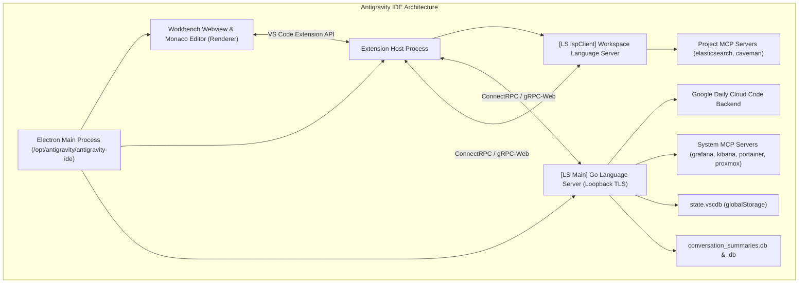

# Antigravity Suite Architecture, Internals & Isolation Guide

This skill documents the complete technical architecture, reverse-engineered runtime mechanics, storage schemas, and operational procedures for **Google Antigravity Hub** (Desktop App) and **Antigravity IDE** (VS Code edition).

---

## 1. Dual-Product Hierarchy & Binary Layout

Antigravity consists of two separate Electron-based products with distinct runtimes:

```mermaid
graph TD
    subgraph Antigravity Hub (Desktop App)
        HubBin["/opt/antigravity2/antigravity"] --> HubAsar["resources/app.asar"]
        HubBin --> HubLS["resources/bin/language_server (Go)"]
        HubLS --> HubDir["~/.gemini/ (Default Root)"]
    end

    subgraph Antigravity IDE (VS Code Fork)
        IDEBin["/opt/antigravity/antigravity-ide"] --> IDECode["resources/app/ (VS Code Core)"]
        IDECode --> IDEExt["resources/app/extensions/antigravity/"]
        IDEExt --> IDELSWrap["bin/language_server_linux_x64 (Wrapper)"]
        IDELSWrap --> IDELSBin["bin/language_server_linux_x64.bin (Go)"]
        IDELSBin --> IDEDir["~/.gemide/ or ~/.gemini/"]
    end
```

### Installation Directory Matrix

| Component | Antigravity Hub (Desktop App) | Antigravity IDE (Code Edition) |
| :--- | :--- | :--- |
| **Primary Directory** | `/opt/antigravity2/` | `/opt/antigravity/` |
| **Main Executable** | `/opt/antigravity2/antigravity` | `/opt/antigravity/antigravity-ide` |
| **Language Server** | `/opt/antigravity2/resources/bin/language_server` | `/opt/antigravity/resources/app/extensions/antigravity/bin/language_server_linux_x64.bin` |
| **Config / User Data** | `~/.config/Antigravity/` | `~/.config/Antigravity IDE/` |
| **Product Spec** | `package.json` inside `resources/app.asar` | `resources/app/product.json` |
| **Launcher** | `~/.local/bin/antigravity`, `antigravity-1`, `antigravity-acc2`, `antigravity-acc<N>` | `~/.local/bin/antigravity-ide` |
| **Desktop Shortcut** | `~/.local/share/applications/antigravity-1.desktop` | `~/.local/share/applications/antigravity-ide.desktop` |

### 1.1 Antigravity IDE Process & Component Architecture

Antigravity IDE is built upon a modified VS Code OSS core with tight integration between editor processes and native language services:



- **VS Code Core (`resources/app/`)**: Electron main runtime, Monaco editor rendering, extension host sandboxing, and workbench state management.
- **Antigravity Extension Host (`resources/app/extensions/antigravity/`)**: Custom extension acting as the IPC bridge between editor events (buffer edits, active tabs, terminal output) and the Go Language Server.
- **Dual Go Language Server Architecture**:
  - `[LS Main]` (**Main Language Server**): Spawned by Electron main process on dynamic loopback HTTPS port. Handles Cloud Code OAuth2 authentication, Gemini streaming, user quota monitoring, and system MCP tools.
  - `[LS lspClient]` (**Workspace Language Server**): Spawned by extension host for active workspace. Manages codebase semantic index, symbol lookup, and workspace-scoped MCP servers.
- **ConnectRPC Transport**: High-throughput binary RPC protocol over local TLS (`127.0.0.1:<port>`), authenticated via session token header `x-codeium-csrf-token: <csrf>`.

---

## 2. Language Server Architecture & ConnectRPC Protocols

Both Hub and IDE rely on a compiled Go language server (`language_server`) providing code intelligence, chat streaming, user state, and cloud sync.

### Process Launch Arguments

```bash
/opt/antigravity/resources/app/extensions/antigravity/bin/language_server_linux_x64.bin \
  --gemini_dir=$HOME/.gemide \
  --csrf_token=5ecc597a-0f7e-460a-9c01-3268282c7b5b \
  --extension_server_port=33557 \
  --extension_server_csrf_token=24a9e44c-a6df-4e5f-991f-a82a72bcac99 \
  --app_data_dir=antigravity-ide \
  --subclient_type=ide \
  --cloud_code_endpoint=https://daily-cloudcode-pa.googleapis.com
```

#### Critical Flag Definitions
- `--gemini_dir`: Root configuration directory containing tokens, history, and artifacts.
- `--app_data_dir`: Relative subfolder under `gemini_dir` storing instance data (`antigravity` or `antigravity-ide`).
- `--cloud_code_endpoint`: Target backend for Cloud Code APIs:
  - `https://cloudcode-pa.googleapis.com`: Corporate/enterprise endpoint (returns `403 Forbidden` for consumer Google AI Pro accounts).
  - `https://daily-cloudcode-pa.googleapis.com`: **Mandatory for consumer Google AI Pro / Google One accounts**.
- `--csrf_token`: Session token required for authenticating loopback RPC HTTP/HTTPS requests.
- `--subclient_type`: Informs backend telemetry of client mode (`ide`, `hub`, `cli`, `sdk`).

#### Comprehensive Hidden & Advanced Flag Inventory
Extracted from `/opt/antigravity2/resources/bin/language_server`:

| Flag | Default | Description & Operational Impact |
|:---|:---|:---|
| `--web_bundle_path` | `""` | Directory or `.zip` holding compiled web UI to serve, overriding the binary's embedded web bundle. Allows live frontend debugging/patching without binary recompilation. |
| `--model_api_client_type` | `ccpa` | Backend client driver: `ccpa` (Cloud Code PA) or `gemini`. Defaults to `ccpa`. |
| `--limit_go_max_procs` | `4` | Caps runtime `GOMAXPROCS` to prevent CPU exhaustion on multi-core systems. |
| `--persistent_mode` | `false` | Daemon mode: writes discovery file to disk and does not exit when IDE window or extension closes. |
| `--exit_on_stdin_close` | `false` | Ties language server lifetime to stdin EOF. Used when parent process cannot signal across OS boundary (e.g. WSL). |
| `--browser_eval_env` | `false` | Enables browser eval environment setup (pre-installed Playwright, CA certs, proxy/SSO). |
| `--cdp_port` | `9222` | Port for Chrome DevTools Protocol browser automation. |
| `--generative_service_addr`| `blade:...` | Generative service backend address (`blade:google.ai.generativelanguage.v1main.generativeservice-prod`). |
| `--beyond_quota_bucket` | `""` | Quota bucket for Beyond API calls (`team/bucket` format). |
| `--beyond_service_addr` | `""` | Address of Beyond generative service (Stubby client). |
| `--is_google_internal` | `false` | Enables Google internal corporate features, Piper VCS, and Mendel flags. |
| `--running_in_xbox` | `false` | Enables Xbox sandbox execution mode. |
| `--xbox_tool_use_port` | `0` | Port for Xbox Tool Use gRPC server. |
| `--zerog_*` | - | Google internal Zerog cloud VM integration (`--zerog_app_host_port`, `--zerog_http_socket_path`, `--zerog_tls_cert_path`, `--zerog_vm_ssh_key_path`). |
| `--use_test_gaia` | `false` | Redirects OAuth endpoints to Google Gaia staging (`gaiastaging`). |
| `--traffic_stream_selfid` | `""` | Census traffic stream isolation tag. |

#### Fixed Port & Environment Variable Overrides
The language server and IDE extension inspect specific environment variables at startup:

- `JETSKI_FIXED_SERVER_PORT`: Overrides dynamic ConnectRPC HTTPS port assignment with a deterministic port.
- `JETSKI_FIXED_LSP_PORT`: Overrides dynamic Language Server Protocol (LSP) port assignment.
- `ANTIGRAVITY_VSCODE_HOST=1`: Instructs the language server to print sign-in URLs to stdout (`ANTIGRAVITY_OPEN_URL: <url>`) rather than attempting to launch a desktop browser (essential in WSL and headless SSH).
- `AGY_BROWSER_ACTIVE_PORT_FILE`: Path to `DevToolsActivePort` used by the browser recording encoder.

#### IDE STDIN Initial Handshake Architecture
When launched by the Antigravity IDE (VS Code extension), the language server does NOT receive credentials via command-line flags. Instead, the extension spawns the binary and immediately writes a binary Protobuf message to **standard input (stdin)** before closing the stream:

```protobuf
message InitialHandshakeMetadata {
  string ide_name = 1;              // "antigravity"
  string ide_version = 2;           // "0.2.0"
  string extension_name = 3;        // "antigravity"
  string extension_path = 4;        // "/opt/antigravity/resources/app/extensions/antigravity"
  string locale = 5;                // e.g. "en"
  string device_fingerprint = 6;    // METADATA_INSTALLATION_ID UUID
  string api_key = 7;               // OAuth access token ("ya29.a0...")
  bool disable_telemetry = 8;       // true/false
  string user_tier_id = 9;          // "g1-pro-tier"
}
```
If this initial payload is malformed or missing, the language server logs:
`"Failed to unmarshal initial Protobuf metadata from stdin: %v"` and immediately aborts startup.

#### Host Bridge Connect Server (`hostBridgeServer.js`)
To enable the language server to query and coordinate with the Electron host without coupling to Electron APIs:
1. Electron starts an internal loopback ConnectRPC server on `127.0.0.1:<ephemeral_port>` with a 32-byte cryptographically random token.
2. Spawns `language_server` with `--host_bridge_url=http://127.0.0.1:<port>` and `--host_bridge_token=<hex_token>`.
3. Exposes `HostBridgeService`:
   - `getUpdateStatus`: Reports app version and update availability.
   - `applyUpdate`: Triggers graceful background update application.

#### Crash Monitoring & Auto-Restart Circuit Breaker
In `dist/languageServer.js`, Electron wraps the language server with an automated crash recovery watchdog:
- `RESTART_WINDOW_MS`: `60000` (1 minute rolling window).
- `MAX_RESTARTS`: `3` consecutive crash threshold.
- `RESTART_COOLDOWN_MS`: `2000` (2 second delay before respawning).
- **Crash Trigger Phrases**: The watchdog continuously tails stderr for:
  `panic:`, `fatal error:`, `unexpected fault address`, `runtime:`, `running GoogleExitFunction`, `panic serving`.
  When detected, the watchdog captures up to 100,000 bytes of stack trace into `language_server.log` and attempts restart. If 3 crashes occur within 60s, it enters permanent failure mode (`"Language server crashed 3 times in a row. Giving up."`).

### Key ConnectRPC Endpoints (`exa.language_server_pb.LanguageServerService`)

All loopback calls use ConnectRPC / gRPC-web over local loopback TLS with header `x-codeium-csrf-token: <csrf_token>`.

#### 1. `GetUserStatus`
Retrieves authenticated user identity, active tier, and capabilities:
```python
import urllib.request, json, ssl
ctx = ssl._create_unverified_context()
req = urllib.request.Request(
    f"https://127.0.0.1:{port}/exa.language_server_pb.LanguageServerService/GetUserStatus",
    data=b"{}",
    headers={"Content-Type": "application/json", "x-codeium-csrf-token": csrf}
)
with urllib.request.urlopen(req, context=ctx) as r:
    data = json.loads(r.read().decode())
    email = data.get("userStatus", {}).get("email")
    tier = data.get("userStatus", {}).get("planStatus", {}).get("planInfo", {}).get("teamsTier")
```

#### 2. `RetrieveUserQuotaSummary`
Fetches remaining token fractions and refresh timestamps:
```python
req = urllib.request.Request(
    f"https://127.0.0.1:{port}/exa.language_server_pb.LanguageServerService/RetrieveUserQuotaSummary",
    data=b"{}",
    headers={"Content-Type": "application/json", "x-codeium-csrf-token": csrf}
)
with urllib.request.urlopen(req, context=ctx) as r:
    quota = json.loads(r.read().decode())
    # Quota buckets: gemini-weekly, gemini-5h, 3p-weekly, 3p-5h
```

#### 3. `GetLoadCodeAssist`
Checks cloud project binding and subscription metadata:
- Consumer projects: `cloudaicompanionProject: aicode-consumers`.
- Paid tier IDs: `g1-pro-tier` (Google AI Pro) vs `free-tier` (Antigravity Starter Quota).

#### 4. `UpdateConversationAnnotations`
Dynamically pushes conversation title, pinned status, and archival state into the running Go Language Server's in-memory index and disk state without restarting the IDE or Desktop App:
```python
req = urllib.request.Request(
    f"https://127.0.0.1:{port}/exa.language_server_pb.LanguageServerService/UpdateConversationAnnotations",
    data=json.dumps({
        "cascadeIds": [conversation_id],
        "annotations": {
            "title": title,
            "pinned": True,
            "archived": False
        }
    }).encode("utf-8"),
    headers={"Content-Type": "application/json", "x-codeium-csrf-token": csrf}
)
with urllib.request.urlopen(req, context=ctx) as r:
    res = json.loads(r.read().decode())
```

#### 5. Live Backend Reconnection & F5 Language Server Recycling
When reloading the IDE window or pressing F5 to synchronize conversations:
- The custom patch (`patch_utils_reload.js`) binds F5 / developer reload.
- Strips stale event handlers to prevent duplicated RPC calls.
- Executes `await ls.restartLanguageServer()` to force the Go language server process to restart cleanly and re-read SQLite and Protobuf state from disk.

> [!NOTE]
> Language server port is dynamically bound upon launch. Discover it via loopback listeners: `ss -tulpn | grep language_server`. CSRF token is parsed from `--csrf_token` command line arguments of the process.

---

## 3. Storage Taxonomy, Databases & Schema Layout

### Directory Hierarchy

```
~/.gemini/ (or ~/.gemide/)
├── jetski-standalone-oauth-token        # Primary OAuth2 credential cache
├── oauth_credentials.json               # Google OAuth client ID & secret
├── google_accounts.json                 # Cached account list
├── cache/
│   └── antigravity-keyring-unavailable # Sentinel file forcing file-based auth
└── antigravity/ (or antigravity-ide/)
    ├── conversations/                   # Trajectory JSON histories
    │   └── <uuid>.json
    ├── brain/                           # Conversation artifacts & logs
    │   └── <uuid>/
    │       ├── *.md                     # Markdown artifacts
    │       └── .system_generated/       # Task logs & transcript.jsonl
    ├── annotations/                     # Pinned messages & bookmarks
    ├── conversation_summaries.db        # SQLite conversation index
    ├── conversation_summaries.db-wal    # SQLite WAL journal
    ├── conversation_summaries.db-shm    # SQLite shared memory
    └── agyhub_summaries_proto.pb        # Protobuf binary conversation summaries
```

### 1. `jetski-standalone-oauth-token` Structure
Stores Google OAuth2 tokens in JSON:
```json
{
  "token": {
    "access_token": "ya29.a0AX...",
    "token_type": "Bearer",
    "refresh_token": "1//0cwz...",
    "expiry": "2026-10-15T03:24:55.245742+00:00"
  },
  "auth_method": "consumer",
  "id_token": "eyJhbGciOi..."
}
```
> [!NOTE]
> `id_token` is a standard JWT containing `email`, `sub` (Google User ID), `aud`, and `iss`.

### 2. `conversation_summaries.db` (SQLite Schema)
Maintains conversation titles, previews, step counts, and user interaction states:
```sql
CREATE TABLE `conversation_summaries` (
    `conversation_id` TEXT PRIMARY KEY,
    `title` TEXT NOT NULL DEFAULT "",
    `preview` TEXT NOT NULL DEFAULT "",
    `step_count` INTEGER NOT NULL DEFAULT 0,
    `last_modified_time` DATETIME NOT NULL,
    `workspace_uris` TEXT NOT NULL DEFAULT "",
    `status` TEXT NOT NULL DEFAULT "CASCADE_RUN_STATUS_IDLE",
    `source` TEXT NOT NULL DEFAULT "",
    `project_id` TEXT NOT NULL DEFAULT "outside-of-project",
    `agent_name` TEXT NOT NULL DEFAULT "",
    `parent_conversation_id` TEXT NOT NULL DEFAULT "",
    `nesting_depth` INTEGER NOT NULL DEFAULT 0,
    `battle_id` TEXT NOT NULL DEFAULT "",
    `winning_conversation_id` TEXT NOT NULL DEFAULT "",
    `not_fully_idle` NUMERIC NOT NULL DEFAULT 0,
    `killed` NUMERIC NOT NULL DEFAULT 0,
    `last_user_input_time` DATETIME NOT NULL,
    `last_user_input_step_index` INTEGER NOT NULL DEFAULT -1,
    `app_data_dir` TEXT NOT NULL DEFAULT "antigravity",
    `raw_summary` BLOB,
    `group_id` TEXT NOT NULL DEFAULT ""
);
```

> [!CRITICAL]
> **Dual-Path Location Bug & Resolution**:
> - The Antigravity language server expects `conversation_summaries.db` strictly at the **gemini root** (`~/.gemini/antigravity/conversation_summaries.db`), NOT inside the `conversations/` subfolder.
> - If placed in `conversations/conversation_summaries.db`, the IDE sidebar completely fails to index or list conversations.
> - The synchronization suite auto-discovers any `conversation_summaries.db` in subdirectories or profile folders, ingests its records into master, backs up the original to `.bak_<timestamp>`, and replaces it with a symlink to master.

> [!CRITICAL]
> **Read/Unread "New" ("تازه") Badge Mechanics**:
> - Antigravity UI sidebar marks any conversation as **"New" / "Unread" ("تازه")** if `last_user_input_step_index == -1` while `step_count > 0` or if Field 16 in `CascadeTrajectorySummary` is omitted.
> - To mark conversations as read and prevent spurious "New" badges across all chats:
>   1. Query the conversation's step table (`SELECT idx FROM steps WHERE step_type = 14 ORDER BY idx DESC LIMIT 1`) to find the last user message index.
>   2. Set `last_user_input_step_index = idx` (or `max(0, step_count - 1)`).
>   3. Preserve the native `raw_summary` binary protobuf blob instead of overwriting it with synthetic stubs.

### 3. Individual Conversation Databases (`<uuid>.db`)
Each conversation is persisted as a dedicated SQLite database containing the complete trajectory steps, execution states, and tracking metadata:
```sql
CREATE TABLE `trajectory_meta` (`trajectory_id` TEXT, `cascade_id` TEXT, `trajectory_type` INTEGER, `source` INTEGER, PRIMARY KEY (`trajectory_id`));
CREATE TABLE `steps` (
    `idx` INTEGER, `step_type` INTEGER NOT NULL DEFAULT 0, `status` INTEGER NOT NULL DEFAULT 0,
    `has_subtrajectory` NUMERIC NOT NULL DEFAULT false, `metadata` BLOB, `error_details` BLOB,
    `permissions` BLOB, `task_details` BLOB, `render_info` BLOB, `step_payload` BLOB,
    `step_format` INTEGER NOT NULL DEFAULT 0, PRIMARY KEY (`idx`)
);
CREATE TABLE `gen_metadata` (`idx` INTEGER, `data` BLOB, `size` INTEGER NOT NULL DEFAULT 0, PRIMARY KEY (`idx`));
CREATE TABLE `executor_metadata` (`idx` INTEGER, `data` BLOB, PRIMARY KEY (`idx`));
CREATE TABLE `parent_references` (`idx` INTEGER, `data` BLOB, PRIMARY KEY (`idx`));
CREATE TABLE `trajectory_metadata_blob` (`id` TEXT DEFAULT "main", `data` BLOB, PRIMARY KEY (`id`));
CREATE TABLE `battle_mode_infos` (`idx` INTEGER, `data` BLOB, PRIMARY KEY (`idx`));
```

### 4. Protobuf `step_payload` Wire Architecture
The IDE frontend and language server decode chat messages from the binary Protobuf blob inside `step_payload` (and `metadata`):

```mermaid
graph TD
    Payload["step_payload (Protobuf Outer Message)"]
    Payload --> Tag1["Tag 1 (Varint): step_type (14=User, 15=Assistant, 132=Tool, ...)"]
    Payload --> Tag4["Tag 4 (Varint): status (1=UNSPECIFIED, 2=RUNNING, 3=DONE, 4=ERROR)"]
    Payload --> Tag5["Tag 5 (Bytes): TrajectoryMetadata (conv_id, cascade_id)"]
    Payload --> TagPayload{"Step Specific Body by Tag"}
    
    TagPayload -->|"step_type == 14"| Tag19["Tag 19 (CortexStepUserInput)"]
    Tag19 --> Tag19_1["Subfield 1: query (string)"]
    Tag19 --> Tag19_2["Subfield 2: Raw User Prompt Text (string)"]
    Tag19 --> Tag19_3["Subfield 3: UserInputChunk (Subfield 1 = Clean Title Text)"]
    Tag19 --> Tag19_5["Subfield 5: images (repeated ImageData)"]
    Tag19 --> Tag19_9["Subfield 9: media (repeated MediaItem: mime_type, uri)"]

    TagPayload -->|"step_type == 15"| Tag20["Tag 20 (CortexStepPlannerResponse)"]
    Tag20 --> Tag20_1["Subfield 1: Primary Markdown Response Body (string)"]
    Tag20 --> Tag20_3["Subfield 3: Thinking / CoT Reasoning (string)"]
    Tag20 --> Tag20_6["Subfield 6: Agent ID ('antigravity-agent')"]
    Tag20 --> Tag20_7["Subfield 7: ToolCall Proto (call_id, function, args JSON)"]
    Tag20 --> Tag20_8["Subfield 8: Fallback Markdown Response Body (string)"]
    Tag20 --> Tag20_11["Subfield 11: thinking_duration (int64)"]
    Tag20 --> Tag20_14["Subfield 14: thinking_signature (bytes)"]
    Tag20 --> Tag20_16["Subfield 16: raw_thinking (string)"]

    TagPayload -->|"step_type == 23"| Tag23["Tag 23 (CortexStepCheckpointGenerated)"]
    Tag23 --> Tag23_30["Subfield 30: TrajectoryState (Subfield 4 = Authentic LLM Title)"]

    TagPayload -->|"step_type == 28"| Tag28["Tag 28 (CortexStepRunCommand)"]
    Tag28 --> Tag28_1["Subfield 1: command_line (string)"]
    Tag28 --> Tag28_2["Subfield 2: cwd (string)"]
    Tag28 --> Tag28_3["Subfield 3: is_daemon (bool)"]

    TagPayload -->|"step_type == 47"| Tag47["Tag 47 (CortexStepMcpTool)"]
    Tag47 --> Tag47_1["Subfield 1: server_name (string)"]
    Tag47 --> Tag47_2["Subfield 2: tool_name (string)"]
    Tag47 --> Tag47_3["Subfield 3: arguments_json (string)"]

    TagPayload -->|"step_type == 132/140"| Tag140["Tag 140 (CortexStepGeneric / ToolExecution)"]
    Tag140 --> Tag140_1["Subfield 1: Tool Parameters / Args Key-Value Pairs"]
    Tag140 --> Tag140_2["Subfield 2: Command stdout / Result Content (string)"]

    TagPayload -->|"step_type == 143"| Tag143["Tag 143 (CortexStepInvokeSubagent)"]
    Tag143 --> Tag143_1["Subfield 1: role (string)"]
    Tag143 --> Tag143_2["Subfield 2: prompt (string)"]

    TagPayload -->|"step_type == 154"| Tag154["Tag 154 (CortexStepAskQuestion)"]
```



#### Complete Step Type Enumeration & Body Tag Mapping
| Step Type ID | Name | Payload Tag | Schema Message | Primary Fields |
|:---:|:---|:---:|:---|:---|
| **14** | `USER_INPUT` | **19** | `CortexStepUserInput` | Subfield 1=`query`, Subfield 2=`user_response` (raw prompt), Subfield 3=`items` (`UserInputChunk`: 1=`clean_title`), Subfield 5=`images`, Subfield 9=`media` |
| **15** | `PLANNER_RESPONSE` | **20** | `CortexStepPlannerResponse` | Subfield 1=`response` (markdown), Subfield 3=`thinking` (CoT), Subfield 6=`message_id`, Subfield 7=`tool_calls`, Subfield 8=`modified_response`, Subfield 16=`raw_thinking` |
| **23** | `CHECKPOINT_GENERATED` | **23** / **30** | `CortexStepCheckpoint` | Subfield 30=`trajectory_state` (Subfield 4=`authentic_llm_title`) |
| **28** | `RUN_COMMAND` | **28** | `CortexStepRunCommand` | Subfield 1=`command_line`, Subfield 2=`cwd`, Subfield 3=`is_daemon`, Subfield 5=`wait_ms_before_async` |
| **42** | `SEARCH_WEB` | **42** | `CortexStepSearchWeb` | Subfield 1=`query`, Subfield 2=`results` |
| **47** | `MCP_TOOL` | **47** | `CortexStepMcpTool` | Subfield 1=`server_name`, Subfield 2=`tool_name`, Subfield 3=`arguments_json` |
| **93** | `TASK_BOUNDARY` | **93** | `CortexStepTaskBoundary` | Subfield 1=`boundary_marker` |
| **94** | `NOTIFY_USER` | **94** | `CortexStepNotifyUser` | Subfield 1=`message` |
| **132** / **140** | `TOOL_EXECUTION` | **140** | `CortexStepGeneric` | Subfield 1=`args` key-value pairs, Subfield 2=`result` stdout/output text |
| **143** | `INVOKE_SUBAGENT`| **143** | `CortexStepInvokeSubagent` | Subfield 1=`role`, Subfield 2=`prompt`, Subfield 3=`subagent_id` |
| **154** | `ASK_QUESTION` | **154** | `CortexStepAskQuestion` | Subfield 1=`questions`, Subfield 2=`options`, Subfield 3=`is_multi_select` |

> [!WARNING]
> **Empty Messages & Blank Bubble Headers Cause**:
> - **Blank Assistant Messages**: The IDE UI extracts assistant replies exclusively from **Tag 20, Subfield 1 & 8**. If assistant text is erroneously placed in Tag 19, the UI finds no Tag 20 and renders a completely blank/empty chat bubble.
> - **Blank User Message Titles**: The IDE UI extracts the user step heading/bubble title from **Tag 19, Subfield 3** (`UserInputChunk` containing Tag 1 string). If Subfield 3 is omitted, the user step header renders empty.
> - **Blank Tool Execution**: Tool output stdout must be encoded into **Tag 140, Subfield 2**.
> - **The `metadata` Column**: The `metadata` column in `steps` must store the exact byte string of Tag 5 (conv_id tracking proto) for IDE SQL readers.

### 5. Transcript Reconstitution & Incomplete Database Detection
When restoring conversations from transcript logs:
1. **Prioritize `transcript_full.jsonl`**: Standard `transcript.jsonl` truncates large messages (flagged by `"truncated_fields": ["content", "thinking"]`). Always ingest `transcript_full.jsonl` first.
2. **Auto-Detection of Incomplete Payloads (`is_synthesized_db_incomplete`)**:
   - Inspects `steps` table for Step 15 rows: checks for wire tag `b"\xa2\x01"` (Tag 20, wire type 2). If absent, assistant messages are blank.
   - Inspects `steps` table for Step 14 rows: checks for wire tag `b"\x1a"` (Tag 19, Subfield 3, wire type 2). If absent, user title bubbles are blank.
   - When incomplete, the merger automatically re-synthesizes the SQLite database from the transcript log.

### 6. Fast Binary Indices (`agyhub_summaries_proto.pb` & `jetbox_summaries.pb`)
Fast binary Protobuf caches used by the Electron UI sidebar to render conversation titles without scanning SQLite or JSON directories:
- `~/.gemini/antigravity/agyhub_summaries_proto.pb`
- `~/.gemini/antigravity/jetbox_summaries.pb`
Both files encapsulate repeated `CascadeTrajectorySummary` records. Updated directly by `antigravity-merge-history.py`.

### 7. Definitive Protobuf Tag Reference (Extracted Descriptors)

#### 7.1 `CascadeTrajectorySummary` (`jetski_cortex.proto`)
The top-level conversation summary message persisted inside SQLite `conversation_summaries.raw_summary` and serialized in `agyhub_summaries_proto.pb`:

| Tag | Field Name | Wire Type | Proto Type | Description |
|:---:|:---|:---:|:---|:---|
| **1** | `summary` | Length-Delimited | `string` | Conversation prompt text or summary fallback |
| **2** | `step_count` | Varint | `uint32` | Total number of trajectory steps executed |
| **3** | `last_modified_time` | Length-Delimited | `google.protobuf.Timestamp` | Last modification timestamp (`seconds`, `nanos`) |
| **4** | `trajectory_id` | Length-Delimited | `string` | Canonical conversation UUID |
| **5** | `status` | Varint | `CascadeRunStatus` | Run status enum (1=IDLE, 2=RUNNING, 3=PAUSED) |
| **7** | `created_time` | Length-Delimited | `google.protobuf.Timestamp` | Conversation initial creation timestamp |
| **8** | `waiting_steps` | Length-Delimited | `repeated CortexTrajectoryStepWithIndex` | Steps awaiting user response or tool approval |
| **9** | `workspaces` | Length-Delimited | `repeated CortexWorkspaceMetadata` | Workspaces and Git repositories bound to conversation |
| **10** | `last_user_input_time` | Length-Delimited | `google.protobuf.Timestamp` | Exact timestamp of the last prompt sent by user |
| **12** | `latest_notify_user_step` | Length-Delimited | `CortexTrajectoryStepWithIndex` | Most recent notification step |
| **14** | `latest_task_boundary_step` | Length-Delimited | `CortexTrajectoryStepWithIndex` | Most recent task boundary execution marker |
| **15** | `annotations` | Length-Delimited | `ConversationAnnotations` | User annotations submessage (title, pinned, archived) |
| **16** | `last_user_input_step_index` | Varint | `uint32` | Step index of last user input. Governs "New" unread badge |
| **17** | `trajectory_metadata` | Length-Delimited | `CortexTrajectoryMetadata` | Deep conversation, agent config, and project metadata |
| **18** | `has_active_children` | Varint | `bool` | True if multi-agent subagents are currently running |
| **19** | `battle_mode_info` | Length-Delimited | `BattleModeInfo` | Multi-model arena / battle mode tracking info |
| **20** | `source` | Varint | `CortexTrajectorySource` | Creation client source enum (1=USER, 2=IDE, etc.) |

> [!CRITICAL]
> **The Reverse-Engineered Protobuf Wire Gates (Sidebar & Visibility Rules)**:
> - **Tag 20 Gate (`source`)**: In `CascadeTrajectorySummary`, Tag 20 encodes the client source enum (`0=UNSPECIFIED`, `1=JETBOX`). If Tag 20 is emitted with non-zero or foreign values, the Desktop App frontend check `Ena(source) === false` shunts the conversation to `externalSummaries`, completely hiding it from the main sidebar (`0 chats rendered`). Must NOT emit Tag 20 when `source == 0` (or omit entirely).
> - **Tag 22 Gate (`trajectory_type`)**: Must strictly be set to `4` (`CASCADE`). Setting `8` or other types triggers frontend `mm()` filter which excludes the conversation from `topLevel` sidebar navigation.
> - **Tag 15 -> Tag 1 Gate (`title` Precedence)**: Frontend function `gC(a)` evaluates titles with strict priority: `annotations.title` (Tag 15 -> Tag 1) takes precedence over root `summary` (Tag 1). If `annotations.title` is populated, changing root `summary` alone has zero visual effect in the UI sidebar.
> - **Tag 15 -> Tag 7 Gate (`last_user_view_time` & Unread Badge)**: Desktop App function `pT(summary)` compares `lastModifiedTime.seconds > lastUserViewTime.seconds`. An unread dot/badge is rendered whenever `lastModifiedTime` is newer than `lastUserViewTime`. Opening a chat fires an internal RPC updating `lastUserViewTime` in `annotations.pbtxt`.
> - **Tag 17 -> Tag 5/6 Gate (`parent_conversation_id` & Subagent Tree)**: In `CortexTrajectoryMetadata`, if Tag 5 (`parent_conversation_id`) is populated, frontend function `tY()` classifies the conversation as a child/subagent trajectory and suppresses it from the top-level chat drawer, nesting it strictly under the parent tree.

| **21** | `not_fully_idle` | Varint | `bool` | In-flight execution sentinel flag |
| **22** | `trajectory_type` | Varint | `CortexTrajectoryType` | Trajectory type enum (4=CHAT) |
| **23** | `killed` | Varint | `bool` | True if conversation was explicitly killed by user |
| **24** | `fork_parent_conversation_id` | Length-Delimited | `string` | Parent UUID if conversation was forked |
| **25** | `interrupted` | Varint | `bool` | True if stream was aborted mid-generation |
| **26** | `has_activity` | Varint | `bool` | Background activity indicator |
| **27** | `cloud` | Varint | `bool` | True if synchronized to Google Cloud backend |
| **28** | `latest_executor_termination_reason` | Varint | `ExecutorTerminationReason` | Termination code of last executor run |

#### 7.2 `ConversationAnnotations` (Tag 15 in `CascadeTrajectorySummary`)
Defines all user-facing state flags, titles, and categorization:

| Tag | Field Name | Wire Type | Proto Type | Description |
|:---:|:---|:---:|:---|:---|
| **1** | `title` | Length-Delimited | `string` | Conversation title displayed in sidebar |
| **3** | `tags` | Length-Delimited | `repeated string` | Tag list attached to conversation |
| **4** | `archived` | Varint | `bool` | **Canonical archival status flag** |
| **5** | `archival_status_timestamp` | Length-Delimited | `google.protobuf.Timestamp` | Timestamp when conversation was archived/restored |
| **6** | `starred` | Varint | `bool` | Starred / favorite flag |
| **7** | `last_user_view_time` | Length-Delimited | `google.protobuf.Timestamp` | Timestamp when user last clicked or opened conversation |
| **8** | `marked_as_unread` | Varint | `bool` | Explicit unread marker |
| **9** | `group_id` | Length-Delimited | `string` | Folder or group category UUID |
| **10** | `group_index` | Varint | `int32` | Relative sort index inside group |
| **11** | `group_description` | Length-Delimited | `string` | Description of group |
| **12** | `pinned` | Varint | `bool` | **Pinned status flag** (evaluated by Desktop App `gZ()`) |
| **13** | `cls` | Length-Delimited | `repeated int64` | Classifier category IDs |
| **14** | `active_profile` | Length-Delimited | `string` | Profile label under which conversation was created |
| **15** | `conversation_group_id` | Length-Delimited | `string` | Group cluster identifier |
| **16** | `sensitivity_level` | Varint | `SensitivityLevel` | DLP data sensitivity classification |

#### 7.3 `CortexWorkspaceMetadata` (Tag 9 in Summary & Tag 1 in Metadata)
| Tag | Field Name | Wire Type | Proto Type | Description |
|:---:|:---|:---:|:---|:---|
| **1** | `workspace_folder_absolute_uri` | Length-Delimited | `string` | Project workspace URI (e.g. `file://<workspace_root>`) |
| **2** | `git_root_absolute_uri` | Length-Delimited | `string` | Git repository root URI |
| **3** | `repository` | Length-Delimited | `Repository` | Repository metadata submessage |
| **4** | `branch_name` | Length-Delimited | `string` | Active Git branch name |

#### 7.4 `CortexTrajectoryMetadata` (Tag 17 in Summary & `trajectory_metadata_blob`)
| Tag | Field Name | Wire Type | Proto Type | Description |
|:---:|:---|:---:|:---|:---|
| **1** | `workspaces` | Length-Delimited | `repeated CortexWorkspaceMetadata` | Workspaces array |
| **2** | `created_at` | Length-Delimited | `google.protobuf.Timestamp` | Trajectory initialization timestamp |
| **3** | `initialization_state_id` | Length-Delimited | `string` | Init state UUID |
| **4** | `agent_script` | Length-Delimited | `AgentScriptItem` | Configured workflow script metadata |
| **5** | `parent_conversation_id` | Length-Delimited | `string` | Parent conversation UUID in agent tree |
| **6** | `root_conversation_id` | Length-Delimited | `string` | Root conversation UUID |
| **7** | `workspace_uris` | Length-Delimited | `repeated string` | Workspace URI strings list |
| **8** | `subagent_spec` | Length-Delimited | `SubagentSpec` | Subagent configuration specification |
| **10** | `static_config` | Length-Delimited | `CustomAgentSpec` | Static agent prompt and tool definitions |
| **11** | `executable_spec` | Length-Delimited | `ExecutableScriptSpec` | Executable script runner specs |
| **12** | `source_metadata` | Length-Delimited | `SourceMetadata` | Origin client metadata |
| **15** | `mendel_experiment_ids` | Length-Delimited | `repeated int32` | Active Google Mendel feature experiment IDs |
| **16** | `is_battle_mode_fork` | Varint | `bool` | True if trajectory is a Battle Mode fork |
| **17** | `nesting_depth` | Varint | `int32` | Subagent recursion nesting depth |
| **18** | `project_id` | Length-Delimited | `string` | Project identifier (`outside-of-project` or hash) |
| **19** | `environment_id` | Length-Delimited | `string` | Environment execution ID |
| **20** | `tags` | Length-Delimited | `repeated string` | Trajectory metadata tags |
| **21** | `replacements` | Length-Delimited | `repeated StringReplacement` | Context placeholder replacements |
| **22** | `battle_mode_metadata` | Length-Delimited | `BattleModeMetadata` | Multi-model arena metadata |
| **23** | `remote_control_details` | Length-Delimited | `RemoteControlDetails` | Remote headless control session state |

#### 7.5 The Year 1 AD ("2027y") Date Collapse & Go `time.Time{}` Zero-Value Mechanics

##### 1. Symptoms & Visual Manifestation
In the Antigravity Hub Desktop App and IDE sidebar, conversation cards suddenly display ancient relative dates such as `"2027y"` or `"2025y"` instead of human dates (e.g. `"2 hours ago"`, `"Oct 14"`). This anomaly frequently manifests on pinned chats or after clicking on a reconstructed conversation.

##### 2. The Frontend Formatting Mechanism
In Electron frontend bundle `jetski_main.js:3630264`:
```javascript
function iO(date) {
    return formatDistanceToNow(date, { addSuffix: false });
}
```
`formatDistanceToNow` computes the difference between current year (2026) and Year 1 AD (`0001-01-01T00:00:00Z`). The resulting duration is ~2025-2027 years, which date-fns formats and truncates to `"2027y"`.

##### 3. Go Runtime `time.Time{}` Zero-Value Wire Encoding
In the Go language server (`language_server`), uninitialized timestamps default to the Go zero-value:
`time.Time{} = 0001-01-01 00:00:00 UTC = -62,135,596,800 seconds from Unix epoch`

When Go's `google.protobuf.Timestamp` proto3 library encodes this value into a varint:
`-62,135,596,800 = 18446744011573954816 (mod 2^64) = 0xfffffff1886e0900`
Serialized protobuf wire bytes:
```hex
08 80 92 b8 c3 98 fe ff ff ff 01
```
Whenever this sequence appears in Protobuf Tag 3 (`last_modified_time`) or Tag 10 (`last_user_input_time`), the frontend parses Year 1 AD.

##### 4. Language Server `recomputeAndStore` Trigger
The Go Language Server maintains an in-memory summaries cache (`jetbox_summaries_store.(*Store).summaries`).
When any of the following events occur:
1. User clicks or views a conversation in the UI (firing `UpdateAnnotations`).
2. An inotify file event detects a change to `conversations/<uuid>.db`.
3. The store initiates startup reconciliation.

The language server executes `Store.recomputeAndStore`, which opens `conversations/<uuid>.db` and scans `steps.metadata` to extract the most recent step timestamps (`CortexStepMetadata`).

##### 5. Root Cause: Missing Step Metadata Timestamps
In earlier database synthesizers, `steps.metadata` was constructed with only `conv_id` and routing metadata:
```python
meta += encode_tag_bytes(12, conv_id.encode("utf-8"))
meta += encode_tag_bytes(20, sub)
# Missing: Step timestamps Tag 1, Tag 6, Tag 7, Tag 8, Tag 32!
```
When `recomputeAndStore` found no timestamp tags in `steps.metadata`, the Go struct field `LastModifiedTime` remained `time.Time{}` (`0001-01-01T00:00:00Z`). The language server stored this zeroed struct into memory and broadcast it over ConnectRPC `JetboxSubscribeToSummaries`, wiping the authentic date in the running UI.

##### 6. The Step Metadata Timestamp Specification (`CortexStepMetadata`)
Every step written to `steps.metadata` must encode authentic timestamps:
- **Tag 1 (`created_at`)**: Step creation timestamp (`google.protobuf.Timestamp`).
- **Tag 6 (`finished_generating_at`)**: Generation finish timestamp.
- **Tag 7 (`started_at`)**: Step execution start timestamp.
- **Tag 8 (`completed_at`)**: Step execution completion timestamp.
- **Tag 32 (`last_completed_chunk_at`)**: Streaming chunk completion timestamp.

##### 7. Live In-Memory Repair via ConnectRPC (Without Killing Language Server)
To update the language server's in-memory summaries map without restarting processes:
```python
import urllib.request, json

req_body = {
    "cascadeId": "<uuid>",
    "summary": {
        ...summary_dict,
        "lastModifiedTime": "2026-10-18T10:00:00Z",
        "lastUserInputTime": "2026-10-18T10:00:00Z",
    }
}
req = urllib.request.Request(
    f"http://127.0.0.1:{ls_port}/exa.language_server_pb.LanguageServerService/JetboxWriteSummary",
    data=json.dumps(req_body).encode("utf-8"),
    headers={
        "Content-Type": "application/json",
        "x-codeium-csrf-token": csrf_token,
        "Connect-Protocol-Version": "1",
    }
)
urllib.request.urlopen(req)
```

---

### 8. Desktop App Storage (`app_storage.json`) & Double-Elimination Filtering Mechanics

The Antigravity Hub Desktop App stores UI interaction state in `~/.config/Antigravity/app_storage.json` (and instance profile variants like `~/.antigravity-profile2/.config/Antigravity/app_storage.json`).

#### Critical Keys & Formatting
```json
{
  "pinnedConversations": "[\"c99bd561-1ff5-4e7a-9774-60193bb967b5\"]",
  "archivedConversations": "[\"4632490d-2bcf-4f90-8e12-c2cb4e6503c5\"]",
  "conversationTitles": {
    "c99bd561-1ff5-4e7a-9774-60193bb967b5": "Running Two AntiGravity Apps Same Account"
  }
}
```
> [!CRITICAL]
> **String-Encoded JSON Arrays vs Native JSON Arrays**:
> - The Electron Desktop App periodically writes `pinnedConversations` and `archivedConversations` as a **JSON-stringified string** (e.g. `"[\"uuid1\", \"uuid2\"]"`), NOT a native JSON array.
> - Parser implementations must handle both native JSON lists and double-deserialization of stringified arrays (`if isinstance(val, str): val = json.loads(val)`).

#### The Double-Elimination Filter in Desktop App UI (`main.js` / `gZ()`)
The Desktop App frontend applies a strict two-tier filter when categorizing conversations:
1. **Pinned Filter**:
   - The UI checks `indexes.pinned.has(uuid)` (from `app_storage.json`).
   - **AND** it checks `summary.annotations.pinned === true` (from Protobuf Tag 15 -> Tag 12).
   - **Double-Elimination Failure**: If a conversation is in `pinnedConversations` inside `app_storage.json`, but `raw_summary` Protobuf Tag 12 is false/missing, the UI strips the chat from the pinned section entirely.
2. **Archived Filter**:
   - The UI checks `indexes.archived.has(uuid)` (from `app_storage.json`).
   - **AND** it checks `summary.annotations.archived === true` (from Protobuf Tag 15 -> Tag 4).
   - If Protobuf Tag 4 is not set, the chat appears in active conversations instead of archives.

#### 3-Tier Synchronization Mandate
To ensure 100% parity across IDE and Desktop App without missing or miscategorized chats:
1. **Protobuf `raw_summary`**: Set Tag 15 -> Tag 12 (`pinned = true`) and Tag 15 -> Tag 4 (`archived = true/false`).
2. **`app_storage.json`**: Update both native lists and write stringified JSON arrays across all instance config roots.
3. **ConnectRPC `UpdateConversationAnnotations`**: Send live updates to running Go Language Server instances so memory caches refresh instantly.

---

### 9. `state.vscdb` (VS Code Global State SQLite)
Located at `~/.config/Antigravity IDE/User/globalStorage/state.vscdb`:
- **Table**: `ItemTable (key TEXT PRIMARY KEY, value TEXT)`
- **Core Key Entries**:
  - `antigravityAuthStatus`: JSON containing `{ "name": "...", "email": "...", "apiKey": "..." }`.
  - `antigravityUnifiedStateSync.oauthToken`: Base64-encoded Protobuf envelope storing:
    - `authStateWithContextSentinelKey`: JSON auth state object (`{"state": "signedIn", "isGcpTos": false, ...}`).
    - `oauthTokenInfoSentinelKey`: Protobuf payload storing Google OAuth `access_token` (`ya29.a0...`), token type (`Bearer`), and Google `refresh_token` (`1//0cwz...`).
  - `antigravityUnifiedStateSync.userStatus`: Base64-encoded Protobuf envelope (`UserStatusSentinelKey`) containing:
    - Authenticated Google identity (display name, email address, profile avatar URL).
    - Active tier specification (`id: "g1-pro-tier"`, name `"Google AI Pro"`, upgrade link `https://antigravity.google/g1-upgrade`).
    - Available model catalog with thinking budget flags: `Gemini 3.8 Flash (High/Medium/Low)`, `Claude Sonnet 4.6 (Thinking)`, `Claude Opus 4.6 (Thinking)`, `GPT-OSS 120B (Medium)`.
    - Supported multi-modal MIME types matrix (over 40 types: `application/json`, `text/x-python`, `application/pdf`, `video/mp4`, `image/webp`, `audio/opus`, etc.).
    - Model deprecation notices and sunset policy metadata.
  - `antigravityUnifiedStateSync.modelCredits`: Base64-encoded Protobuf envelope storing `minimumCreditAmountForUsageKey` and `availableCreditsSentinelKey`.
  - `antigravityUnifiedStateSync.trajectorySummaries`: Base64-encoded Protobuf index caching all conversations and tree hierarchies for instant sidebar display.
  - `antigravityUnifiedStateSync.agentPreferences`: Custom subagent prompt templates and execution flags.
  - `antigravityUnifiedStateSync.sidebarWorkspaces`: Pinned and active workspace folders for the sidebar drawer.

---

### 10. Legacy vs. Modern Database & Storage Architecture Comparison

The storage architecture of Antigravity IDE underwent a major transition from flat binary/JSON structures (Early 2024 - Mid 2026) to a transactional SQLite + Protobuf wire system (Late 2026+):

| Dimension | Legacy Architecture (Early 2024 - Mid 2026) | Modern Architecture (Late 2026+) |
| :--- | :--- | :--- |
| **Chat Storage Format** | Flat binary Protobuf files (`<uuid>.pb`) and JSON logs (`<uuid>.json`) | Dedicated SQLite databases per conversation (`<uuid>.db`) with WAL journal |
| **Trajectory Steps** | Monolithic blob containing all steps in memory | Granular `steps` table: 1 row per step (`idx`), indexed by step type |
| **Global Conversation Index** | Flat binary files (`agyhub_summaries_proto.pb`, `jetbox_summaries.pb`) | SQLite relational database `conversation_summaries.db` with B-Tree indices |
| **Workspace Filtering** | None. All conversations appeared in a single flat sidebar list | Strict workspace partitioning via `workspace_uris` and `project_id` columns |
| **Unread "New" State** | Not tracked. Spurious badges or untracked state | Tracked via `last_user_input_step_index` and `last_user_input_time` |
| **IDE State Persistence** | Basic JSON / file cache | Two-way synchronized `state.vscdb` (`antigravityUnifiedStateSync.trajectorySummaries`) |
| **Concurrent Safe Operations** | High risk of file corruption during concurrent access or hard crashes | ACID compliant via SQLite WAL mode and transactions (`copy_sqlite_db_safely`) |
| **Subagent / Multi-Agent Support** | Flat, no hierarchy tracking | Relational hierarchy tracking via `parent_conversation_id` and `nesting_depth` |

#### Detailed Schema Comparison

##### 1. Legacy Schema (`conversation_summaries` - Initial Format)
```sql
-- Initial barebones schema without workspace separation
CREATE TABLE conversation_summaries (
    conversation_id TEXT PRIMARY KEY,
    title TEXT DEFAULT "",
    preview TEXT DEFAULT "",
    step_count INTEGER DEFAULT 0,
    last_modified_time DATETIME NOT NULL,
    status TEXT DEFAULT "CASCADE_RUN_STATUS_IDLE",
    source TEXT DEFAULT "",
    raw_summary BLOB
);
-- Limitations of Legacy:
-- 1. No workspace_uris or project_id: All conversations leaked across all workspaces.
-- 2. No last_user_input_step_index: Sidebar displayed spurious "New" badges permanently.
-- 3. No timestamps indexing: Full table scan required on every sidebar load.
```

##### 2. Modern Schema (`conversation_summaries` - Full Modern Schema)
```sql
CREATE TABLE conversation_summaries (
    conversation_id TEXT PRIMARY KEY,
    title TEXT NOT NULL DEFAULT "",
    preview TEXT NOT NULL DEFAULT "",
    step_count INTEGER NOT NULL DEFAULT 0,
    last_modified_time DATETIME NOT NULL,
    workspace_uris TEXT NOT NULL DEFAULT "",            -- [MODERN] Project Git URI for workspace filtering
    status TEXT NOT NULL DEFAULT "CASCADE_RUN_STATUS_IDLE",
    source TEXT NOT NULL DEFAULT "",
    project_id TEXT NOT NULL DEFAULT "",                -- [MODERN] Project hash / "outside-of-project"
    agent_name TEXT NOT NULL DEFAULT "",                -- [MODERN] Specialized agent spec name
    parent_conversation_id TEXT NOT NULL DEFAULT "",    -- [MODERN] Agent tree parent UUID
    nesting_depth INTEGER NOT NULL DEFAULT 0,           -- [MODERN] Subagent recursion depth
    battle_id TEXT NOT NULL DEFAULT "",                 -- [MODERN] Battle Mode arena identifier
    winning_conversation_id TEXT NOT NULL DEFAULT "",   -- [MODERN] Battle Mode winner UUID
    not_fully_idle NUMERIC NOT NULL DEFAULT false,      -- [MODERN] In-flight execution sentinel
    killed NUMERIC NOT NULL DEFAULT false,              -- [MODERN] Cancelled/killed state flag
    last_user_input_time DATETIME NOT NULL,             -- [MODERN] Exact timestamp of last user prompt
    last_user_input_step_index INTEGER NOT NULL DEFAULT -1, -- [MODERN] Read/unread indicator
    app_data_dir TEXT NOT NULL DEFAULT "antigravity",
    raw_summary BLOB,                                   -- Complete CascadeTrajectorySummary protobuf
    group_id TEXT NOT NULL DEFAULT ""                   -- [MODERN] Grouping / folder identifier
);

CREATE INDEX idx_conversation_summaries_last_user_input_time
    ON conversation_summaries (last_user_input_time);
CREATE INDEX idx_conversation_summaries_last_modified_time
    ON conversation_summaries (last_modified_time);
```

##### 3. Modern Per-Conversation Database (`<uuid>.db`)
Each conversation is an independent SQLite database preventing single-point corruption:
```sql
CREATE TABLE trajectory_meta (
    trajectory_id TEXT PRIMARY KEY,
    cascade_id TEXT,
    trajectory_type INTEGER, -- 4=CHAT
    source INTEGER           -- 1=USER, 2=IDE
);

CREATE TABLE steps (
    idx INTEGER PRIMARY KEY,
    step_type INTEGER NOT NULL DEFAULT 0, -- 14=User, 15=Assistant, 28=RunCommand, 47=MCP, 140=Tool
    status INTEGER NOT NULL DEFAULT 0,    -- 1=UNSPECIFIED, 2=RUNNING, 3=DONE, 4=ERROR
    has_subtrajectory NUMERIC NOT NULL DEFAULT false,
    metadata BLOB,                        -- Protobuf Tag 5 TrajectoryMetadata
    error_details BLOB,
    permissions BLOB,
    task_details BLOB,
    render_info BLOB,
    step_payload BLOB,                    -- Protobuf payload (Tags 19, 20, 28, 47, 140)
    step_format INTEGER NOT NULL DEFAULT 0
);

CREATE TABLE trajectory_metadata_blob (
    id TEXT PRIMARY KEY DEFAULT "main",
    data BLOB -- Protobuf CortexTrajectoryMetadata (workspaces, git_root, project_id)
);

CREATE TABLE gen_metadata (idx INTEGER PRIMARY KEY, data BLOB, size INTEGER NOT NULL DEFAULT 0);
CREATE TABLE executor_metadata (idx INTEGER PRIMARY KEY, data BLOB);
CREATE TABLE parent_references (idx INTEGER PRIMARY KEY, data BLOB);
CREATE TABLE battle_mode_infos (idx INTEGER PRIMARY KEY, data BLOB);
```

---

## 4. Keyring Decoupling & Complete Isolation Protocol

By default, the Go language server uses `github.com/zalando/go-keyring` to query DBus Secret Service (`service="gemini"`, `username="antigravity"`). If Secret Service responds, it loads Account 1's token regardless of local files.

### 4-Point Isolation Strategy

To isolate any Antigravity instance from GNOME Keyring completely:

#### Step 1: Strip DBus Session Bus
Unsetting `DBUS_SESSION_BUS_ADDRESS` breaks DBus IPC, forcing `go-keyring` to fail immediately and trigger the file-based token fallback:
```bash
export DBUS_SESSION_BUS_ADDRESS=""
export GNOME_KEYRING_CONTROL=""
export SSH_AUTH_SOCK=""
```

#### Step 2: Pass Password Store Basic Flag
Forces Electron / VS Code secret storage to use plaintext local configuration instead of system `libsecret`:
```bash
--password-store=basic
```

#### Step 3: Touch Keyring Unavailable Sentinel
Antigravity Hub checks for this sentinel file on startup:
```bash
mkdir -p "$HOME/.gemini/cache"
touch "$HOME/.gemini/cache/antigravity-keyring-unavailable"
```

#### Step 4: Binary String Patching (IDE Language Server)
The compiled Go binary `language_server_linux_x64.bin` contains hardcoded paths joining `os.UserHomeDir()` with `".gemini"` at offset `0x374087f`.

Patch offset `0x374087f` from `b'.gemini'` to `b'.gemide'`:
```python
with open("/opt/antigravity/resources/app/extensions/antigravity/bin/language_server_linux_x64.bin", "r+b") as f:
    f.seek(0x374087f)
    assert f.read(7) == b".gemini"
    f.seek(0x374087f)
    f.write(b".gemide")
```

---

## 5. Multi-Account Profile Isolation Matrix

To run multiple Antigravity instances concurrently without credential collisions or quota mirroring:

| Instance | Executable / Launcher | Profile Root | Gemini Dir | Password Store | Account Example |
| :--- | :--- | :--- | :--- | :--- | :--- |
| **Hub Acc 1** | `antigravity-1` | `~` | `~/.gemini` | `--password-store=basic` | `primary@example.com` |
| **Hub Acc 2** | `antigravity-acc2` | `~/.antigravity-profile2` | `~/.antigravity-profile2/.gemini` | `--password-store=basic` | `secondary@example.com` |
| **Hub Acc N** | `antigravity-acc<N>`| `~/.antigravity-profile<N>` | `~/.antigravity-profile<N>/.gemini`| `--password-store=basic` | `custom@example.com` |
| **IDE** | `antigravity-ide` | `~` | `~/.gemide` | `--password-store=basic` | `ide-dev@example.com` |

### Dynamic Multi-Instance Architecture & Generic Launchers (`app_launcher.sh`)
Bespoke, hardcoded scripts (`account1.sh`, `account2.sh`) have been completely eliminated. Generic launchers are dynamically written with two mission-critical safeguards:
1. **Manual Restart Flag (`--restart` / `-r`)**:
   Pass `--restart` to cleanly kill existing instance PIDs and start fresh without zombie lockups:
   ```bash
   antigravity --restart
   antigravity-acc2 --restart
   ```
2. **Stale Binary Detection in RAM**:
   When the Antigravity binary is updated while running, the kernel marks the running executable in `/proc/<pid>/exe` as `(deleted)`. The launcher detects this stale status and automatically restarts the process with the new version.

### 3-Way Unified History Architecture
While accounts and auth remain isolated, conversation histories and brain artifacts are unified via symlinks:
```
~/.gemini/antigravity/conversations/  <--- MASTER POOL
    ▲                             ▲
    │                             │
    ├── (Symlinked by Acc 2)      ├── (Symlinked by IDE)
    ~/.antigravity-profile2/           ~/.gemide/antigravity-ide/
    .gemini/antigravity                conversations
```

### Customizations, Skills, Rules & MCP Servers Unification
To guarantee all MCP servers, custom skills, rules, and plugins are shared between App and IDE without duplicating configs:

1. **Global Configuration Sharing**:
   - The IDE Language Server looks for customizations in `${gemini_dir}/config`.
   - Symlink `${REAL_HOME}/.gemide/config -> ~/.gemini/config`.
   - Exposes master `mcp_config.json`, `skills/`, `plugins/`, `sidecars/`, and hierarchical rules across all instances.

2. **MCP Tool Schemas & State Directory**:
   - The Language Server caches MCP tool JSON schemas inside `${app_data_dir}/mcp`.
   - Symlink `${REAL_HOME}/.gemide/antigravity-ide/mcp -> ~/.gemini/antigravity/mcp`.
   - Symlink `${REAL_HOME}/.gemide/antigravity-ide/plugin_data -> ~/.gemini/antigravity/plugin_data`.

3. **Dual Language Server MCP Architecture in IDE**:
   - **Main LS (`[LS Main]`)**: Spawned by Electron main process on random HTTPS port, binds core MCP servers (`grafana`, `kibana`, `portainer`, `proxmox`).
   - **Workspace LSP LS (`[LS lspClient]`)**: Spawned by extension host for the active workspace, binds remaining MCP servers (`elasticsearch`, `caveman`).
   - Both language servers register tools under ConnectRPC endpoint `GetMcpServerStates` (response field `states`).

4. **Root GEMINI.md & Shared Global Configuration**:
   - The Language Server resolves global system rules and instructions from `${gemini_dir}/GEMINI.md` as `user_global` (`CORTEX_MEMORY_SOURCE_USER`, `globalScope`, `discoveryCategory: DISCOVERY_CATEGORY_CONFIG`).
   - If `${gemini_dir}/GEMINI.md` is missing, the instance operates without custom rules or language protocols.
   - Symlink `${gemini_dir}/GEMINI.md -> ~/.gemini/GEMINI.md` across all instances (`~/.gemide`, `~/.gemini-ide`, `~/.antigravity-profile2/.gemini`).
   - Symlink `projects.json`, `settings.json`, `.env`, `state.json`, and `trustedFolders.json` identically.
   - **Rule Discovery & Deduplication Protocol**: The Go Language Server scans both `${gemini_dir}/GEMINI.md` and recursively crawls `${gemini_dir}/config/**/` for rule markdown files. NEVER create duplicate symlinks for `GEMINI.md` inside `${gemini_dir}/config/` or `${gemini_dir}/antigravity-ide/`. Doing so causes the language server to index the file multiple times, registering duplicate `user_global` rules in the IDE and wasting prompt tokens.
   - **Strict Isolation Boundary**: ONLY OAuth token files (`jetski-standalone-oauth-token`, `oauth_credentials.json`, `google_accounts.json`) and DBus keyring state are kept isolated per instance.

### 5.1 Multi-Account Selector Subsystem & IDE Injection
The Multi-Account Selector subsystem enables seamless, per-conversation Google account routing, real-time quota telemetry, and native UI controls inside both the local Antigravity Desktop App and Antigravity IDE:
1. **Workbench DOM & Injection Layer**:
   - Injected into Antigravity IDE workbench shell (`workbench.desktop.main.js`) and Desktop App (`app.asar/dist/utils.js`).
   - Automatically locates the model selector button (`[data-testid="model-selector-trigger"]`) or input footer container.
2. **Layer Isolation & Z-Index Hierarchy**:
   - VS Code Quick-Pick, Command Palette, and Global Modals render at `z-index: 2550`.
   - The Account Selector container uses `z-index: auto` / `2000` to prevent leaking above command palettes or chat search popups.
3. **Dynamic Viewport Anchoring (`updateDdPos`)**:
   - Dropdown uses `position: fixed` calculated from the anchor button's bounding rectangle.
   - Active `resize` and `scroll` listeners dynamically recompute `bottom/top/left/right` offsets during window or container resizing.
   - If the anchor button is scrolled out of the visible viewport, open dropdowns and flyout menus automatically close.
4. **Quota Telemetry Freshness & Synchronization**:
   - Direct Cloud Code HTTPS API queries (`/v1internal:retrieveUserQuotaSummary`) for secondary accounts and LanguageServer ConnectRPC for the primary account.
   - Proactive background synchronization triggered on conversation switch, window focus, and dropdown open.
   - Cache staleness threshold set to 20 seconds, with forced bypass via "Refresh" button (`?refresh=1`).
5. **Quota Fallback & Routing Policy**:
   - **Per-Conversation Pinning**: Individual conversations (`cascadeId`) are bound to specific Google accounts in `bindings.json`. Unpinned chats inherit `__active_account`.
   - **No Silent Cross-Account Failover**: The router does not silently switch Google accounts on HTTP 429 (`RESOURCE_EXHAUSTED`). If an account exhausts its quota, the user explicitly switches accounts via the UI selector or `/switch` command to maintain audit integrity.
   - **Internal Model Fallback**: Upstream Google Language Server internally falls back between priority models (e.g., Gemini 1.5 Pro to Gemini 1.5 Flash) when weekly quota is exhausted, but operates strictly within the active account's token scope.

---

## 6. Google One AI Pro Quota Mechanics & Family Sharing

### Quota Bucket Types
1. `gemini-weekly`: Weekly tier quota budget (Gemini Pro / Flash).
2. `gemini-5h`: 5-hour smoothing window to prevent burst capacity exhaustion.
3. `3p-weekly` / `3p-5h`: Third-party models (Claude Sonnet/Opus, GPT-OSS).

### Google Family Group Pooling Caveat
> [!WARNING]
> If two Google accounts belong to the same Google Family Group with a shared Google One AI Premium subscription, Google Cloud Code backend **pools rate limits across all family members**.
> - Both accounts will report nearly identical remaining fractions.
> - Both accounts will report identical weekly reset times down to the second (`resetTime`).
> - Truly independent quotas require separate, unlinked Google One subscriptions outside of any shared family group.

---

## 7. Real-Time Synchronization Daemon (`antigravity-merge-history.py`)

Runs as a systemd user service (`antigravity-sync.service`) or on-demand CLI command:
- Uses Linux kernel inotify and `epoll` with adaptive debounce (3.0s quiet duration) to monitor write events.
- **Self-Trigger Protection**: Excludes `app_storage.json`, `*.vscdb-wal`, `*.vscdb-shm`, and `transcript_full.jsonl` from watch triggers to prevent feedback loops and ensure 0.0% idle CPU (`STAT Ss`).
- **Physical Database Protection**: Enforces hard existence guards on `(d / f"{c}.db").stat().st_size > 100` before processing any deletion, preventing active conversations from being purged during workspace switches.
- **Go Zero-Value Timestamp Rejection**: Rejects any incoming date starting with `"0001"`, preventing `-62135596800` varint seconds from poisoning Protobuf Tag 3 and causing the `2027y` UI date bug.
- Re-indexes conversation titles into SQLite `conversation_summaries.db`.
- Serializes and writes binary `agyhub_summaries_proto.pb` and `jetbox_summaries.pb` for instantaneous Hub UI updates without app restarts.
- Broadcasts Base64 `antigravityUnifiedStateSync.trajectorySummaries` to all IDE `state.vscdb` targets.

### 7.1 Multi-Home & Deep Targeted Heuristic Discovery Algorithm
To discover conversations across any system where Antigravity was manually installed, customized, or backed up:
1. **Multi-Home Resolution**: Aggregates `REAL_HOME`, `~`, and `~<user>` into candidate roots.
2. **Standard & Desktop Launcher Roots**: Parses `--user-data-dir`, `--profile-directory`, and `GEMINI_DIR` from all `.desktop` files in `/usr/share/applications` and `~/.local/share/applications`.
3. **Deep Targeted Scan (Depth Limit 5)**:
   - Recursively walks `.gemini*`, `.antigravity*`, `.config/*antigravity*`, and `.local/share/*antigravity*`.
   - **Brain Stores**: Detected when `transcript.jsonl` or `transcript_full.jsonl` is found; identifies the grandparent folder as a conversation brain store.
   - **Conversation Stores**: Detected when any UUID `.db` (`^[0-9a-fA-F-]{36}\.db$`) is found.
   - Detects backup stores like `brain.bak`, `conversations.bak`, and `backups/history/`.

### 7.2 Symlink Pipeline & Safe Backup Protocol
When uniting history across multiple instances without data loss:
1. **Step 1 & 2 (Copy Ingest)**: Any new `.db` or brain items in candidate stores are copied into the master pool (`~/.gemini/antigravity/`).
2. **Transcript Backfill**: If a conversation brain directory already exists in master but lacks `.system_generated/logs/transcript*.jsonl`, the logs are automatically backfilled from candidate folders.
3. **Step 7 (Atomic Link & Backup)**: For each target profile (`antigravity-ide`, `antigravity-cli`, `antigravity-acp`, custom profiles):
   - If `conversations`, `brain`, `annotations`, or `conversation_summaries.db` is an existing regular directory/file (from a manual installation), it is safely renamed to `<name>.bak_<timestamp>`.
   - An atomic symlink is created pointing to the master store.
   - This ensures manual installations join the unified pool without overwriting existing data.

### 7.3 Authentic H1 Document Title Extraction Pipeline
To prevent generic titles (`"Conversation"`, `"Untitled Conversation"`), user prompt leaking into headers, or non-ASCII truncation:
1. **Annotations First**: Checks `annotations/<conv_id>.pbtxt` across all profile roots for user-renamed titles.
2. **Language Server Checkpoint Step 23**: Queries `<uuid>.db` for Step 23 (`CHECKPOINT_GENERATED`), decoding Protobuf Tag 30 (`TrajectoryState`), Subfield 4 (`Title`) generated asynchronously by the LLM.
3. **Markdown Artifact H1 Heading**: Scans the conversation's brain folder for markdown artifacts (`*.md`). Parses the first H1 header (`# Server Configuration And Deployment Strategy`) as the genuine human-readable title.
4. **Prompt Fallback**: If no artifact H1 exists, extracts clean text from `<USER_REQUEST>` prompt tags (up to 80 chars).

### 7.4 Dynamic Workspace Discovery (Elimination of Hardcoded Roots)
Previous iterations relied on hardcoded container sets (`phpstormprojects`, `webstormprojects`, etc.). The system now dynamically learns workspaces:
1. Queries `state.vscdb` (`recentlyOpenedPathsList`) for active project roots across all IDE instances.
2. Inspects Git root identifiers for opened files.
3. Automatically maps `outside-of-project` conversations without hardcoded personal path leaks.

### 7.5 "2027y" Zero-Value Timestamp Rejection & Fallback Mechanics
Go's uninitialized `time.Time{}` (`0001-01-01T00:00:00Z`) serializes to `-62135596800` Unix seconds, which encodes as a 10-byte signed varint and causes the UI to render `"2027y"` or `"Year 1 / Epoch 0"`:
- Validates `dt.year > 2000` and explicitly rejects any incoming timestamp starting with `"0001"`.
- Falls back to the physical filesystem modification time (`mtime`) of `<uuid>.db`.

### 7.6 Operational CLI Reference

| Command | Purpose |
| :--- | :--- |
| `python3 ~/.local/bin/antigravity-merge-history.py` | Standard full sync across all profiles and stores. |
| `python3 ~/.local/bin/antigravity-merge-history.py --rebuild` | **Force re-synthesizes all SQLite databases from transcripts** with complete Protobuf payloads. |
| `python3 ~/.local/bin/antigravity-merge-history.py --watch` | Runs in persistent daemon mode with automatic change detection. |
| `python3 ~/.local/bin/antigravity-merge-history.py --quiet` | Runs silently for background launchers and systemd. |

### 7.7 Quad-Phase Scaling Optimization Architecture (17.0s -> 2.18s)
When synchronizing large conversation stores (300+ chats across IDE and App), the history merger experienced heavy CPU saturation (17.0s duration, 25% CPU / 1 full core, 17.7 million calls). The quad-phase optimization resolved this:
1. **Phase 1: SQLite Discovery & Inode Pruning**:
   - Skips non-existent or 0-byte database paths before attempting schema inspection or SQL connections.
   - Eliminates redundant filesystem traversals across disconnected workspace folders.
2. **Phase 2: Inode Dirty-Checking & Change Detection**:
   - Calculates a lightweight composite fingerprint: `(file_size, mtime_ns, last_row_id)`.
   - Bypasses full metadata extraction and SQLite table scans for unchanged conversations.
3. **Phase 3: SQLite FTS Index Upsert Guard**:
   - Full-text search indexing (`conversation_fts`) is guarded against unchanged tokens.
   - Eliminates 300+ redundant writes per cycle, reducing WAL file churn and I/O lock contention.
4. **Phase 4: Protobuf Parsing Memoization**:
   - Implements an LRU memoization cache for binary protobuf `step_payload` blobs.
   - Completed historical steps are deserialized once and cached across merger cycles.
5. **Authentic Chronological Timestamp Extraction**:
   - Queries `SELECT created_at FROM steps WHERE created_at IS NOT NULL ORDER BY step_index DESC LIMIT 1` from the SQLite `steps` table.
   - Inspects the stream tail (last 32 KB) of `transcript.jsonl` when SQLite is absent.
   - Rejects future timestamps (`2027y`) and unauthenticated filesystem mtimes to preserve true chronological order.
6. **Empirical Benchmark Results**:
   - Duration reduced from **17.0s -> 2.18s** (~87% faster).
   - Internal function calls reduced from **17.7M -> 5.1M** (~71% reduction).
   - CPU impact reduced from continuous 25% saturation to a transient <0.3s burst.

---

## 8. Antigravity IDE Bundle Checksum Integrity & Corruption Dialog Prevention

### 8.1 Mechanism
Antigravity IDE (VS Code OSS) runs `IntegrityService` on startup to verify core bundle files against `/opt/antigravity/resources/app/product.json["checksums"]`.
- Files checked: 11 core files under `out/` (`workbench.desktop.main.js`, `workbench.html`, `workbench-jetski-agent.html`, etc.).
- Algorithm: SHA-256 base64 digest with trailing `=` stripped.
- If any file hash mismatches, the dialog `"Your Antigravity IDE installation appears to be corrupt. Please reinstall."` is displayed.

### 8.2 Cause
Applying patches (`antigravity-rtl`, custom workbench reload buttons) alters bundle files without updating `product.json["checksums"]`.

### 8.3 Fix & Tooling
- Synchronizer tool: `~/.local/bin/antigravity-checksums` or `manage-antigravity.sh checksums`.
- Verification command: `antigravity-checksums /opt/antigravity --verify`.
- Automated hook: `patch_rtl.sh` and `suite_update.sh` automatically invoke `fix_ide_checksums` on patch apply and update.

---

## 9. X11 Window Class, System Tray Sync & Catmull-Rom Bicubic Resampling

### 9.1 Multi-Resolution Resampler (`src/scale_icon.c`)
Standard nearest-neighbor or bilinear image downsampling produces blurry window and taskbar icons. The suite compiles a native C resampler (`scale_icon`) using Catmull-Rom bicubic spline filtering:
- Compiles to `~/.local/bin/scale_icon`.
- Generates exact mipmap buffers across discrete resolution brackets: `16x16`, `24x24`, `32x32`, `48x48`, `64x64`, `128x128`, and `256x256`.

### 9.2 Live X11 Window Injector (`antigravity-apply-icon.py`)
A background daemon monitors window creation via `xdotool` / `xprop` and dynamically applies `_NET_WM_ICON` directly onto X11 surfaces:
- Synchronizes tray icon caches in `/tmp/org.chromium.Chromium.*/status_icon_*.png`.
- Maintains theme distinction: Account 1 (White/Black), Account 2 (Violet recolor).

---

## 10. Suite Repository Self-Update & Background Services Orchestration

### 10.1 Self-Update Workflow (`bin/lib/sh/repo_update.sh`)
Allows updating the Antigravity Suite Manager codebase itself without broken states:
```bash
~/manage-antigravity.sh update-repo
# or via installer:
./install.sh --update-repo
```
- **Discovery**: Resolves repo root dynamically via git and Python package inspection (`antigravity_suite.__file__`).
- **Git Pull**: Pulls latest commits from `origin/main`.
- **Recompilation**: Recompiles `src/scale_icon.c` with GCC `-O3`.
- **Redeployment**: Synchronizes scripts and `bin/lib/` to `~/.local/bin`.
- **Python Path**: Refreshes `antigravity_suite.pth` in user site-packages.
- **Service Restart**: Automatically invokes background service restarts.

### 10.2 Non-Blocking Background Services Restart (`sync_service.sh`)
```bash
~/manage-antigravity.sh restart-services
# or via installer:
./install.sh --restart-services
```
- Non-blocking systemd reload: `systemctl --user restart --no-block antigravity-sync.service` prevents shell freezing while `antigravity-merge-history.py --watch` shuts down.
- Detached icon daemon recycling: Spawns `antigravity-apply-icon.py --daemon` decoupled with `nohup` and stdin redirection (`</dev/null >/dev/null 2>&1 &`).

---

## 11. Comprehensive Diagnostics & Checkpoint Matrix

| Checkpoint | Target Path / Command | Expected Healthy State |
| :--- | :--- | :--- |
| **Protobuf Tag 20** | `src/antigravity_suite/proto/cascade.py` | Must NOT emit Tag 20 when `source == 0` |
| **Protobuf Tag 1 vs 2** | `src/antigravity_suite/proto/cascade.py` | Tag 1 = Clean Title, Tag 2 = Preview Prompt |
| **Checkpoint Step 23** | `src/antigravity_suite/history/extractor_checkpoint.py` | Decodes `Tag 30 -> Tag 4` from `<uuid>.db` for authentic LLM title |
| **Timestamp Floor** | `src/antigravity_suite/history/item_metadata.py` | Rejects `0001%` dates; validates `dt.year > 2000` |
| **Physical DB Deletion Guard** | `src/antigravity_suite/history/deletion_sync.py` | Never deletes conversation if `<uuid>.db` exists on disk (`size > 100`) |
| **Watcher Inotify Quiescence** | `src/antigravity_suite/history/watcher_debounce.py` | Excludes `app_storage.json` & WAL; daemon sleeps at 0.0% CPU |
| **IDE Checksum Integrity** | `bin/antigravity-checksums.py --verify` | All 11 bundle checksums match `product.json` (`isPure: true`) |
| **Tray Icon Paths** | `~/.local/share/icons/` | `antigravity-1-tray.png` & `antigravity-acc2-tray.png` (48x48, 32x32, 24x24) |
| **Launcher Tray Env** | `~/.local/bin/antigravity-1`, `antigravity-acc2` | Exports `ANTIGRAVITY_TRAY_ICON_PATH` |
| **Tray Cache Sync** | `src/antigravity_suite/icon/tray_sync.py` | Scans `tempfile.gettempdir()`, `$TMPDIR`, `$XDG_RUNTIME_DIR`, `/run/user/<uid>`, `/tmp` |
| **Dynamic Workspaces** | `src/antigravity_suite/history/projects_roots.py` | Queries `state.vscdb` (`recentlyOpenedPathsList`); dynamically learns containers |
| **Hub vs IDE Partition** | `conversation_summaries.db` | `app_data_dir`: `antigravity` (Hub) vs `antigravity-ide` (IDE) |
| **Hub Binary Proto** | `agyhub_summaries_proto.pb` | Contains ONLY Hub partition chats, NOT IDE workspace chats |
| **IDE State** | `state.vscdb` (`trajectorySummaries`) | Contains ALL workspace chats (304 active records) |
| **Audit Log** | `~/.gemini/antigravity/history_merger_audit.log` | JSONL records for all mutations |
| **Language Server Health** | `~/.config/Antigravity/logs/language_server.log` | `reconcile checked N, restored 0, cached N, dropped 0` |
| **F5 Backend Reload** | `bin/lib/patch/patch_utils_reload.js` | Invokes `await ls.restartLanguageServer()` & strips stale handlers |
| **Suite Self-Update** | `~/manage-antigravity.sh update-repo` | Git pull, recompile resampler, redeploy scripts, restart daemons |
| **Speed Benchmark** | `~/manage-antigravity.sh benchmark` | Evaluates IPv6 blackhole, TLS latency, MCP tool bloat & TTFT |
| **Services Restart** | `~/manage-antigravity.sh restart-services` | Systemd non-blocking reload & X11 icon injector recycle |
| **Unit Test Suite** | `python3 -m unittest discover tests` | All 127 tests passing |

---

## 12. Policy Guardian & DeepMind Command Assessor Architecture

### 12.1 Security & Safety Model Overview
Antigravity integrates DeepMind's Autonomous General Intelligence (AGI) safety monitoring layer (`google3/gdm/security/agi_control/agent_monitoring`) directly into the agent execution pipeline. Before the agent executes bash commands or invokes file-altering tools, requests pass through **Policy Guardian** and the **Command Assessor**.

### 12.2 Protobuf Configuration Architecture
Defined in `google3/third_party/jetski/cortex_pb/cortex.proto` and configured via `CommandAssessorConfig` inside `CascadeExecutorConfig`:

```protobuf
message PolicyGuardianConfig {
  bool enabled = 1;
  string model_selection = 2;
  string model_tier = 3;
  FailMode fail_mode = 4;
  bool antivirus_enabled = 5;
  repeated string vetted_tools = 6;
  int32 max_tool_rounds = 7;
  bool enable_url_vetting = 8;
  bool enable_denied_repeat_precheck = 9;
  int32 http_timeout_seconds = 10;
  bool antivirus_enforced = 11;
  repeated string allowed = 12;
  string tool_provider = 13;
  bool use_v2 = 14;

  enum FailMode {
    FAIL_MODE_UNSPECIFIED = 0;
    FAIL_OPEN = 1;   // If classifier times out, allow command execution with warning
    FAIL_CLOSED = 2; // If classifier times out, strictly block command execution
  }
}

message CommandAssessorConfig {
  bool enabled = 1;
  PolicyGuardianConfig policy_guardian_config = 2;
  bool allow_experimental_monitors = 3;
  bool allow_pss_experimental_monitors = 4;
  repeated string active_tags = 5;
  string sonar_monitors_config_textproto = 6;
}
```

### 12.3 Execution Pipeline Hook Architecture
The Language Server binds safety monitors across three execution phases:
1. **Pre-Tool Hooks (`pretoolhooks.NewCommandAssessorHook`)**: Inspects proposed command string, flags, and paths. Blocks execution if destructive patterns match or if Sonar monitors flag safety violations.
2. **Post-Tool Hooks (`posttoolhooks.NewCommandAssessorHook`)**: Audits command exit codes and output streams for unintended data exfiltration or privilege escalation.
3. **Post-Invocation Hooks (`posthooks.NewCommandAssessorPostInvocationHook`)**: Assesses overall agent behavior against active tags and safety policies.

### 12.4 Hardcoded Safety Guardrails
Regardless of user settings, the following guardrails are enforced at runtime:
- **Root Git Protection**: Blocks `git push --delete origin main`, `git push --delete origin master`, and forced root pushes (`--force`).
- **Binary Execution Quarantine**: Freshly downloaded executables in `/tmp` or workspace cannot be executed without explicit user confirmation.
- **Silent Privilege Escalation**: Silent `sudo` invocation without interactive terminal confirmation is rejected.

---

## 13. Battle Mode Architecture (Multi-Model Arena & Virtualized Filesystem)

### 13.1 Concept & Purpose
Battle Mode enables running multiple foundation models (e.g., Gemini 1.5 Pro, Claude 3.5 Sonnet, internal models) simultaneously on identical user tasks. Each model executes independently within an isolated workspace worktree. The user inspects competing implementations side-by-side and selects the winning branch.

### 13.2 Virtualized Filesystem (`BattleModeFS`)
To prevent concurrent models from corrupting the user's working directory, Antigravity implements `BattleModeFS` (`google3/third_party/jetski/fs/fs.(*BattleModeFS)`):
- **Dynamic Redirection (`redirect`)**: Intercepts all file system calls (`ReadFile`, `WriteFile`, `MkdirAll`, `Remove`, `Rename`, `FindFiles`).
- **Worktree Sandboxing**: Staged mutations are written to temporary worktrees located at `AppDataDir` / `GeminiDir` under unique arm identifiers.
- **URI Mapping**: Uses `URISchemePrefix` and `NewPathFromURI` to resolve virtualized relative paths while preserving parent workspace reads.

### 13.3 Battle Mode Protobuf Metadata
Defined in `google3/third_party/jetski/cortex_pb/cortex.proto`:

```protobuf
message BattleModeMetadata {
  repeated string cloned_workspace_uris = 1;
  string parent_conversation_id = 2;
  string model_info_override = 3;
}

message BattleModeInfo {
  repeated string children_conversation_ids = 1;
  string winning_conversation_id = 2;
  int32 start_step_index = 3;
  int32 end_step_index = 4;
}
```

### 13.4 Arena Lifecycle Flow
1. **Initiation**: User opens Battle Mode or navigates to `/battle/$battleId`.
2. **Branching**: Language server clones workspace context, creating child trajectories (`children_conversation_ids`) with `is_battle_mode_fork = true`.
3. **Parallel Execution**: Competing models run in parallel with decoupled tool execution environments.
4. **Side-by-Side Review**: Web UI displays multi-column diff views and execution step histories.
5. **Consolidation**: Upon selecting the winner (`winning_conversation_id`), mutations from `start_step_index` to `end_step_index` are cherry-picked into the base workspace. Competing worktrees are pruned.

---

## 14. Sidecars Subsystem & Process Lifecycle

### 14.1 Architecture Overview
Sidecars are auxiliary local services or microservices managed by the Antigravity Language Server. They provide custom agent tools, language runtime bridges, local databases, or specialized UI panels directly within the IDE and Desktop App.

### 14.2 Protobuf Schema (`cortex.proto`)
```protobuf
message SidecarConfig {
  string mode = 1;
  string command = 2;
  bool builtin = 3;
  string restart_policy = 4;
  repeated string args = 5;
  string description = 6;
  bool has_web_ui = 7;
  map<string, string> env = 8;
  string display_name = 9;
  bool disabled = 10;
  SidecarUIConfig ui_config = 11;
  SidecarAgentPermissions agent_permissions = 12;
  repeated SidecarArgumentDefinition arguments = 13;
}

message SidecarAgentPermissions {
  repeated string workspace_uris = 1;
  repeated string access_grants = 2;
  bool allows_user_interactions = 3;
}

message SidecarUIConfig {
  string display_name = 1;
  repeated SidecarUIView views = 2;
}

message SidecarUIView {
  string url = 1;
  SidecarUIEntrypoint entrypoint = 2;
  string path = 3;
  string title = 4;
  repeated string file_extensions = 5;
}

message SidecarStatusInfo {
  string sidecar_id = 1;
  SidecarConfig config = 2;
  SidecarStatus status = 3;
  string last_error = 4;
  int64 start_time_ms = 5;
}
```

### 14.3 Sidecar Process Manager (`LocalExecutor`)
- **Port Allocation**: Dynamically assigns free loopback ports via `getUnusedUIPort`.
- **Fault Tolerance**: Connects via `startupTolerantTransport` with exponential backoff retries.
- **Security Boundaries**: Permissions enforced by `SidecarAgentPermissions`: Sidecars only access whitelisted `workspace_uris` and approved capability grants.

---

## 15. Frontend Router Registry & Hidden Internal Debug Views

### 15.1 Client Route Table
Extracted from `/opt/antigravity/resources/app/out/jetskiAgent/main.js`:

```javascript
var ls = {
  settings: "/settings",
  launchpad: "/launchpad",
  debug: "/debug",
  lsDebug: "/lsdebug",
  stateSyncDebug: "/stateSyncDebug",
  shared: "/s",
  onboarding: "/onboarding",
  home: "/",
  knowledge: "/knowledge",
  sidecars: "/sidecars",
  automations: "/automations",
  extensions: "/plugins",
  plugins: "/plugins",
  pluginsInstalled: "/plugins/installed",
  pluginDetail: "/plugins/detail/$pluginPath",
  sidecarDetail: "/sidecars/$sidecarId",
  extensionDetail: "/plugins/$sidecarId",
  history: "/history",
  conversation: "/c/$cascadeId",
  customView: "/view/$viewId",
  multiConversation: "/multi",
  battleMode: "/battle/$battleId",
  newProject: "/new-project",
  forkedConversation: "/forked/$sourceCascadeId"
};
```

### 15.2 Secret & Diagnostic View Capabilities
- **`/stateSyncDebug` (Unified State Sync Debugger)**: Interactive inspection tool for `ussClient`. Shows live protobuf topic streams, state synchronization keys (`oauthToken`, `userStatus`, `modelCredits`), topic pause/resume, and snapshot trees.
- **`/lsdebug` (Language Server Debug Console)**: Real-time log streamer connected to the `JETSKI_LOG_MAIN` channel. Displays raw ConnectRPC frames, payload sizes, and internal Go goroutine errors.
- **`/multi` (Multi-Conversation Canvas)**: Multi-column view allowing parallel conversation execution, synchronized scrolling, and cross-chat prompt replaying.
- **`/sidecars` & `/sidecars/$sidecarId`**: Management console for starting, stopping, configuring arguments, and viewing embedded web UIs of active sidecar processes.
- **`/view/$viewId`**: Host environment for generative UI widgets, artifact previews, and custom extension panels.

---

## 16. WebRTC Remote Control, Companion Origin & Mesh Relay

### 16.1 Remote Pairing & Control Architecture
Antigravity incorporates a peer-to-peer WebRTC stack (`github.com/pion/webrtc/v4`) within the Go Language Server. This allows pairing an active IDE or Hub session with external companion clients (browser companions, mobile devices, remote CLI terminals) without requiring open inbound firewall ports.

### 16.2 ConnectRPC Methods & Protos
- **Endpoint**: `/exa.language_server_pb.LanguageServerService/GetRemoteControlInfo`
- **Request / Response**:
  ```protobuf
  message GetRemoteControlInfoRequest {}

  message GetRemoteControlInfoResponse {
    bool enabled = 1;
    string instance_id = 2;
    string companion_origin = 3;
  }
  ```
- **User Settings (`jetbox_state.proto`)**:
  - `remote_control_enabled`: Master switch.
  - `remote_control_hostname`: Signaling and relay host.
  - `cli_remote_control_hostname`: Specialized host for headless CLI remote pairing.
- **Mendel Feature Flag**: `GetWebrtcMeshReady` gates WebRTC mesh routing across distributed development environments.

### 16.3 Telemetry & Event Model (`RemoteControlEvent`)
Monitors remote session quality and diagnostics:
- Fields: `instance_id`, `protocol_version`, `client_version`, `duration_ms`, `disconnect_reason`, `reconnect_attempt`, `error_category`, `rpc_path`, `route`, `command_count`, `webrtc_connection_type`, `webrtc_command_error_count`.

---

## 17. Antigravity IDE Extension Commands, Custom Editors & Lineage

### 17.1 VS Code Extension Architecture
The IDE extension (`/opt/antigravity/resources/app/extensions/antigravity/`) acts as the presentation bridge between VS Code's extension host and the local Go Language Server.

### 17.2 Registered Custom Editors
Configured in `package.json`:
- **`antigravity.workflowEditor`**: Graphical markdown editor for workflow authoring. Associated with `**/.agent/workflows/**/*.md`, `**/_agent/workflows/**/*.md`, and `**/.gemini/antigravity*/global_workflows/*.md`.
- **`antigravity.ruleEditor`**: Custom UI for managing steering rules (`**/.agent/rules/**/*.md`, `**/_agent/rules/**/*.md`).

### 17.3 Diagnostic & Maintenance Command Registry
| Command ID | Function & Operational Use |
|:---|:---|
| `antigravity.simulateSegFault` | Deliberately causes a crash to test the language server auto-restart circuit breaker. |
| `antigravity.persistentLanguageServer` | Toggles background persistent daemon mode (`--persistent_mode`). |
| `antigravity.killLanguageServerAndReloadWindow` | Terminates active language server process and restarts window host. |
| `antigravity.openPersistentLanguageServerLog` | Streams live stdout/stderr from language server into an editor output channel. |
| `antigravity.startDemoMode` / `endDemoMode` | Toggles sandboxed demo environment for screen shares and workshops. |
| `antigravity.resetOnboardingBackend` | Clears local onboarding flags in `app_state` and forces initial walkthrough. |
| `antigravity.captureTraces` | Generates diagnostic trace bundle containing ConnectRPC timing and Go pprof dumps. |
| `antigravity.migrateWindsurfSettings` | Imports settings, rules, and workflows from Windsurf configuration roots. |
| `antigravity.importCursorSettings` | Imports configuration and extension rules from Cursor environments. |

---

## 18. Response Throttling, Pacing & Latency Discrepancy Diagnostics

### 18.1 Execution Bottleneck Identification: Time To First Token (TTFT)
The user-facing "Thinking for Xs" timer rendered in the frontend (`jetskiAgent/main.js`):
```javascript
t >= 0 ? f(Dt, { children: ["Thinking for ", Math.max(1, t), "s"] }) : f(Dt, { children: ["Thinking", f(vNe, {})] })
```
measures the elapsed time between dispatching the user prompt and receiving the first stream chunk (`streamGenerateContent?alt=sse`) from Google's Cloud Code PA backend. In active telemetry, local message preparation takes under 100 ms (`total_latency_ms: 98`). The remainder of the thinking duration is spent waiting on server-side prefill and network round-trips.

### 18.2 CPU Thread Capping (`--limit_go_max_procs=4`)
The Language Server binary hardcodes a ceiling on Go's runtime concurrency scheduler:
```bash
/opt/antigravity2/resources/bin/language_server --limit_go_max_procs=4
```
Even on 16-core or 32-core workstations, background indexing, Tree-sitter AST parsing, and symbol embedding are capped at 4 OS threads to prevent workstation UI freezes.

### 18.3 Dynamic Debouncing (`DynamicDebouncer`)
Implemented in `third_party/jetski/go_utils/debouncer.go`:
- `DynamicDebouncer[string].CanExecute`: Throttles background code completions (Supercomplete) and AST parsing.
- Key properties: `GetDebounceLatencyMs`, `GetPromptLatencyMs`, and `HandleStreamingCommandRequest.GetIgnoreSupercompleteDebounce`.
- Applies a 150 ms to 300 ms debounce window during keystroke bursts to prevent flooding backend model APIs.

### 18.4 Backoff and Retry Sleeping (`ModelAPIRetryConfig`)
Defined in `google3/third_party/jetski/cortex_pb/cortex.proto` and `google3/learning/genai/api/interactions`:
```protobuf
message ModelAPIRetryConfig {
  int32 max_retries = 1;
  int32 initial_sleep_duration_ms = 2;
  float exponential_multiplier = 3;
  int32 jitter_range = 4;
  int32 max_sleep_duration_ms = 5;
}
```
Upon receiving HTTP 429 (Too Many Requests), rate-limit signals, or transport dropouts, the Go engine suspends the execution goroutine via `time.Sleep` with exponential backoff before retrying.

### 18.5 Frontend DOM & State Pacing (`_changeThrottler`)
Extracted from `jetskiAgent/main.js`:
```javascript
this._changeThrottler = new Glo();
this._changeThrottler.throttle(this._flushUpdates, 10);
timing: { throttleMs: 100, retryDelayMs: 1000, oppositeDirectionCooldownMs: 1000 }
```
React state and DOM updates are batched at 10 ms to 100 ms intervals rather than rendering per-byte stream deltas, preventing browser thread lockups during high-speed token generation.

### 18.6 Machine-to-Machine Latency Divergence Diagnostics (3s vs 12s)
When two systems with identical accounts, models, and empty chat context exhibit vast latency differences (e.g. 3 seconds vs 12 seconds), the delay stems from 5 operational factors:

1. **IPv6 Blackhole in Go Dual-Stack `net.Dialer` (Primary Cause)**:
   - Go's resolver queries both A and AAAA records for `daily-cloudcode-pa.googleapis.com`.
   - If IPv6 is enabled on the network adapter but dropped by an upstream router or ISP firewall, Go waits for TCP SYN timeout (5 to 9 seconds) before failing over to IPv4.
   - Verification and mitigation on Linux:
     ```bash
     curl -6 -m 5 https://daily-cloudcode-pa.googleapis.com
     sudo sysctl -w net.ipv6.conf.all.disable_ipv6=1
     ```
2. **Local MCP Tools & Skills Injection (Prefill Token Inflation)**:
   - MCP servers (`~/.gemini/config/mcp_config.json`) and skills (`~/.gemini/config/skills/`) are stored locally per machine.
   - If System B has 6 MCP servers (such as Portainer with 150+ tools) and 45 skills, every prompt carries over 40,000 tokens of JSON schema definitions in the system prompt even with zero chat history.
   - LLM server-side prefill time increases significantly with input prompt size.
3. **Reasoning Effort & Thinking Budget Allocation (`thinking_budget`)**:
   - Models with reasoning support utilize `ThinkingConfig.GetThinkingBudget` and `GetMinThinkingBudget`.
   - If one machine has Extended Thinking or a higher budget configured (e.g. 8,192 tokens vs 1,024 tokens), the model generates hidden reasoning tokens in `CHANNEL_THOUGHT` before outputting the first visible text.
4. **HTTP/2 WebChannel Drops & Proxy Handshake Latency**:
   - The Language Server uses long-lived HTTP/2 streams (`streamGenerateContent?alt=sse`).
   - If an intermediate proxy or VPN terminates idle TCP connections (`WebChannel connection closed ... Retrying immediately`), every prompt incurs a cold TCP handshake and TLS 1.3 negotiation round-trip over the proxy (1.5s to 3s).
5. **A/B Testing Assignment (`device_fingerprint`)**:
   - At initialization, the client transmits `device_fingerprint` to Google's backend, assigning the machine to Mendel experiment cohorts. Cohorts may route through deeper safety classification pipelines (e.g. Sonar monitors) or different inference server clusters.

### 18.7 Automated Speed & Latency Benchmark Tool (`antigravity-benchmark.py`)
A dedicated diagnostic tool measures the exact variables affecting Antigravity AI response speed:
```bash
~/manage-antigravity.sh benchmark
# or directly:
antigravity-benchmark.py [--json] [--skip-network]
```
- **Network & DNS Diagnostics**: Measures IPv4 vs IPv6 resolution, TCP handshake times, TLS 1.3 negotiation speed, and detects IPv6 blackhole timeouts.
- **Context & MCP Bloat Analysis**: Counts active MCP servers, separates eager vs lazy tool definitions, calculates active skills/rules, and projects estimated initial system prompt token overhead.
- **Language Server Process Health**: Scans live `language_server` instances, reports `GOMAXPROCS`, memory consumption (RSS), and tests localhost ConnectRPC loopback latency.
- **Actionable Diagnosis**: Assigns a performance tier (`OPTIMAL`, `MODERATE`, `BOTTLENECKED`), estimates TTFT in seconds, and provides concrete remediation steps (e.g. disabling broken IPv6, converting eager MCP tools).

---

## 19. Context Compaction, Truncation & Token Budgeting Subsystem

### 19.1 Architecture & Protobuf Schemas
Context compression is handled via the Compaction subsystem in `google3/third_party/jetski/jetski_cortex_pb/` and `google.ai.generativelanguage.v1main`:
```protobuf
message CompactionConfig {
  CompactionMode mode = 1;
  int32 compaction_threshold = 7;
}

message CompactionInfo {
  repeated int32 compacted_at_step_indices = 1;
}

message CompactionStep {
  string summary = 1;
  int64 original_tokens = 2;
  int64 compacted_tokens = 3;
}
```

### 19.2 Compaction Triggers & Lifecycle
- **Manual Trigger**: Executing the `/compact` slash command triggers `cortex/shared.ParseCompactRequest`.
- **Automated Threshold Trigger**: When trajectory tokens exceed `compaction_threshold`, the language server automatically initiates rolling summarization.
- **Folding Index (`compacted_at_step_indices`)**: Older turns, tool calls, and large command outputs are collapsed into a compressed summary block. These indices are omitted from active attention windows during upstream calls while physical step data remains persisted in `<uuid>.db`.
- **UI Feedback**: When `enableCompactionNotification` is active, the frontend surfaces an inline compaction badge informing the user of the folded steps.

### 19.3 Customization Token Budgeting & Priority Pruning
Located in `google3/third_party/jetski/cortex/customizations/`:
- **Budget Computation**: `GetCustomizationBudget` and `GetRulesBudget` calculate maximum allowable tokens for steering rules and skills.
- **Priority Ranking**: `computeRulePriority` and `sortTruncatableItems` rank customizations by scope and relevance.
- **Pruning Engine**: When customizations exceed the token budget, `computeTruncatedCustomizations` and `truncateItemsToFit` prune lower-priority leaves (`pruneUntruncatedLeaves`), ensuring base system prompts do not exhaust context capacity.

---

## 20. Model Context Protocol (MCP) Subsystem Architecture

### 20.1 Client Session Architecture
Implemented in `third_party/jetski/cortex/utils/mcp/` and `mcpcore/mcp_client_session_instance.go`:
- Configuration is loaded from `~/.gemini/config/mcp_config.json` into `McpServerConfig`.
- Parameters parsed: `GetCommand`, `GetArgs`, `GetEnv`, `GetCwd`, `GetDisableStandaloneSse`, and `GetAuthProviderType`.

### 20.2 Transport Mechanisms
- **`stdio`**: Spawns a child process and communicates via JSON-RPC 2.0 over standard input/output.
- **`sse`**: Establishes an HTTP connection consuming Server-Sent Events for remote or networked MCP hosts.

### 20.3 Dual Loading Strategy (Eager vs Lazy)
To prevent prompt bloat from large toolsets:
- **Eager Loading**: Tools are compiled directly into the model's tool declarations as `mcp_<serverName>_<toolName>` with full JSON parameter schemas embedded in the system prompt.
- **Lazy Loading**: Used for large tool catalogs. Full schemas are stored on disk at `~/.gemini/antigravity/mcp/<serverName>/<toolName>.json`. The system prompt only receives the top-level `call_mcp_tool` (`NewCallMcpToolConverter`), `list_resources`, and `read_resource`. The agent reads tool schemas on demand and executes calls through `call_mcp_tool`.

---

## 21. Skills Subsystem & Dynamic Runtime Narrowing

### 21.1 Discovery Roots & Frontmatter Parsing
Located in `google3/third_party/jetski/cortex/customizations/`:
- **Discovery Paths**: Scans `~/.gemini/config/skills/`, `.agent/skills/`, `.agents/skills/`, and workspace roots for `SKILL.md` files.
- **Parser (`ParseSkillMetadata`)**: Extracts YAML frontmatter into Protobuf `SkillMetadata`:
  ```protobuf
  message SkillMetadata {
    string name = 1;
    string description = 2;
    string publisher = 3;
    string version = 4;
    string icon = 5;
    string logo = 6;
  }
  ```

### 21.2 Dynamic Runtime Filtering (`narrowSkillsForRuntime`)
- Rather than dumping all installed skills into every conversation, `CascadeManager.narrowSkillsForRuntime` dynamically filters skills based on the active workspace type, repository structure, and opened files.
- Injected skills supply brief descriptions in the system prompt. Deep procedural instructions inside `SKILL.md` are progressively fetched by the agent via `read_file` only when triggered.


